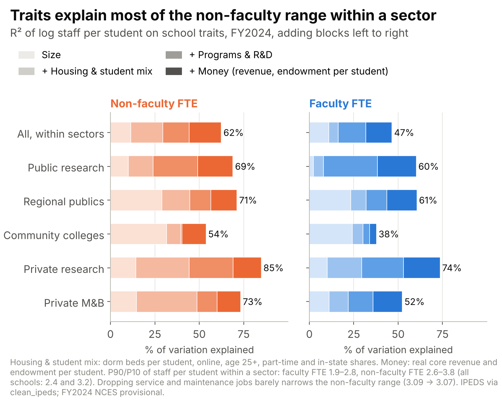
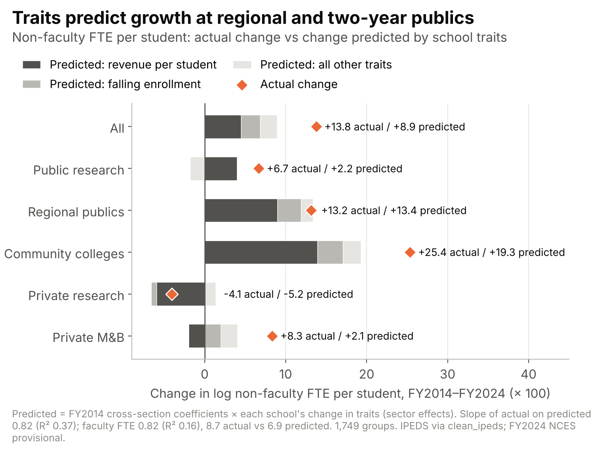
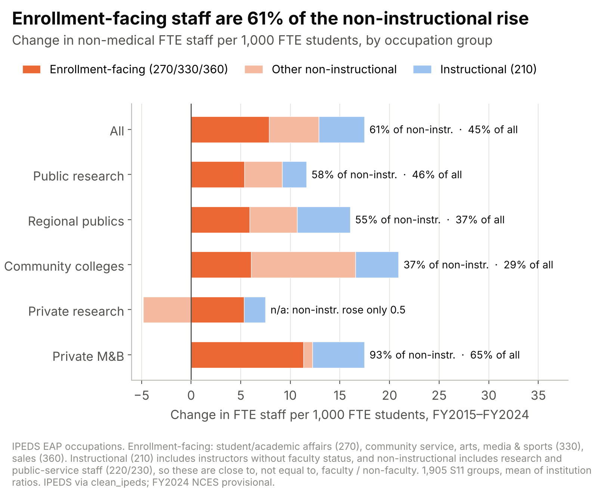
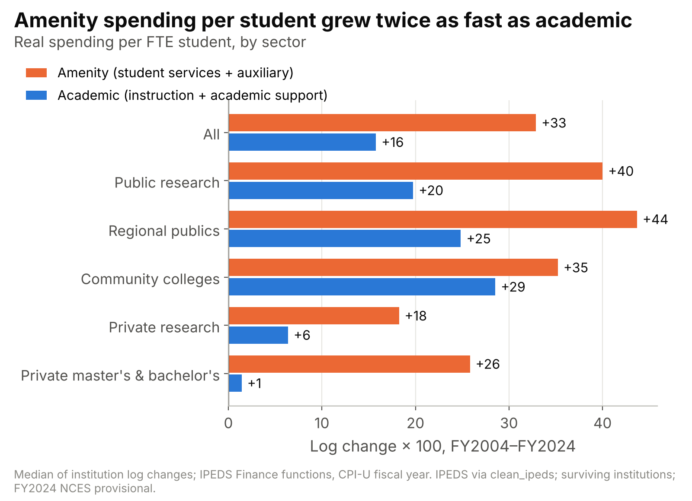
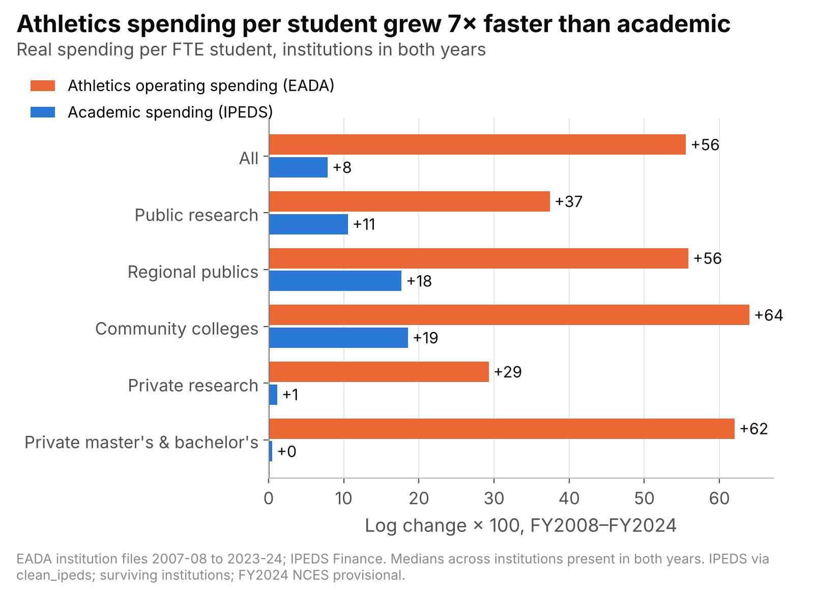





::: {.cs-preview}
Draft for review. Every figure caption links to the interactive tool that lets you explore it. FY2024–25 IPEDS data are NCES provisional.
:::

## Executive summary {#summary}

::: {.cs-preview}
This is version 2 of the paper; a [PDF version](../../../research/papers/counting_college_staff_v2.pdf) is available. It supersedes [version 1](../../../research/papers/counting_college_staff_v1.pdf) (October 12, 2026). What changed: staffing is now reported separately for faculty and non-faculty staff, in full-time equivalents, with graduate assistants excluded from faculty; §7.3 is new.
:::

Since 2012, staff per student has risen at nearly every kind of American college, reversing the public-sector decline that the Delta Cost Project documented for 2000–2012. Most of that rise comes from enrollment falling while staff did not fall as fast. Faculty adjusted to the students who left, at community colleges mostly by cutting part-time faculty; other staff did not. The part that is real hiring is mostly non-faculty, and it has gone disproportionately to jobs that recruit and serve students, including athletics. These jobs show no sign of paying for themselves in enrollment.

We rebuild the Delta Cost Project's 2014 brief, *Labor Intensive or Labor Expensive?*, from raw IPEDS files and extend it through FY2024 (fall-2023 staff; NCES provisional). Results are reported by sector, because public research universities, regional public universities, community colleges and private colleges behave very differently. They are also reported separately for faculty and for other staff, counted in full-time equivalents (full time plus one third of part time, graduate assistants excluded from faculty), because about half of faculty work part time against about one in six other staff.

- **The rebuild works.** Every sector's FY2010 and FY2012 staffing ratio is within 1 per 1,000 students of the published brief (§3).
- **The public decline reversed, for faculty and for other staff.** From FY2013 to FY2024, faculty FTE and non-faculty FTE per 1,000 FTE students rose in every public sector:
  - public research universities, faculty 73 to 83, non-faculty 146 to 159;
  - public master's universities, 54 to 62 and 86 to 98;
  - public bachelor's colleges, 59 to 67 and 93 to 111;
  - community colleges, 55 to 64 and 65 to 88.

  The FY2000–12 public decline had been mostly non-faculty. At private research universities faculty per student rose (119 to 126) and non-faculty fell (244 to 235). Full-time faculty per student rose in every sector. Professional staff grew, and nonprofessional staff shrank (§4).
- **Hiring explains little of the rise in compensation per student; falling enrollment explains most of it.** Real compensation per FTE student rose 13.2 log points over FY2013–24. Pay per FTE employee fell 0.9 points, and FTE employees per student rose 14.1: 4.5 points from faculty and 9.7 from non-faculty staff (§4).
- **The denominator fell.** Fall FTE enrollment fell 26% at community colleges and 9% at regional public universities over FY2012–24, while research universities grew. For the typical surviving institution, FTE students fell 17.4 log points over FY2013–24, faculty FTE fell 6.4 and non-faculty FTE 0.3. Faculty per student therefore rose 11.0 points and non-faculty per student 17.1. Counting only on-campus students, the rises are 28.3 and 34.4. Dual-enrollment high-school students now make up 19% of community-college FTE, which hides part of the community-college decline (§5).
- **Community colleges cut adjuncts, not other staff.** Their FTE students fell 29.3 log points over FY2013–24. Faculty FTE fell 16.6, mostly through part-time faculty (−26.7), while non-faculty FTE was flat (−0.1). Faculty per student rose 12.7 points and non-faculty per student 29.1 (§5).
- **The enrollment decline is mostly not demographic, and staffing does not drive it.** A gravity-based population instrument splits the FY2013–24 enrollment change of −17.8 log points (the 1,903 institutions the instrument covers) into three parts:
  - population, +0.5;
  - the business cycle, −3.6 at most;
  - everything else, −14.7.

  Faculty FTE respond to population-driven enrollment change with an elasticity of about 0.82, and non-faculty FTE about 0.75. Faculty respond at about 0.8 in every public sector; non-faculty staff carry the differences between sectors: 0.83 at public research universities, 0.71 at regional publics and 0.70 at community colleges. With elasticities below 1, a falling denominator mechanically raises staff per student. In the instrument sample faculty per student rose 11.0 log points, 7.1 of it the enrollment part and 3.9 growth beyond enrollment. Non-faculty per student rose 17.3, 9.6 and 7.8 (§6).
- **Growth beyond enrollment is mostly non-faculty, above all at community colleges.** Across all institutions, non-faculty growth beyond enrollment is 7.8 log points with the main estimate and up to 11.1 with alternative elasticities, against 3.3–4.7 for faculty. At community colleges faculty growth beyond enrollment is about zero (0.7) and non-faculty growth 13.7. At regional publics the two are about equal (5.4 and 5.7). Public research universities are the exception: enrollment grew, and faculty per student rose 11.9 points, all of it beyond enrollment, against 7.4 for non-faculty staff (§6).
- **What changes the staff mix is weakly identified.** Research funding, program scope and recruiting reach all go with more executive and professional staff. Following one university over time, a 10% rise in real R&D goes with 0.9% more non-faculty staff per student and 0.2% more faculty. Every one-standard-deviation within-institution change moves executive and professional staff by 3% or less. Staff per student falls with size; a U-shape appears only among research universities (and public master's universities that report R&D), near 10,000–11,000 FTE. A research-funding shift-share instrument failed. Academic medical centers hold 70% of research-university faculty FTE and 72% of its non-faculty FTE (§7).
- **Money and size explain why schools of the same type differ, and the same forces predict growth.** Within a sector, size, housing and student mix, programs and research, and money per student explain 62% of the variation in non-faculty staff per student in FY2024 and 47% for faculty. Revenue per student matters most, then enrollment; outsourcing explains almost none of the range. Of the 13.8-log-point rise in non-faculty staff per student over FY2014–24, changes in the same traits predict 8.9: 4.5 from revenue per student and 2.3 from falling enrollment (§7.3).
- **Hiring to attract students.** Enrollment-facing staff (student affairs, communications and marketing, coaches, recruiters) grew 17.8 log points over FY2015–24 while students fell 14.3. They account for 61% of the rise in non-instructional staff per student, and 45% of the rise in all staff per student. Coaches account for 18% of that growth overall and 57% at private master's and bachelor's colleges.
  - Amenity spending per student grew 33 log points over FY2004–24, against 16 for academic spending.
  - Athletics spending per student grew 56 points over FY2008–24, against 8 for academic spending, and was 31% of all amenity-spending growth.
  - Amenity spending predicts later first-time enrollment only at private master's and bachelor's colleges and in the pooled estimate, which they drive. Athletics spending predicts nothing, and academic spending predicts as well or better (§8).

None of the staffing-mix or spending results is causal. The enrollment elasticities are the only estimates with a credible instrument (§9).

## 1. Introduction {#sec-1}

The complaint that colleges hire too many administrators is old, loud and mostly argued from ratios: staff per student at a handful of institutions over a handful of years. A ratio has a numerator and a denominator. After 2012 the denominator moved more than the numerator at most of the institutions Americans actually attend.

This paper does three things.

1. It rebuilds the best-known careful study of college staffing: Desrochers and Kirshstein's 2014 Delta Cost Project brief, *Labor Intensive or Labor Expensive?* We extend every exhibit twelve years, through FY2024, on the same institutions and definitions.
2. It takes the denominator seriously. It measures how much of the post-2012 rise in staff per student is falling enrollment, and uses population shocks to estimate how staffing responds to enrollment changes institutions don't control.
3. It asks what kinds of staff were added when enrollment fell, and whether the spending that accompanied them, on student services, amenities and athletics, brought students back.

The findings differ sharply by sector, so results are reported for public research universities, regional public universities (public master's and bachelor's institutions other than flagships), community colleges and private colleges, rather than as national averages. They also differ between faculty and other staff, so the two are counted separately throughout, in full-time equivalents.

Most figures have an interactive version on the companion site, [College Staffing](../). There readers can look up any institution, state or sector. The site is a preview and not yet public.

## 2. The Delta Cost Project and the bloat debate {#sec-2}

The Delta Cost Project turned scattered federal surveys into the first consistent account of where college money goes. Its 2014 staffing brief is still the reference point for the "administrative bloat" argument.

### Where does the money go?

By the mid-2000s everyone could see tuition rising, but few could say what colleges spent their money on. The data that would answer the question sat in IPEDS surveys whose definitions changed every few years. The Delta Project on Postsecondary Education Costs, Productivity and Accountability, led by Jane Wellman, set out to reorganize those data into a consistent institution-level panel starting in 1987. Its *Trends in College Spending* reports asked where the money comes from, where it goes and what it buys ([Desrochers & Wellman 2011](https://eric.ed.gov/?id=ED539420); [DCP history](https://nces.ed.gov/ipeds/deltacostproject/download/DCP_History_Documentation.pdf)).

### From Delta to AIR to NCES

In late 2011 the project announced that it would close as an independent organization in early 2012 ([Inside Higher Ed, Nov. 28, 2011](https://insidehighered.com/node/80379)). The analysis moved to the American Institutes for Research as the [Delta Cost Project at AIR](https://air.org/project/delta-cost-project). The database went to the National Center for Education Statistics, which published it as *IPEDS Analytics: Delta Cost Project Database*. The final release covers 1987–2012 ([Desrochers & Sun 2015, NCES 2015-091](https://nces.ed.gov/Ipeds/use-the-data/delta-cost-project-finance-data)). That file is the benchmark for everything in this paper.

### The "administrative bloat" debate

The project's work landed in a loud argument.

- **The Goldwater Institute (2010).** It reported that at 198 leading universities, full-time administrators per 100 students grew 39% between 1993 and 2007, while instruction, research and service staff grew 18% ([Greene, Kisida & Mills 2010](https://goldwaterinstitute.org/article/administrative-bloat-at-american-universities-the/)).
- **Ginsberg (2011).** Benjamin Ginsberg's *The Fall of the Faculty* argued that an expanding administrative class had displaced the professoriate: "Instead of an institution serving teaching and scholarship, teaching and scholarship serve the institution" ([Inside Higher Ed](https://www.insidehighered.com/news/2011/07/14/fall-faculty)).
- Skeptics questioned whether administrative costs rose much relative to instruction at all (Hedrick, Wassell & Henson 2009). **Economists' explanations** were less dramatic:
  - Baumol and Bowen's cost disease: labor-intensive services get relatively more expensive as productivity rises elsewhere ([Archibald & Feldman 2008](https://doi.org/10.1080/00221546.2008.11772099)).
  - Howard Bowen's "revenue theory": colleges raise all the money they can and spend all they raise ([Martin 2009](https://jamesgmartin.center/?p=2196); [Hill & Martin 2012](https://ideas.repec.org/p/lsu/lsuwpp/2012-05.html)).
  - Competition for students who value amenities. Jacob, McCall and Stange find that most students value consumption amenities such as student activities, sports and dormitories, while a taste for academic quality is confined to high-achieving students ([Jacob, McCall & Stange 2018](https://doi.org/10.1086/694654)).

### What *Labor Intensive or Labor Expensive?* found

In February 2014 Donna Desrochers and Rita Kirshstein published the most careful look at staffing to that date. It covered public and private nonprofit four-year colleges and public community colleges focusing on 2000–2012 and reaching back to 1990 on many measures, grouped by 2005 Carnegie class ([Desrochers & Kirshstein 2014](https://highered.colorado.gov/sites/highered/files/2020-03/deltacostair_staffing_brief.pdf)). Its main findings:

- The public and private nonprofit higher-education workforce "grew by 28 percent" between 2000 and 2012. At public institutions new positions "largely mirrored rising enrollments," and public research universities and community colleges ended the period with fewer staff per student than in 2000.
- Private institutions added 15 to 26 workers per 1,000 FTE students.
- Growth came mainly from professional jobs (business analysts, HR, admissions, IT), not executives. At public non-research institutions professional positions "grew twice as fast as executive and managerial positions."
- Faculty and staff per administrator fell by roughly 40% from 1990, to "2.5 or fewer" at most four-year institutions.
- Average full-time faculty salaries were flat in real terms, while rising benefits offset the savings.

The brief did not call any of this bloat. AIR's own summary stressed that management jobs grew "largely in lockstep with enrollment growth" ([Desrochers 2014, AIR blog](https://www.air.org/resource/blog-post/admin-bloat-behind-high-cost-college)).

This paper asks the brief's questions again, with twelve more years of data and one change in emphasis. The brief's public-sector story was enrollment growing as fast as staff. Ours is enrollment shrinking faster than staff.

## 3. Data and measurement {#sec-3}

We rebuild the Delta brief from raw IPEDS files, reproduce its published numbers, and then carry the same definitions forward. Six choices matter for reading the results; Appendix A has the detail.

1. **The same institutions every year.** The universe is the brief's: public and private nonprofit four-year institutions and public community colleges, classified by the 2005 Carnegie class and held fixed. Trends use *surviving* institutions that report in every year compared:
   - S24: 1,909 institutions, FY1990–2025;
   - S11: 2,038, FY2000–2025;
   - F13: about 2,000 finance units, FY2013–2024.

   Mergers and multi-campus systems are combined in every year, so a merger never looks like hiring. Closed institutions drop out, which understates the enrollment decline.
2. **Two kinds of average.** The brief reports the *mean of institution ratios*: the typical institution, each weighted equally. We also report enrollment-weighted ratios (total staff ÷ total students), which describe where students actually are. The two diverge whenever large and small institutions move differently, as they did after 2012.
3. **Students are fall FTE.** Full-time plus part-time students converted to full-time equivalents with the NCES factors DCP used. FY2024 means the 2023–24 year, so staff and enrollment are fall 2023.
4. **Faculty and other staff are counted separately, in full-time equivalents.** About half of faculty work part time (49% at the typical institution in FY2024, the mean of institution shares; 60% at community colleges and 26% at public research universities), against 17% of non-faculty staff. A headcount that adds an adjunct teaching one course to a full-time employee mixes very different amounts of work, and the brief's total headcount also counts graduate assistants as part-time faculty. We therefore report faculty FTE and non-faculty FTE as a pair, with FTE = full time + one third of part time, the convention of NCES and the Delta brief (Appendix A.10). Faculty excludes graduate assistants, who are reported as their own series, and full-time and part-time faculty are also shown separately. We never add faculty and non-faculty staff into one analytical measure. Pooled headcount appears only where we reproduce the brief, and is labeled.
5. **A survey redesign in 2012.** IPEDS rebuilt its staffing categories around the Standard Occupational Classification in 2012–13 and warned of a "loss of trend data" ([NCES](https://nces.ed.gov/ipeds/report-your-data/archived-changes/2012-13)). Full-time faculty, non-faculty FTE and faculty FTE excluding graduate assistants are continuous across the redesign at the median institution. Part-time faculty and graduate assistants are not: both run about 3–4% below trend at the break in aggregate. So any measure containing them (part-time faculty, faculty headcount, the brief's total headcount) is compared within survey era: changes after 2012 are measured from FY2013, or with institution × era effects in panels. The split of non-faculty staff into executive, professional and nonprofessional breaks as before: about 9–11% more people were counted as managers and 7% more as professionals in fall 2012 than the trend implies. We never compare those categories across FY2012|FY2013. Non-faculty part-time headcount also jumps about 4% at the break. Non-faculty FTE, the sum of those categories, does not, except for a step of about 1 log point at community colleges and regional publics, all of it part-time; FY2013 is the starting year there too. Table 1 maps the categories, and Appendix Figure A1 shows the break.
6. **Money is real and comparable.** Dollars are deflated by the CPI-U fiscal-year average, exactly as DCP did. Finance measures with an IPEDS reporting change (FY2013 salary survey, FY2016 functional detail) are reported within windows that avoid the break. Hospital pay is excluded from cost measures.

FY2024 and FY2025 IPEDS files are NCES *provisional* releases; revised (final) files follow about a year later ([NCES](https://nces.ed.gov/Ipeds/use-the-data/timing-of-ipeds-data-collection)).

**Table 1. Staff categories under the two IPEDS schemes**

| Category | Through FY2012 (old scheme) | From FY2013 (SOC-based scheme) | Continuous across FY2012\|FY2013? |
| --- | --- | --- | --- |
| Full-time faculty | Full-time instruction/research/public service faculty | Occupation 200 (210 + 220 + 230), full time | Yes (median excess 0.0%) |
| Part-time faculty (excluding graduate assistants) | Part-time instruction/research/public service faculty | Occupation 200, part time | No: spliced (−2.8% against trend in aggregate). Within-era windows or institution × era effects |
| Graduate assistants | Graduate assistants (the brief counts them as part-time faculty) | Graduate assistants (400) | No: spliced (−3.6%). Shown as a separate series |
| Faculty FTE (FT + PT/3, excluding graduate assistants) | Sum | Sum | Yes at the median (−0.5%); contains spliced part-time faculty, so FY2013 starts are the main windows |
| Executive, administrative & managerial (EAM) | Executive/administrative/managerial | Management (300) | No: break at FY2012\|FY2013 |
| Other professional | "Other professionals" (support/service) | Library and student/academic affairs (261, 262, 264, 270); business and financial; computer, engineering and science; community service, legal, arts and media; healthcare (310–340) | No |
| Nonprofessional | Technical/paraprofessional, clerical, skilled crafts, service/maintenance | Library technicians (263); service, sales, office, natural resources and construction, production and transportation (350–390) | No |
| Non-faculty FTE (EAM + professional + nonprofessional, FT + PT/3) | Sum | Sum | Yes (median +0.1%); a step of about 1 log point at community colleges and regional publics |
| Non-faculty part-time headcount | Sum | Sum | No (+4.0%) |
| Total headcount (the brief's employees) | Sum, including graduate assistants | Sum, including graduate assistants | Not strictly: contains spliced part-time faculty and graduate assistants. Replication only |

*Source: IPEDS Fall Staff and Human Resources (EAP); crosswalk in `bloat/hr_crosswalk`; continuity tests in `bloat/staffing_panel/output/break_markers_split.csv` (growth FY2012→13 against the trend on either side; aggregate unless labeled median). FTE = full time + one third of part time. Delta's "faculty" (occupation 200; before 2012, instruction/research/public service) includes research (220) and public-service (230) staff and medical faculty, so it is not the instructional (210) count; we keep it for comparability with the brief. Delta's part-time faculty includes graduate assistants; we report them separately.*

**The rebuild reproduces the brief.** Every FY2010 and FY2012 staffing ratio is within 1 per 1,000 FTE students of the published value (Figure 1). The largest gap for total employees is 4.5 per 1,000, for private research universities in FY1990. Our faculty FTE and non-faculty FTE match the same measures built from the DCP database within 0.6% in FY1990, 2010 and 2012. Headline finance growth rates (tuition, salaries, E&R) for the brief's FY2002–10 window are within 0.2 percentage point a year.

{fig-alt="Figure 1" .cs-fig}

**Figure 1. Our rebuild of the brief's Appendix Table 1 against the published values.** Employees (headcount, as the brief defines them) per 1,000 FTE students, by sector and year; mean of institution ratios on the DCP 26-year matched set. *Source: Desrochers & Kirshstein (2014); IPEDS; DCP database; repository `bloat/staffing_panel/output/C_gate_appendix_tables_1_3.csv`.* Interactive version: [Sector trends → replication](../sector-trends/?view=table).

## 4. Twelve more years: staffing and spending since 2012 {#sec-4}

After 2012 staff per student rose in every public sector, for faculty and for other staff, reversing the decline the brief reported. Before 2012 that decline had been mostly non-faculty. Full-time faculty per student rose everywhere, part-time faculty rose fastest at private master's and bachelor's colleges, professional staff kept growing, and nonprofessional staff kept shrinking. Real pay stalled after 2017, so the rise in compensation per student came from more employees per student, about two-thirds of it non-faculty staff, not from higher pay.

### 4.1 The public-sector decline reversed

The brief's most-quoted public finding was a decline: public research universities and community colleges had fewer staff per student in 2012 than in 2000. Counting faculty and other staff separately shows that the decline was mostly non-faculty (Table 2). From FY2000 to FY2012, non-faculty FTE per student fell 13.2% at public research universities, 7.7% at public master's and 4.9% at public bachelor's institutions, while faculty FTE per student was nearly flat (−0.8%, −3.2% and +1.1%). Community colleges cut both (faculty −11.7%, non-faculty −11.3%).

That did not last (Figures 2 and 3, Table 2). From FY2013 to FY2024, faculty FTE and non-faculty FTE per 1,000 FTE students rose:

- 13% and 8% at public research universities;
- 14% and 14% at public master's universities;
- 14% and 20% at public bachelor's colleges;
- 15% and 36% at community colleges.

Among public sectors, public research universities are the one where faculty per student grew clearly faster than other staff. The brief's headcount measure (+7%) understates their faculty growth, partly because it includes graduate assistants (60 of its 328 per 1,000 in FY2024), whose number per student barely changed (+1%). At community colleges non-faculty staff per student grew more than twice as fast as faculty. Private master's and bachelor's institutions kept rising, as they had before 2012. At private research universities faculty per student rose 6% and non-faculty fell 4%, which the headcount shows as flat. Outside research universities, weighting by enrollment lowers the levels, because large institutions run leaner per student; at research universities it raises them. The direction is the same; the exception is private master's universities, where weighted faculty and non-faculty per student rose only 1–2%.

{fig-alt="Figure 2" .cs-fig}

**Figure 2. Faculty FTE and non-faculty FTE per 1,000 FTE students by sector, FY1988–FY2025.** S24 surviving set (1,909 institutions), mean of institution ratios; the brief's headcount measure is shown as a thin grey line for reference. Shading marks the years covered by the Delta brief. Faculty FTE and non-faculty FTE are continuous across the FY2012|FY2013 redesign at the median institution; faculty FTE, which contains spliced part-time faculty, is still drawn in two segments. Total headcount includes part-time faculty and graduate assistants, which are spliced at the redesign, and is shown for comparison with the 2014 brief. *Source: IPEDS; repository `bloat/exhibits/output/A_split_per1000_annual_S24.csv`.* Interactive version: [Sector trends](../sector-trends/).

{fig-alt="Figure 3" .cs-fig}

**Figure 3. Change in faculty FTE and non-faculty FTE per 1,000 FTE students, FY2000–2012 vs FY2013–2024.** Mean of institution ratios, S24; grey tick = the brief's headcount measure. *Source: `bloat/exhibits/output/B_split_reversal_S24.csv`.* Interactive version: [Sector trends](../sector-trends/).

**Table 2. Faculty FTE and non-faculty FTE per 1,000 FTE students**

| Sector | Faculty FTE, FY2013 → FY2024 | Non-faculty FTE, FY2013 → FY2024 | % change FY2000→12, faculty / non-faculty | % change FY2013→24, faculty / non-faculty | Weighted % change FY2013→24, faculty / non-faculty | Headcount (brief), FY2013 → FY2024 |
| --- | --- | --- | --- | --- | --- | --- |
| Public research | 73 → 83 | 146 → 159 | −0.8 / −13.2 | +13.2 / +8.4 | +12.7 / +10.3 | 307 → 328 |
| Public master's | 54 → 62 | 86 → 98 | −3.2 / −7.7 | +14.2 / +14.0 | +11.4 / +13.0 | 179 → 203 |
| Public bachelor's | 59 → 67 | 93 → 111 | +1.1 / −4.9 | +13.5 / +19.6 | +8.6 / +15.7 | 188 → 218 |
| Community colleges | 55 → 64 | 65 → 88 | −11.7 / −11.3 | +15.3 / +35.7 | +10.5 / +29.9 | 185 → 221 |
| Private research | 119 → 126 | 244 → 235 | +18.9 / −2.6 | +6.4 / −3.6 | +9.1 / +1.7 | 469 → 471 |
| Private master's | 74 → 82 | 107 → 117 | +11.1 / −2.0 | +12.0 / +9.4 | +1.2 / +2.4 | 245 → 274 |
| Private bachelor's | 82 → 89 | 144 → 163 | +5.3 / +1.1 | +9.4 / +12.8 | +7.3 / +7.7 | 277 → 314 |

*Mean of institution ratios unless labeled weighted (total staff ÷ total FTE). FTE = full time + one third of part time; faculty excludes graduate assistants. Headcount = the brief's total employees, including graduate assistants, shown for comparison. Changes that include part-time faculty start in FY2013, after the 2012 survey redesign. S24 surviving set. FY2024 = fall 2023, NCES provisional. Source: `bloat/exhibits/output/B_split_reversal_S24.csv`. Interactive version: [Sector trends, table view](../sector-trends/?view=table).*

### 4.2 More full-time faculty per student, and more part-time faculty

The brief found full-time faculty hiring that "equaled or lagged" enrollment. Since 2012, full-time faculty per student rose in every sector (Figure 4). From FY2013 to FY2024:

- public research universities, 66 to 74 per 1,000;
- community colleges, 32 to 40;
- private research universities, 102 to 107.

Part-time faculty (excluding graduate assistants) per student rose in every sector too, by 3 to 13 per 1,000, against 3 to 9 for full-time faculty. Faculty FTE rose by 8 to 10 per 1,000 everywhere.

The two sectors where the full-time/part-time mix changed most moved in opposite directions.

- **Private master's and bachelor's colleges substituted part-time for full-time faculty.** Part-time faculty per 1,000 students rose by 13 at both, against 5 and 3 for full-time. In numbers, these colleges cut full-time faculty by 6.8 log points over FY2013–24 and added 8.2 points of part-time faculty, while their enrollment fell 12.1. The part-time share of sector-average faculty at private bachelor's colleges rose from 0.40 to 0.45.
- **Community colleges cut part-time faculty.** They cut part-time faculty by 26.7 log points and full-time by 8.5, and the part-time share of sector-average faculty fell from 0.68 to 0.64.

Weighted by enrollment, part-time faculty per student barely changed (−0.7 log points), because large institutions cut adjuncts while small ones added them.

Before 2012, the brief's part-time faculty count grew mostly through graduate assistants at research universities. At public research universities, 9.2 of the 11.9 per 1,000 added over FY2000–12 were graduate assistants.

Section 6 shows that at most public institutions the faculty rise is less a hiring wave than faculty staying as students left.

{fig-alt="Figure 4" .cs-fig}

**Figure 4. Full-time and part-time faculty (excluding graduate assistants, headcounts) per 1,000 FTE students, by sector.** Mean of institution ratios, S24. Part-time faculty are spliced at the FY2012|FY2013 survey redesign and drawn separately in each era. *Source: `bloat/exhibits/output/A_split_per1000_annual_S24.csv`; changes in `C_split_fig4_faculty_change.csv`.* Interactive versions: [Sector trends → FT faculty](../sector-trends/?m=ftfac) and [PT faculty](../sector-trends/?m=ptfacx).

### 4.3 Professional staff kept growing; nonprofessional staff kept shrinking

Within each HR era the brief's composition story continued (Figure 5). Counting staff in FTE, from FY2013 to FY2024 professional staff per 1,000 students rose in every sector:

- public research, 70 to 86;
- community colleges, 23 to 37;
- private bachelor's colleges, 50 to 76.

Nonprofessional staff fell almost everywhere, most sharply at private research universities (98 to 75). EAM rose by 1 to 6 per 1,000, from a much smaller base. Headcounts give the same signs.

The brief's Figure 5b, other faculty and staff per executive or professional employee, kept falling: from 2.0 to 1.6 at public research universities and from 3.1 to 2.2 at community colleges. But that numerator mixes faculty, graduate assistants and nonprofessional staff, and about half of its decline is nonprofessional staff shrinking. Counting faculty alone, faculty FTE per FTE executive or professional employee fell from 0.96 to 0.86 at public research universities and from 1.99 to 1.41 at community colleges, and it fell in every sector in both eras (Figure 6). Nonprofessional staff per executive or professional employee fell proportionally more: from 0.78 to 0.54 and from 1.11 to 0.75.

{fig-alt="Figure 5" .cs-fig}

**Figure 5. Professional and nonprofessional FTE per 1,000 FTE students, FY1990–FY2025, drawn separately in each HR era.** Mean of institution ratios, S24. *Source: `bloat/exhibits/output/A_split_per1000_annual_S24.csv`; changes in `D_split_fig5_prof_nonprof_S24.csv`.* Interactive version: [Sector trends → professional](../sector-trends/?m=prof).

{fig-alt="Figure 6" .cs-fig}

**Figure 6. Faculty FTE and nonprofessional FTE per FTE executive + professional employee, FY1990–2012 and FY2013–2024.** Companions to the brief's Figure 5b, whose numerator adds faculty, graduate assistants and nonprofessional staff. Levels are not comparable across eras, only slopes. *Source: `bloat/exhibits/output/E_split_fig5b_per_admin_S24.csv`.* Related interactive view (EAM + professional per 1,000 students; the ratios themselves are not on the site): [Sector trends → EAM + professional](../sector-trends/?m=eamprof).

### 4.4 The money stalled after 2017

The finance side split into two periods (Figure 7).

- **FY2013–17.** Real sticker tuition grew 2.0–2.5% a year. Real full-time faculty salaries grew 0.2–0.9%. Education and related spending (E&R) per student grew 1.5–3.6%.
- **FY2017–24, as inflation surged.** Real tuition fell 0.2–1.3% a year in every sector. Real faculty salaries fell 1.0–1.9% a year. E&R per student was roughly flat (−0.9 to +1.0%).

Student-services salaries per employee still outgrew the average salary in every sector, as the brief found for 2002–10.

{fig-alt="Figure 7" .cs-fig}

**Figure 7. Real average annual growth of sticker tuition, FT faculty salary, E&R per student and compensation per student, by sector and window.** CAGR of the sector mean of real institution values (the brief's formula); CPI-U fiscal year. FY2002–10 uses DCP inputs; FY2013+ uses finance set F13. *Source: `bloat/exhibits/output/Fig6_Fig8_AppTable4_finance_growth.csv`.* Interactive version: [Sector trends → finance](../sector-trends/?fm=ft_faculty_avg_salary).

### 4.5 Where staffing sits in total cost

Compensation is about 60% of education and general (E&G) spending, so staffing ratios and costs move together. They are not the same thing. Real compensation per FTE student splits exactly into pay per FTE employee plus FTE employees per student. FTE employees here are full time plus one third of part time, excluding graduate assistants, faculty and non-faculty together:

$$
\Delta \ln\frac{\text{Comp}}{\text{FTE students}} = \Delta \ln\frac{\text{Comp}}{\text{FTE employees}} + \Delta \ln\frac{\text{FTE employees}}{\text{FTE students}}
$$

The employee term then splits into faculty (F) and non-faculty (N) contributions, each weighted by its average share of FTE employees, s̄:

$$
\Delta \ln\frac{L}{E} \approx \bar s_F\,\Delta \ln\frac{F}{E} + (1-\bar s_F)\,\Delta \ln\frac{N}{E}
$$

Over FY2013–24, real compensation per student rose 13.2 log points at the typical institution in the finance set. Pay per FTE employee contributed −0.9 and FTE employees per student +14.1 (Figure 8). Of the 14.1, faculty contributed 4.5 and non-faculty staff 9.7: faculty FTE per student rose 11.0 and non-faculty FTE per student 16.9 (17.1 in §5, which uses the larger staffing set).

- **Public institutions:** +20.1 = +2.1 pay + 18.0 employees per student, of which 5.2 is faculty and 12.8 non-faculty.
- **Private institutions:** +3.5 = −5.1 pay + 8.6 employees per student (faculty 3.5, non-faculty 5.2).
- **Community colleges:** the largest rise, +24.6, almost all from employees per student (+21.4), three-quarters of it non-faculty (faculty 5.5, non-faculty 15.9).

The part-time weight barely matters. With weights of 1/4 and 1/2, pay per FTE employee changes by −1.3 and −0.3 points rather than −0.9 (Appendix B).

Compensation rose from 61.2% to 63.0% of E&G spending. Its share rose 4.3 points at publics and fell 1.6 points at privates, and over FY2017–24 it fell in both. Instruction's share of E&G fell about 4 points in every sector. Institutional support (+2.3 points public, +1.4 private) and student services (+1.8 and +3.4) rose.

{fig-alt="Figure 8" .cs-fig}

**Figure 8. Change in real compensation per FTE student, FY2013–2024, split into pay per FTE employee and the faculty and non-faculty contributions of FTE employees per student.** FTE employees exclude graduate assistants. Mean of institution log changes, finance set F13f (1,985 units). *Source: `bloat/cost_share/output/T3_split_decomposition_fy2013_2024.csv`.* Interactive version: [Institution explorer → spending](../institution-explorer/?f=ins).

*Two caveats.* The cost measures remove hospital, auxiliary and independent-operation pay, so medical centers do not swamp research universities. Including them would put the aggregate compensation-share change at +8.2 points rather than +3.0. IPEDS also changed how operations-and-maintenance salaries are reported in FY2016, and no correction is break-free. For publics the compensation-share change is +4.3 points with that line stripped and +1.7 points with it kept; we report the bracket.

## 5. The denominator {#sec-5}

At the typical surviving institution, FTE students fell 17.4 log points over FY2013–24. Faculty FTE fell 6.4 points and non-faculty FTE 0.3, so faculty per student rose 11.0 points and non-faculty per student 17.1: almost all of the rise is students leaving. Enrollment fell hardest at community colleges and regional publics, grew at research universities, and fell even more on campus than the totals show.

### 5.1 Where the students went

Every sector grew through the 2000s. After 2012 the paths split (Figure 9). From FY2012 to FY2024, fall FTE enrollment:

- grew at public research (+7%) and private research universities (+10%);
- held roughly flat at private master's institutions (+4%);
- fell at public master's (−9%), public bachelor's (−9%) and private bachelor's institutions (−5%);
- fell 26% at community colleges.

State flagships pulled away from everyone else (Figure 10). Flagship enrollment went from 126 to 140 (FY1990 = 100) between FY2012 and FY2024. Regional publics fell from 139 to 126, and small private colleges from 132 to 122.

{fig-alt="Figure 9" .cs-fig}

**Figure 9. Total fall FTE students by sector, FY1990 = 100.** S24 surviving set. *Source: `bloat/substack/output/E1a_fte_index_annual_S24.csv`.* Interactive version: [Enrollment](../enrollment/?g=sector&base=1990).

{fig-alt="Figure 10" .cs-fig}

**Figure 10. Total fall FTE students for flagships, regional public universities and small private colleges, FY1990 = 100.** Flagships: each state's flagship campus with its branches (42 states; 8 states whose flagship reports inside a multi-university system are excluded). Regional publics: other public master's and bachelor's. Small privates: private bachelor's under 2,000 FTE in FY2012. *Source: `bloat/substack/output/E5_peer_groups_annual_S24.csv`.* Interactive version: [Enrollment → peer groups](../enrollment/?g=peer&base=1990).

The decline was geographically uneven and widespread within sectors (Figures 11 and 12).

- **The map.** Public four-year enrollment rose 15% or more in Utah, Texas, Arizona, Nevada, California and South Carolina. It fell across the Midwest and Northeast. Community colleges shrank almost everywhere.
- **How many shrank.** Among surviving institutions, enrollment fell at:
  - 90% of community colleges;
  - 72% of public master's universities;
  - 76% of public bachelor's colleges;
  - 63% of private bachelor's colleges.

{fig-alt="Figure 11" .cs-fig}

**Figure 11. Percent change in total fall FTE, FY2012–FY2024, by state: public four-year institutions and community colleges.** S24 surviving set. *Source: `bloat/substack/output/E2_enrollment_by_state_S24.csv`.* Interactive version: [State explorer](../state-explorer/?map=pct_2012_2024).

{fig-alt="Figure 12" .cs-fig}

**Figure 12. Share of surviving institutions whose fall FTE fell between FY2012 and FY2024, by sector.** S11 surviving set. *Source: `bloat/substack/output/E4_growth_distribution_S11.csv`.* Interactive version: [Enrollment](../enrollment/?by=rosefell).

### 5.2 Splitting the change into staff and students

Because staff per student is a ratio, its change in logs splits exactly into two parts. For staff S and FTE students E between years a and b:

$$
\Delta \ln(S/E) = \Delta \ln S - \Delta \ln E
$$

Log changes × 100 are close to percent changes for small moves and add up exactly. Table 3 applies this to FY2013–24 on the 2,038 S11 institutions, separately for faculty FTE and non-faculty FTE. The columns average institution log changes.

**Table 3. Change in faculty FTE and non-faculty FTE per FTE student = staff change − enrollment change, FY2013→FY2024 (log points × 100)**

| Group | FTE students | Faculty FTE | Non-faculty FTE | Faculty FTE per student | Non-faculty FTE per student | Faculty FTE per on-campus student | Non-faculty FTE per on-campus student | Headcount per student (version 1) |
| --- | --- | --- | --- | --- | --- | --- | --- | --- |
| All | −17.4 | −6.4 | −0.3 | +11.0 | +17.1 | +28.3 | +34.4 | +12.6 |
| Public research | +0.9 | +12.2 | +8.2 | +11.3 | +7.3 | +19.6 | +15.6 | +6.2 |
| Public master's | −16.0 | −3.7 | −2.7 | +12.3 | +13.3 | +28.2 | +29.3 | +12.0 |
| Public bachelor's | −14.6 | −2.9 | +3.3 | +11.7 | +17.9 | +29.1 | +35.3 | +14.2 |
| Community colleges | −29.3 | −16.6 | −0.1 | +12.7 | +29.1 | +37.0 | +53.5 | +16.2 |
| Private research | +4.1 | +8.4 | +0.4 | +4.3 | −3.7 | +16.8 | +8.8 | +0.9 |
| Private master's | −13.4 | −2.8 | −5.3 | +10.5 | +8.0 | +27.4 | +24.9 | +10.5 |
| Private bachelor's | −11.2 | −2.3 | +0.2 | +8.8 | +11.3 | +18.6 | +20.9 | +12.5 |
| Enrollment fell | −31.4 | −16.5 | −6.8 | +14.9 | +24.6 | +33.0 | +42.7 | +17.6 |
| Enrollment rose | +19.0 | +19.9 | +16.5 | +0.9 | −2.4 | +16.1 | +12.8 | −0.5 |

*Unweighted means of institution log changes; S11 surviving set (2,038; 2,037 for the on-campus columns). FTE = full time + one third of part time; faculty excludes graduate assistants. Both FTE measures are within the post-2012 survey era. Headcount = the brief's total employees, version 1's measure, shown for comparison. On-campus FTE excludes exclusively-online students. Source: `bloat/online/output/D2_split_headline.csv` (versions B and C); version-1 column `bloat/online/output/D2_decomposition_headline.csv`. Interactive version: [Enrollment → decomposition](../enrollment/?by=sector&v=b).*

The rows tell two stories.

- **Community colleges and regional publics:** staff per student rose because students left. At community colleges faculty fell with the students, mostly through part-time faculty, while non-faculty staff were flat, so non-faculty per student rose more than twice as fast as faculty per student.
- **Research universities:** enrollment grew and staff grew faster. At public research universities faculty grew faster than other staff (12.2 against 8.2). At private research universities faculty grew and non-faculty staff per student fell, which the headcount (+0.9) hid.

Institutions whose enrollment rose saw essentially no change in staff per student. Weighting by enrollment gives 12.7 for faculty and 15.6 for non-faculty (version 1's headcount: 11.8), and the weighted staff counts *rose*, 6.7 points for faculty and 9.5 for non-faculty, because the institutions that grew were large.

The part-time weight matters only where the faculty mix changed. At community colleges faculty per student rises 10.9 at a weight of 1/2 and 13.9 at 1/4, and non-faculty (29.1) outgrows faculty at any weight. At private master's and bachelor's colleges faculty (8.7–10.9) and non-faculty staff (10.0) grow about equally at any weight.

The composition shift is real hiring, even where the total is not. By FY2013–24 headcounts, professional staff grew 21.9 log points at the typical institution and nonprofessional staff fell 27.3, even as students left.

### 5.3 Online students change the per-student picture

Exclusively-online students rose from 7.9% of fall headcount in fall 2012 to 21.1% in fall 2023 at the typical institution. Fully online programs went from 8.0% to 20.8% of programs. These students count in FTE but use few campus services. Counting only on-campus FTE, faculty per student rose 28.3 log points rather than 11.0, and non-faculty per student 34.4 rather than 17.1 (Figure 13). On-campus FTE fell 34.7 points; online growth replaced about half of the on-campus loss.

{fig-alt="Figure 13" .cs-fig}

**Figure 13. Change in faculty FTE and non-faculty FTE per FTE student, FY2013–2024, per total and per on-campus FTE.** Mean of institution log changes, S11; tick = the brief's headcount measure. *Source: `bloat/online/output/D2_split_headline.csv`; IPEDS distance education.* Interactive version: [Enrollment → online](../enrollment/?by=online&v=c).

### 5.4 Dual enrollment hides part of the community-college decline

IPEDS has no dual-enrollment item, so we proxy it with undergraduates under 18. Their share of community-college FTE rose from 7.6% in fall 2013 to 18.9% in fall 2023 (Figure 14). That is consistent with [CCRC's estimate](https://ccrc.tc.columbia.edu/easyblog/how-many-students-are-taking-dual-enrollment-courses-in-high-school-new-national-state-and-college-level-data.html) that dual-enrollment students were 21% of community-college enrollment in 2022–23.

- **Community colleges.** Excluding them, FTE fell 40.9 log points over FY2014–24 rather than 26.9. Faculty FTE per regular student rose 23.9 rather than 9.9 (25.2 or 22.0 at part-time weights of 1/4 or 1/2), and non-faculty FTE per regular student 39.5 rather than 25.5.
- **Regional publics.** The effect is smaller: −17.9 rather than −14.7.
- **Four-year publics.** States where dual enrollment grew fastest show no extra decline at four-year publics.

{fig-alt="Figure 14" .cs-fig}

**Figure 14. Under-18 undergraduates as a share of fall FTE, by sector.** Mean across institutions; odd falls, when age detail is mandatory. *Source: `bloat/causal/output/e_dual_by_sector.csv`.* Interactive version: [Enrollment → dual enrollment](../enrollment/?by=sector) and [State explorer → dual enrollment](../state-explorer/?map=dual_2023).

## 6. Enrollment shifts institutions don't control {#sec-6}

When enrollment moves for reasons outside an institution's control, staff follow only part of the way. The elasticity is 0.82 for faculty FTE and 0.75 for non-faculty FTE. Faculty respond at about 0.8 in every public sector; non-faculty staff carry the differences between sectors: 0.83 at public research universities, 0.71 at regional publics and 0.70 at community colleges. The post-2013 enrollment decline was not demographic. Most of it is unexplained by population or the business cycle. With elasticities below 1, that decline mechanically raised staff per student. Growth beyond what enrollment predicts is mostly non-faculty, above all at community colleges; at research universities faculty grew more.

### 6.1 A population instrument

Enrollment and staffing are chosen together, so a raw correlation can't say how staffing responds to students. We need enrollment changes that institutions don't cause. We use changes in the number of college-age people in the places an institution historically draws from.

For each institution, a gravity model of freshman origins gives the share of its base-period (falls 1986–88) entering class expected from each county c, s\_ci. The model accounts for distance, state borders and competition from nearby institutions of the same type. We age each county's 10-year-olds forward eight years, so the shock reflects children already born and living there, not current migration toward growing colleges. The instrument is the predicted proportional change in the institution's catchment population:

$$
Z_{it} = \ln\Big( (1-f_i) \sum_c s_{ci}\, \frac{\tilde P_{ct}}{\tilde P_{cb}} + f_i \Big), \qquad \tilde P_{ct} = \text{age-10 population of county } c \text{ in year } t-8
$$

Here f\_i is the share of freshmen from abroad or unknown origin, held constant. Multi-campus groups combine their campus instruments through predicted enrollment. We then estimate:

$$
\ln E_{it} = \pi Z_{it} + \alpha_i + \delta_{s(i)t} + u_{it}, \qquad \ln S_{it} = \beta \ln E_{it} + \alpha'_i + \delta'_{s(i)t} + \varepsilon_{it}
$$

E is fall FTE, S is staff (faculty FTE or non-faculty FTE), α are institution effects and δ are sector × year effects. β, estimated by two-stage least squares, is the elasticity of staff to enrollment. For faculty FTE we also report a version with separate institution effects before and after the 2012 survey redesign, because part-time faculty are spliced there. Standard errors are clustered by state. The design follows the shift-share literature ([Goldsmith-Pinkham, Sorkin & Swift 2020](https://doi.org/10.1257/aer.20181047); [Borusyak, Hull & Jaravel 2022](https://doi.org/10.1093/restud/rdab030)). It uses SEER county population by single year of age ([SEER](https://seer.cancer.gov/popdata/)) and Autor–Dorn commuting zones ([Autor & Dorn 2013](https://doi.org/10.1257/aer.103.5.1553)). Appendix A gives the gravity model.

The first stage is strong: F = 137 with state-clustered errors, and about 100 even with state × year effects that absorb state budgets and policy. Simpler instruments built from state-level shares lose all power once state × year effects are added (F < 1). The gravity version does not.

**Table 4. Elasticity of staff to enrollment, by staff measure, FY1988–2024**

| Specification | First-stage F | Faculty FTE | Faculty FTE, institution × era | Non-faculty FTE | All FTE excl. graduate assistants | Headcount (version 1) |
| --- | --- | --- | --- | --- | --- | --- |
| Fixed effects, no instrument | – | 0.68 (0.01) | 0.61 (0.02) | 0.58 (0.02) | 0.62 (0.01) | 0.67 (0.02) |
| Gravity instrument, base 1987 (main) | 137 (55) | 0.82 (0.07) | 0.85 (0.10) | 0.75 (0.10) | 0.77 (0.07) | 0.72 (0.10) |
| … plus state × year effects | 97 (27) | 0.80 (0.06) | 0.79 (0.08) | 0.79 (0.08) | 0.77 (0.05) | 0.76 (0.07) |
| … base 2002 | 36 (12) | 0.67 (0.08) | 0.59 (0.13) | 0.70 (0.12) | 0.67 (0.08) | 0.73 (0.10) |
| … births 18 years earlier instead of age 10 | 124 (64) | 0.82 (0.08) | 0.89 (0.11) | 0.75 (0.10) | 0.77 (0.08) | 0.69 (0.12) |
| … excluding the institution's own commuting zone | 84 (41) | 0.84 (0.08) | 0.90 (0.10) | 0.64 (0.11) | 0.72 (0.08) | 0.66 (0.12) |
| Earlier blended 60-mile instrument (item 11b) | 58 (45) | 0.81 (0.11) | 0.77 (0.14) | 0.81 (0.09) | 0.79 (0.09) | 0.72 (0.11) |

*2SLS; institution (or institution × HR-era) and sector × year effects; unweighted; SEs clustered by state; about 50,000 institution-years. FTE = full time + one third of part time; faculty excludes graduate assistants. First-stage F for the institution × era column in parentheses. The all-FTE column adds faculty and non-faculty and is shown only for comparison, as is version 1's headcount. Source: `bloat/causal/output/m_split_elasticities.csv`; version-1 column `c_first_stage.csv`, `c_panel_iv.csv`. Interactive version: [Population shocks](../population-shocks/).*

Faculty and non-faculty FTE both respond more than version 1's pooled headcount (0.72). The headcount counted part-time faculty at full weight and included graduate assistants, whose response is unstable (−0.66 with the 1987 base, +0.46 with the 2002 base) and pulled the pooled number down. Part-time weights of 1/4 and 1/2 move the faculty elasticity by at most 0.02.

### 6.2 Staffing responds differently by sector

Pooled, faculty FTE rise about 0.82% and non-faculty FTE about 0.75% for each 1% of enrollment. The sector estimates differ in a way that matters for the bloat debate (Figure 15).

- **Faculty respond at about 0.8 in every public sector:** 0.82 at public research universities, 0.79 at regional publics and 0.82 at community colleges. With institution × era effects the spread is wider (0.75, 0.65 and 0.92), but no public sector stands out. Full-time faculty alone come in at 0.80, 0.81 and 0.92; version 1 of this paper labeled these "faculty". The part-time share of faculty does not respond to enrollment in any public sector.
- **Non-faculty staff carry the sector differences:** 0.83 at public research universities, 0.71 at regional publics and 0.70 at community colleges.
- **Public research universities** scale both kinds of staff almost proportionally. Executive and professional FTE scale at 0.84.
- **Regional public universities:** executive and professional FTE do not track enrollment (0.43, CI 0.11–0.74).
- **Community colleges:** nonprofessional FTE track enrollment (0.88). The faculty response is about the same at part-time weights of 1/4 and 1/2 (0.84 and 0.79).

An earlier version of this analysis reported "sticky" executive and professional staff nationwide. That result does not survive the better instrument, on headcount or on FTE: the pooled executive + professional FTE elasticity is 0.31 (SE 0.39) with the 1987 base and 0.71 (0.13) with the 2002 base. Sticky administrative staff is a regional-public pattern, not a national one. Private-sector first stages are too weak (F of 11–14) to report.

{fig-alt="Figure 15" .cs-fig}

**Figure 15. Elasticity of faculty FTE and non-faculty FTE to population-driven enrollment change, by public sector, with 95% intervals.** 2SLS, gravity instrument (base 1987); version 1's headcount estimate in grey. *Source: `bloat/causal/output/m_split_sector_elasticities.csv`.* Interactive version: [Population shocks → elasticities](../population-shocks/).

### 6.3 The post-2013 decline was not demographic

The FY2013–24 change in log enrollment splits into three parts:

- the change predicted by the population instrument;
- a business-cycle term, sector-specific responses to national unemployment;
- a residual.

$$
\Delta \ln E_i = \underbrace{\hat\pi\,\Delta Z_i}_{\text{population}} + \underbrace{\hat\gamma_{s(i)}\,\Delta u}_{\text{cycle}} + \underbrace{\Delta \ln E_i - \hat\pi\Delta Z_i - \hat\gamma_{s(i)}\Delta u}_{\text{everything else}}
$$

For the typical surviving institution, enrollment fell 17.8 log points (Figure 16):

- **Population added 0.5.** The demographic "cliff" is mostly still ahead ([Grawe 2018](https://www.press.jhu.edu/books/authors/nathan-d-grawe)).
- **The cycle subtracted at most 3.6.** Unemployment fell from 8.1% to 3.7%, and college enrollment is countercyclical. This is an upper bound, because Pell and GI Bill changes moved with the cycle.
- **Everything else subtracted 14.7.**

At community colleges the split is −30.1 = +0.5 − 7.0 − 23.7. Public research universities grew. Online growth replaced about half of the fall in on-campus FTE: 16.8 of 34.6 points.

{fig-alt="Figure 16" .cs-fig}

**Figure 16. FY2013–2024 change in fall FTE split into population, business cycle and everything else, by sector.** Mean of institution log changes, 1,903 S11 groups with the instrument. *Source: `bloat/causal/output/c_decomposition.csv`.* Interactive version: [Population shocks → decomposition](../population-shocks/?sector=all).

### 6.4 Why staff per student rose

With the elasticities in hand, the rise in staff per student splits into two parts, separately for faculty and for non-faculty staff:

- the enrollment decline meeting an elasticity below 1;
- staff growth beyond what enrollment predicts.

$$
\Delta \ln\frac{S}{E} = \underbrace{(\beta_p - 1)\,\Delta \ln E^{\text{pop}} + (\beta_o - 1)\,\Delta \ln E^{\text{other}}}_{\text{enrollment part}} + \underbrace{\eta}_{\text{beyond enrollment}}
$$

β\_p is the response to population-driven change and β\_o the response to other change, estimated for each staff measure with a control function. For faculty FTE they are 0.65 and 0.60; for non-faculty FTE, 0.65 and 0.47. Neither difference is significant (the bootstrap SE on β\_p is 0.10–0.12), and for faculty the ordering reverses with state × year effects (0.54 against 0.59).

In the instrument sample (Figure 17):

- faculty FTE per student rose 11.0 log points: 7.1 is the enrollment part and 3.9 growth beyond enrollment;
- non-faculty FTE per student rose 17.3: 9.6 is the enrollment part and 7.8 growth beyond enrollment.

Growth beyond enrollment is twice as large for non-faculty staff, and 7.8 is the low end. With a fixed-effects elasticity estimated on the same FY2006–24 panel (0.48, not Table 4's 0.58) it is 8.0, and with the instrumented elasticity 11.1. For faculty the alternatives give 3.3–4.7 (Appendix B; the fixed-effects one uses 0.60 from the same panel, not 0.68).

- **Community colleges:** faculty per student rose 12.7, of which 12.0 is the enrollment part and 0.7 growth beyond enrollment (−0.3 with institution × era effects). Faculty adjusted to enrollment, largely by cutting adjuncts: full-time faculty alone grew 5.0 beyond enrollment. Non-faculty per student rose 29.8, of which 13.7 is beyond enrollment (11.1 to 19.2 across the alternatives).
- **Regional publics:** faculty 12.1 = 6.6 + 5.4; non-faculty 14.6 = 8.9 + 5.7.
- **Public research universities:** faculty per student rose 11.9 and non-faculty per student 7.4. Enrollment grew, so growth beyond enrollment is slightly larger than the rise: 12.3 for faculty and 7.7 for non-faculty staff. This is the one public sector where faculty grew more than other staff beyond enrollment.
- **Private master's and bachelor's colleges:** faculty 9.4 = 4.8 + 4.6, but behind that is substitution. Full-time faculty grew 0.9 points less than enrollment predicts, and part-time faculty 35.1 points more. Non-faculty staff: 10.2 = 6.5 + 3.7.

So the national gap between non-faculty and faculty growth beyond enrollment comes mainly from community colleges, the largest group of institutions. At regional publics the two are about equal, and at research universities, public and private, faculty grew more beyond enrollment than other staff.

The sector rows apply the pooled elasticities to each sector's enrollment change, as version 1 did, and are approximate. Sector-specific fixed-effects and instrumented elasticities, used where the sector first stage allows (F ≥ 10), give the ranges in Appendix B.

{fig-alt="Figure 17" .cs-fig}

**Figure 17. FY2013–2024 change in faculty FTE and non-faculty FTE per student split into the enrollment part and growth beyond enrollment, all institutions and by sector.** Control-function elasticities estimated for each measure, pooled, applied to each sector's enrollment change; 1,903 S11 groups, unweighted. *Source: `bloat/causal/output/m_split_staff_split.csv`, `m_split_staff_response.csv`.* Interactive version: [Population shocks → staff per student](../population-shocks/?dm=pair).

**No sign that staffing drives enrollment.** If institutions hired to attract students, and hiring worked, the plain fixed-effects elasticity would exceed the instrumented one, because staffing would raise enrollment as well as respond to it. It does not: fixed effects give 0.68 for faculty FTE and 0.58 for non-faculty FTE, the instrument 0.82 and 0.75. The comparison rests mainly on non-faculty staff and the 1987 base. With the 2002 base, faculty FTE give 0.68 with fixed effects against 0.67 instrumented, while non-faculty FTE still give 0.58 against 0.70. Staff per student rises even under enrollment changes institutions don't control. Section 8 tests the hiring-to-attract channel directly.

> **Box: The online-provider hypothesis, tested and not supported.** A natural explanation for the unexplained decline is competition from national online providers: 51 institutions that enroll at least 3,000 fully online students, mostly out of state, and whose online headcount was flat from 2012 to 2019 and then rose, ending 35% above its 2012 level by 2024. If they drew students away, local and non-traditional campuses in states where they recruited heavily should have lost more. They did not. Exposure × non-traditional profile and exposure × local draw are near zero or positive at public institutions and private master's and bachelor's colleges, with or without state × year effects (only private research universities show a negative interaction), and a placebo period is flat. Community colleges in high-exposure states did lose more (about 7 log points), but not their local or non-traditional members. Other measured drivers, sticker and net price, competitor mass and own online growth, each explain a few points. About 20 points at regional publics and 27 at community colleges remain unexplained. Interactive version: [Population shocks](../population-shocks/).

## 7. What changes the staff mix {#sec-7}

Research funding, program scope and a national recruiting reach all go with more executive and professional staff per student across institutions. Within an institution over time the associations are a third to two-thirds as large, and none tilts the mix toward administration. Research funding moves non-faculty staff, not faculty. Within a sector, money per student and size explain most of why some schools carry far more staff than others. These are associations: the one instrument we tried for research funding failed.

### 7.1 Research, programs and competition

We tested three explanations for administrative growth:

- **research funding**, through compliance and grant administration;
- **program scope**, more majors to coordinate;
- **competition for students**, through recruiting and student services.

Each is estimated two ways: comparing institutions in the same sector and year, and following one institution over time with institution × HR-era and year effects. The gap between the two answers is the main lesson (Figure 18, Table 5).

**Table 5. Staff per 1,000 FTE students: across vs within institutions**

| Driver (sample) | EAM + professional FTE: across institutions | EAM + professional FTE: within institutions | EAM + professional FTE: one within-SD change | Faculty FTE: within | Non-faculty FTE: within |
| --- | --- | --- | --- | --- | --- |
| Log real R&D (research universities) | 0.235 | 0.074 | +2.8% | 0.020 | 0.091 |
| Log number of programs (all) | 0.106 | 0.074 | +1.5% | 0.130 | 0.127 |
| In-state share of freshmen (all) | −0.482 | −0.177 | −0.9% | −0.118 | −0.179 |

*Dependent variable log(1 + staff per 1,000 FTE). Across: sector × year effects. Within: institution × era + year effects for EAM + professional; institution + year effects for faculty FTE and non-faculty FTE, which are continuous across the 2012 redesign (faculty FTE with institution × era effects: 0.023, 0.116, −0.112). SEs clustered by institution; all within estimates significant at 1% except faculty FTE on R&D (p = 0.055). FY1988–2024 panel, 52,721 institution-years (R&D row: 5,384 research-university years). Source: `bloat/models/output/B_split_panel_coefficients.csv`, `F1_split_standardized_effects.csv`. Interactive version: [Institution explorer](../institution-explorer/?m=ep).*

- **Research.** Research-heavy universities carry far more executive and professional staff per student. Following one university as its real R&D grows, a 10% rise goes with 0.7% more executive and professional staff, 0.9% more non-faculty staff and 0.2% more faculty. Long differences agree: for executive and professional FTE, 0.14 over FY2000–12 and 0.09 over FY2013–24; for non-faculty FTE, 0.11 and 0.10; for faculty FTE, 0.03 and 0.06, neither significant. The added staff are professional, not executive, and nonprofessional staff rise in the same proportion (0.073), so the mix within non-faculty staff does not tilt toward administration. The executive + professional share of non-faculty FTE barely moves with R&D (+0.17 points, not significant).
- **Programs.** 10% more programs goes with 0.7% more executive and professional FTE, 1.3% more non-faculty FTE and 1.3% more faculty FTE, partly through part-time faculty (2.5%). The executive + professional *share* of non-faculty FTE falls (−0.75 points per log point of programs).
- **Competition.** Institutions that recruit nationally carry more staff, but one that becomes more national adds little. The within-institution association for executive and professional staff is −0.23 at publics, −0.12 at privates and zero at research universities. A higher in-state share goes with fewer faculty and non-faculty staff alike.

A one-standard-deviation within-institution change in any of these drivers moves executive and professional staff per student by 3% or less, and non-faculty staff by 3.5% or less. Enrollment moved 17 log points at the typical institution after 2013.

{fig-alt="Figure 18" .cs-fig}

**Figure 18. Coefficients on research spending, program scope, in-state share and enrollment for EAM + professional staff per 1,000 FTE students: across institutions vs within institutions, with 95% intervals.** Headcount, as in version 1; the FTE version gives the same within coefficients for the three drivers. *Source: `bloat/models/output/B_panel_coefficients.csv`; FTE check `B_split_panel_coefficients.csv`.* Interactive version: [Institution explorer](../institution-explorer/?m=ep).

**The research instrument failed.** To move beyond association, we built shift-share instruments for research funding. Each university's base-period mix of federal agencies (or fields) was interacted with national agency (or field) growth, leaving the university out. Neither instrument has power: first-stage F is 1.3 for both, and no variant reaches 3. The first stage does not involve staff, so the failure holds for every staff measure. The reason is structural:

- HHS (mainly NIH) is 53–58% of federal university R&D every year, leaving only about four effective agencies.
- Base-period HHS exposure is mostly medical-school status (R² 0.51).
- Field pre-trends fail.

The within-institution estimate above remains the best available, as an association. Appendix B reports the details.

**Size.** Across institutions within a sector and year, faculty and non-faculty staff per student fall with enrollment. Version 1 reported a U, with staff per student bottoming out near 15,000 FTE. That U came from counting graduate assistants and part-time employees at full weight. On FTE excluding graduate assistants, the fitted minimum for faculty lies near 48,000 FTE (95% interval 14,000–162,000), above almost every institution, and for non-faculty near 33,000 (12,000–95,000), with 2% of observations above it. Staff per student falls with size over almost the whole range. A U appears only among research universities (and the public master's universities that report R&D), with minima near 10,000–11,000 FTE for faculty FTE and non-faculty FTE. Within an institution there is no U: as it grows, staff per student keeps falling (Appendix A.9, Figure A2).

### 7.2 Academic medical centers

Universities with medical schools or hospitals (academic medical centers, AMCs) set the *level* of research-university staffing, not its trend. Of 252 research universities, 35 own a hospital and 71 more have a medical school. Together they hold 70% of research-university faculty FTE, 72% of its non-faculty FTE and 76% of its R&D (Figure 19). The non-faculty share has barely moved since FY1988 (72%); the faculty share rose from 65%.

- **Staff per 1,000 FTE students in FY2024:**
  - faculty FTE 80 and non-faculty FTE 142 at research universities with no medical school;
  - 116 and 220 with a medical school but no hospital;
  - 156 and 336 with an owned hospital.

  The hospital premium is mostly non-faculty.
- **Most hospital employees are not in IPEDS staff counts.** At 27 of 35 hospital owners, salary per FTE employee (graduate assistants excluded) is 1.20–2.65 times peers' (median 1.75). Exceptions where hospital staff appear to be included are Vanderbilt to FY2016, Ole Miss/UMMC, Ohio State, Saint Louis University, Colorado Denver/Anschutz since FY2013 and, more weakly, Tulane. UIC, listed in version 1, now falls just short; both it and Colorado Denver sit near the cutoff.
- **Some of the most hospital-heavy institutions fall outside the trimmed analysis sample** (Johns Hopkins in most years, Vanderbilt and others). They are listed in the repository.
- **AMCs do not drive the research association.** Splitting the sample, the within-institution R&D association for executive and professional staff is 0.055 without AMCs and 0.117 within them, but a pooled R&D × AMC interaction is small and insignificant (−0.011, SE 0.032).

{fig-alt="Figure 19" .cs-fig}

**Figure 19. Share of research-university faculty FTE, non-faculty FTE, R&D and FTE students held by AMCs, FY1988–2024.** Public and private research universities (2005 Carnegie). *Source: `bloat/amc/output/B1_split_amc_shares_by_year.csv`; R&D and students `B1_amc_shares_by_year.csv`; per-1,000 levels `B2_split_staff_per_student_by_class.csv`.* Interactive version: [Institution explorer](../institution-explorer/) (medical-center flag shown for each institution).

### 7.3 Why schools of the same type differ so much

Averages hide a wide range. In FY2024 the typical institution had 70 faculty FTE and 105 non-faculty FTE per 1,000 students. The institution at the 90th percentile had 2.4 times the faculty FTE per student of the one at the 10th percentile, and 3.2 times its non-faculty FTE. Non-faculty staffing is the more variable in every sector (Table 6).

**Table 6. Ratio of the 90th to the 10th percentile of staff per student, FY2024**

| Sector | Faculty FTE | Non-faculty FTE | Headcount (version 1) |
| --- | --- | --- | --- |
| Community colleges | 2.30 | 2.72 | 2.59 |
| Regional publics | 1.90 | 2.58 | 2.21 |
| Public research | 2.33 | 3.06 | 2.53 |
| Private research | 2.80 | 3.85 | 2.93 |
| Private master's & bachelor's | 2.06 | 2.82 | 2.09 |

*Per 1,000 FTE students. Source: `bloat/causal/output/l_dispersion_split.csv`.*

Over time the range narrowed for non-faculty staff: the standard deviation of log non-faculty FTE per student fell from 0.59 in FY1990 to 0.48 in FY2024, against 0.39 to 0.36 for faculty. Since FY2012 regional publics and community colleges have spread out again on both measures. Positions persist: within each sector, institutions' ranks in FY2013 and FY2024 are correlated 0.74–0.91 for non-faculty staff and 0.60–0.85 for faculty. Full-time faculty alone vary more than faculty FTE (P90/P10 of 3.2), because schools with few full-timers make up with adjuncts.

**What explains the range.** We regress log staff per student in FY2024 on institution traits within sectors, adding blocks of traits in turn: size (log FTE); housing and student mix (dorm beds per student, online share, shares of students aged 25+ and part time, in-state share); programs and R&D; and money (real core revenue per student and endowment per student). Table 7 and Figure 20 show how much of the within-sector variation each step explains.

**Table 7. Share of within-sector variation in staff per student explained, FY2024 (R², adding blocks left to right)**

| Staff measure, sector | Size | + housing & student mix | + programs & R&D | + money | Left unexplained (SD, log points) |
| --- | --- | --- | --- | --- | --- |
| Non-faculty FTE, all within sectors | 0.12 | 0.29 | 0.44 | 0.62 | 25 |
| … community colleges | 0.32 | 0.40 | 0.40 | 0.54 | 27 |
| … regional publics | 0.29 | 0.45 | 0.56 | 0.71 | 20 |
| … public research | 0.10 | 0.24 | 0.49 | 0.69 | 24 |
| … private research | 0.14 | 0.44 | 0.69 | 0.85 | 21 |
| … private master's & bachelor's | 0.15 | 0.49 | 0.60 | 0.73 | 22 |
| Faculty FTE, all within sectors | 0.11 | 0.16 | 0.32 | 0.47 | 23 |

*OLS of log staff FTE per 1,000 FTE students on the trait blocks, with sector effects in the pooled rows; 1,912 institutions. Source: `bloat/causal/output/q_cross_section.csv`; coefficients in `q_coefs.csv`.*

Money and size explain most of it. Holding the other traits fixed, a one-standard-deviation difference within a sector in:

- **revenue per student** goes with 19 log points more non-faculty staff per student (elasticity 0.48) and 14 more faculty (0.36): schools staff to their means;
- **enrollment** goes with 14 log points fewer non-faculty staff per student and 16 fewer faculty: small schools carry a fixed core;
- **endowment, research and dorm beds** each go with 5–7 points more non-faculty staff, and programs with 3; dorm beds go with fewer faculty per student (−3);
- **in-state and online shares** matter little (−2 and −1).

*Outsourcing is not the explanation.* One might suspect that low-staff schools contract out dining, custodial and maintenance work. In the EAP occupation detail, service and maintenance jobs are 17% of non-instructional staff at the median institution and 24% of the gap between the top and bottom quarters. Dropping them barely narrows the range (P90/P10 of 3.09 becomes 3.07), and auxiliary spending, housing and size explain only 22% of the variation in service staffing. What is left after all the traits is real but moderate: two schools alike on every measured trait typically differ by 20–27 log points in non-faculty staff per student.

{fig-alt="Figure 20" .cs-fig}

**Figure 20. Share of within-sector variation in faculty FTE and non-faculty FTE per student explained by institution traits, FY2024.** R² as blocks of traits are added: size; housing and student mix; programs and R&D; money. *Source: `bloat/causal/output/q_cross_section.csv`; P90/P10 ranges `l_dispersion_split.csv`.* Interactive version: not yet on the site.

**Do the same traits predict where staffing grew?** Yes, through how traits changed rather than where a school started. Applying the FY2014 cross-section coefficients to each school's change in traits over FY2014–24 predicts its non-faculty growth with a slope of 0.82 (SE 0.04) and R² of 0.37 (faculty: 0.82 and 0.16; 1,749 groups; Figure 21). Of the 13.8-log-point mean rise in non-faculty FTE per student, the traits predict 8.9: 4.5 from rising revenue per student, 2.3 from falling enrollment and 2.1 from everything else. For faculty, 6.9 of 8.7 is predicted (revenue 3.2, enrollment 2.6).

- **The prediction fits public two- and four-year colleges.** Community colleges grew 25.4 points against 19.3 predicted, 13.9 of it from revenue: their real core revenue per student rose 21 log points as appropriations held while students left. Regional publics grew 13.2 against 13.4 predicted.
- **It fails at public research universities** (6.7 actual, 2.2 predicted) **and private master's and bachelor's colleges** (8.3 against 2.1). At the private colleges revenue per student fell, yet non-faculty staff per student rose.

Within a school, enrollment bites harder than across schools. On changes, non-faculty staff per student moves −0.43 with log enrollment (an implied elasticity of staff to enrollment of 0.57), against −0.18 across schools, because staff adjust slowly when students leave. Revenue moves non-faculty staff 0.28 (faculty 0.22), about half the cross-section 0.48. Changes in traits explain 42% of the variation in non-faculty growth and 25% for faculty. Where a school started explains only 10%: schools with more staff than their peers grew less (−0.28 per log point over ten years), richer schools grew a little more, and schools with many students aged 25 and older grew more, since those students left.

Persistence is decade-scale. Within-sector rank correlations of non-faculty staff per student are 0.71–0.88 between FY2012 and FY2024, but 0.38 (community colleges) to 0.78 (public research) between FY1990 and FY2024. Of the FY1990 top-quarter schools, 43% of community colleges, 62% of regional publics, 69% of public research and 76% of private research universities are still in the top quarter.

{fig-alt="Figure 21" .cs-fig}

**Figure 21. Actual and predicted growth in non-faculty FTE per student, FY2014–2024, by sector.** Predicted = FY2014 cross-section coefficients × each institution's change in traits, split into revenue per student, enrollment and other traits; mean log change × 100; 1,749 groups. *Source: `bloat/causal/output/q_growth_split.csv`.* Interactive version: not yet on the site.

*A caveat.* Revenue is not exogenous: tuition depends on the same students, and some revenue follows staff. The instrumented response of public staffing to state appropriations is 0.11 for non-faculty FTE and 0.14 for faculty FTE, well below the cross-sectional 0.48. Money per student and enrollment are where both the range and the growth come from, but only the appropriations estimate says how much more money causes.

## 8. Hiring to attract students {#sec-8}

The real hiring after 2012 went disproportionately to staff who recruit and serve students. Spending tilted toward amenities and athletics, most at less-selective institutions. Neither the staff nor the athletics spending shows an enrollment payoff, and academic spending predicts later enrollment as well or better.

### 8.1 Enrollment-facing staff

The post-2012 IPEDS occupation codes let us isolate staff whose jobs face students and prospective students. We call them *enrollment-facing*:

- student and academic affairs (code 270): advisers, admissions, financial aid, residence life;
- community service, arts, media and sports occupations (330): counselors, communications and marketing staff, and coaches;
- sales (360).

We measure from FY2015, because code 270 settled only after a 22–24% coding jump in FY2014. These occupation codes do not exist before fall 2012. All counts are FTE (full time + one third of part time), excluding graduate assistants and medical staff.

From FY2015 to FY2024, enrollment-facing FTE staff rose 17.8 log points while FTE students fell 14.3 (Figure 22). They went from 23.0 to 30.9 per 1,000 students. Non-instructional staff of all kinds rose from 105.9 to 118.8 per 1,000, so enrollment-facing staff account for 7.9 of the 12.9-point rise, 61%. Against all staff, instructors included, the rise was 17.5 per 1,000 and the share 45%. The share of the non-instructional rise varies by sector: 37% at community colleges, 55% at regional publics, 58% at public research universities and 93% at private master's and bachelor's colleges. At private research universities non-instructional staff per student barely rose (0.5 per 1,000), so a share is not meaningful there. The occupation codes do not line up exactly with faculty status: instructional staff (210) include instructors without faculty status, and non-instructional staff include research and public-service staff (220, 230), some of them faculty.

Instructional staff per 1,000 students rose from 66.7 to 71.3 in FTE. Full-time instructors rose from 47.8 to 51.6 per 1,000 and part-time instructors from 56.7 to 58.9 (headcounts), although both fell in number: full-time by 6.0 log points and part-time by 5.2. At community colleges part-time instructors fell 25.9 log points, so even per student they fell, from 73.4 to 71.2 per 1,000; full-time instructors fell 8.2. At private master's and bachelor's colleges full-time instructors fell 6.8 points and part-time instructors rose 7.0.

Enrollment-facing staff respond to enrollment with an elasticity of 0.40, a little below non-instructional staff as a whole (0.47) and about the same as full-time instructors (0.39). Instructional FTE respond more (0.59) because part-time instructors respond strongly: within institutions their elasticity is 0.80, against 0.42 for full-time instructors. The instrumented part-time estimate is larger but weakly identified, and we do not report it. Enrollment-facing staff growth over FY2015–19 does not predict first-time enrollment over FY2019–24: 0.005 (SE 0.017). Instructional staff growth does (0.15).

{fig-alt="Figure 22" .cs-fig}

**Figure 22. Change in non-medical FTE staff per 1,000 FTE students, FY2015–2024: enrollment-facing, other non-instructional and instructional staff.** Enrollment-facing staff as a share of the rise in non-instructional staff, by sector; the share of the rise in all staff shown for comparison. 1,905 S11 groups, mean of institution ratios; graduate assistants excluded. *Source: `bloat/causal/output/f_split_enrfacing_share.csv`; levels in `f_split_composition.csv`.* Interactive version: [Who was hired](../who-was-hired/?view=lvl).

**Is it athletics?** IPEDS has no separate code for coaches; they sit in 330. Subtracting EADA head and assistant coach FTE shows coaches are 18% of the 48,100 enrollment-facing FTE added (Figure 23):

- 5% at public research universities;
- 22% at regional publics;
- 29% at community colleges;
- 57% at private master's and bachelor's colleges.

Outside small privates, the growth is student affairs plus non-coach communications, marketing, counseling and media jobs. Coach counts are a lower bound on athletics staff, because EADA does not count trainers, operations or compliance staff.

{fig-alt="Figure 23" .cs-fig}

**Figure 23. Coaches' share of the growth in enrollment-facing FTE staff, FY2015–2024, by sector.** EADA coach FTE vs IPEDS EAP codes 270/330/360. *Source: `bloat/causal/output/g_coaches_share.csv`.* Interactive version: [Who was hired → coaches](../who-was-hired/?view=chg).

### 8.2 College as country club

Jacob, McCall and Stange argue that competition for students who value consumption pushes colleges toward amenities ([2018](https://doi.org/10.1086/694654)). We compare two kinds of real spending per FTE student from IPEDS finance functions:

- *amenity* spending: student services plus auxiliary enterprises;
- *academic* spending: instruction plus academic support.

From FY2004 to FY2024, the median institution's amenity spending per student rose 33 log points and its academic spending 16 (Figure 24). At private master's and bachelor's colleges the gap is starker: +26 against +1.

The tilt is larger at less-selective institutions: about 8.5 points more per standard deviation lower in the SAT 25th percentile, in every four-year sector. For publics it is also larger in less concentrated markets. Competitor mass has the wrong sign, and within-institution changes in competition don't move the ratio. Population shocks raise it.

{fig-alt="Figure 24" .cs-fig}

**Figure 24. Change in real amenity and academic spending per FTE student, FY2004–2024, by sector.** Median institution log change; CPI-U fiscal year. *Source: `bloat/causal/output/f_spending_growth.csv`.* Interactive version: [Amenities & athletics](../amenities-athletics/?win=long).

### 8.3 Athletics

Athletics is the fastest-growing piece of amenity spending (Figure 25). Real athletic operating spending per student, from EADA, rose 56 log points at the median institution over FY2008–24, against 8 for academic spending. At private master's and bachelor's colleges it rose 62 against 0.5.

- **Levels.** Median athletics spending per student is about $3,200 at small privates, $2,600 at public research universities, $1,700 at regional publics and $390 at community colleges.
- **Share of amenity growth.**
  - Athletics was 31% of all amenity-spending growth over FY2008–24 and 59% over FY2013–24.
  - At private master's and bachelor's colleges it was 40% over FY2008–24, or 61% counting athletic scholarships.
  - EADA and IPEDS are separate reports, so these shares are approximate.
- **Subsidy.** At Division I public universities, the institutional subsidy per student rose from $781 to $1,226 (+36 log points, against +12 for instruction). At regional publics the subsidy is 74% of athletic revenue. Data: USA Today NCAA finances; see also the [Knight-Newhouse database](https://www.knightnewhousedata.org/about).

The athletics tilt, like the amenity tilt, is larger at less-selective schools (−0.19 per SD of SAT) and where an institution's own market share is smaller.

{fig-alt="Figure 25" .cs-fig}

**Figure 25. Change in real athletic and academic spending per FTE student, FY2008–2024, by sector.** Medians across institutions present in both years. *Source: EADA institution files ([U.S. Department of Education](https://ope.ed.gov/athletics/)); `bloat/causal/output/g_athletics_growth.csv`.* Interactive version: [Amenities & athletics → athletics](../amenities-athletics/?win=long).

### 8.4 Does any of it bring students?

We regress the change in log first-time students over FY2019–24 on the change in log real spending per student over FY2015–19. Controls are the population instrument's change in both windows and the institution's prior enrollment trend.

**Table 8. Spending growth FY2015–19 and later first-time enrollment FY2019–24 (elasticity, SE)**

| Spending category | All | Public research | Regional publics | Community colleges | Private master's & bachelor's |
| --- | --- | --- | --- | --- | --- |
| Amenity (spec A) | 0.10 (0.04) | 0.09 (0.16) | −0.01 (0.09) | 0.06 (0.05) | 0.28 (0.11) |
| Academic (spec A) | 0.06 (0.04) | 0.29 (0.11) | 0.01 (0.09) | −0.08 (0.08) | 0.14 (0.09) |
| Athletics (spec B) | 0.03 (0.03) | −0.04 (0.09) | −0.01 (0.09) | 0.03 (0.03) | 0.07 (0.07) |
| Non-athletic amenity (spec B) | 0.03 (0.03) | 0.09 (0.08) | −0.05 (0.06) | −0.01 (0.06) | 0.10 (0.05) |
| Academic (spec B) | 0.15 (0.05) | 0.31 (0.12) | 0.07 (0.12) | 0.05 (0.10) | 0.25 (0.09) |

*Spec A: academic + amenity. Spec B: academic + non-athletic amenity + athletics, on the EADA sample. Sector effects pooled; SEs clustered by state. Private research omitted (75 institutions; imprecise). Associations only. Source: `bloat/causal/output/g_spending_payoff.csv`. Interactive version: [Amenities & athletics → payoff](../amenities-athletics/#payoff).*

Amenity spending growth predicts later first-time enrollment only at private master's and bachelor's colleges (0.28) and in the pooled estimate (0.10), which they drive. Once athletics is split out, neither athletics nor the remaining amenity spending is significant in any sector. Academic spending predicts later enrollment as well or better: 0.15 pooled, 0.31 at public research universities and 0.25 at small privates. With fall FTE as the outcome, there is no amenity or athletics association at all. Academic spending's is 0.11.

## 9. Conclusions, and what can't be read causally {#sec-9}

Twelve years after the Delta brief, staff per student is up nearly everywhere, for faculty and for other staff. The headline "administrative bloat" story fits the data poorly, and the sector detail matters more than the national average. So does the line between faculty and everyone else.

1. **At community colleges and regional publics the rise is mostly a falling denominator.** Enrollment fell, mostly for reasons that are neither demographic nor cyclical. Faculty adjusted: they respond to enrollment with an elasticity of about 0.8, and at community colleges the adjustment came mainly from cutting part-time faculty, so faculty growth beyond enrollment there is about zero. Non-faculty staff did not fall with students. At community colleges non-faculty staff per student rose 29.8 log points, 13.7 of them beyond what enrollment predicts. Counting dual-enrollment high-school students and online students as regular students understates how far on-campus enrollment fell.
2. **At public research universities the rise is hiring, led by faculty.** Enrollment grew, and faculty per student still rose 11.9 log points and non-faculty staff per student 7.4, all of it beyond what enrollment predicts. These institutions scale both faculty and other staff almost proportionally (0.82 and 0.83). Their extra non-faculty staff go with research volume and medical centers, at a modest within-institution rate.
3. **Nationally, growth beyond enrollment is mostly non-faculty.** Non-faculty staff per student grew 7.8–11.1 log points beyond what enrollment predicts, against 3.3–4.7 for faculty. Community colleges drive the gap; at regional publics the two grew about equally. At private master's and bachelor's colleges, faculty growth beyond enrollment is part-time faculty replacing full-time.
4. **The hiring that did happen went toward attracting students.** Enrollment-facing staff account for 61% of the rise in non-instructional staff per student since FY2015, and 45% of the rise in all staff. Amenity and athletic spending grew far faster than academic spending, most at less-selective institutions. None of it predicts later enrollment except amenity spending at small private colleges. Academic spending predicts enrollment as well or better.
5. **Money and size explain why schools of the same type differ, and the same two forces predict growth.** Within a sector, institution traits explain 62% of the variation in non-faculty staff per student and 47% for faculty, with revenue per student and enrollment doing most of the work; outsourcing explains almost none of it. Rising revenue per student and falling enrollment predict where non-faculty staff grew after FY2014, well at public two- and four-year colleges and poorly at public research universities and private master's and bachelor's colleges.
6. **Costs followed staffing, not pay.** Real compensation per student rose because there were more FTE employees per student, about two-thirds of that increase non-faculty staff; real pay per employee fell after 2017.

**What is and isn't causal.**

- **Causal, with a credible instrument:** the staffing elasticities in §6, for faculty FTE and non-faculty FTE. The population instrument is strong, survives state × year effects and gives similar answers across bases and constructions.
- **Accounting identities, not models:** the decompositions in §4–§6. They say how much of a change came from each part, not why.
- **Associations:** everything in §7 and §8, including the traits behind the range of staffing in §7.3. Research funding, program scope, competition, revenue per student, amenity tilts and spending payoffs all move with other things that change at the same time, such as state budgets, new medical schools and leadership. Causation can run both ways. Revenue per student is partly the schools' own doing; the instrumented response to state appropriations (0.11–0.14) is the causal anchor, and it is well below the cross-sectional association.
- **Measurement limits:**
  - The 2012 survey redesign prevents comparing managers and professionals across the break, and splices part-time faculty and graduate assistants, so changes that include them start in FY2013.
  - IPEDS has no hours, course loads or part-time pay, so counting a part-time employee as one third of a full-time one is a convention (Appendix A.10). Weights of 1/4 and 1/2 change no conclusion.
  - The brief's "faculty" includes research and public-service staff and medical faculty, not only instructors.
  - IPEDS has no coach or dual-enrollment item.
  - EADA and IPEDS are separate reports.
  - FY2024 data are NCES provisional.

The findings suggest three questions worth asking of any institution's staffing:

- How much of the change in its ratio is the denominator?
- How fast does it adjust faculty, and other staff, when enrollment falls?
- Does its spending on recruiting and amenities bring students, or only follow competitors?

The [institution explorer](../institution-explorer/) puts each of these numbers on one page for any institution.

## Appendix A. Methods detail {#app-a}

This appendix documents the constructions behind §3–§8. Code and README files for each step are in the private analysis repository (`clauderesearch/bloat/`). Folder names are given so each step can be traced.

### A.1 Universe, groups and surviving sets (`bloat/staffing_panel`, `bloat/exhibits`)

- **Universe.** Public and private nonprofit four-year institutions and public community colleges in seven 2005 Basic Carnegie sectors, held fixed. For-profits are excluded, as in the brief.
- **Year convention.** FY *t* staff and enrollment = fall *t*−1. Finance and completions = FY *t*. Before FY2002 staff data are biennial; the partial even-year staff files of FY2003–11 are excluded.
- **Groups.**
  - DCP's parent/child groups are rebuilt from IPEDS link fields and fitted to DCP group totals. 94–98% of group-years are within 1% of DCP in FY1990, 2010 and 2012.
  - Extension groups (2,231) add post-2012 staff and enrollment links and mergers, combined in all years. Examples: Connecticut State, Dallas College, the Georgia consolidations.
  - Large Delta-era systems (e.g. UMass, the UT system) stay single units.
- **Surviving sets.** Staff and fall FTE present in every year compared:
  - S24: FY1990, 2000, 2010, 2012 and every FY2013–2025; 1,909 groups.
  - S11: FY2000, 2012 and every FY2013–2025; 2,038 groups.
  - F13: finance units reporting every FY2013–2024; 2,003 units, or 1,985 for the cost-share measures.
- **Peer groups.**
  - Flagships: each state's flagship campus with its own branches, 42 states. AK, IL, ME, MA, MO, NH, NM and TX are excluded because their flagship reports inside a multi-university system unit.
  - Regional publics: public master's and bachelor's, excluding flagships.
  - Small privates: private bachelor's under 2,000 FTE in FY2012.
- **Staff measures** (`bloat/staffing_panel/04_faculty_staff_split.py`). For every group-year: full-time faculty; part-time faculty excluding graduate assistants; graduate assistants; faculty FTE = full-time + part-time/3; non-faculty full time, part time and FTE (EAM + professional + nonprofessional); and an HR-era flag. Faculty headcount + graduate assistants + non-faculty headcount equals the brief's total headcount exactly in every group-year.

### A.2 Students (`bloat/phase0`, clean\_ipeds `enrollment_detail`)

Fall FTE = full-time + part-time × the NCES Digest part-time factors by level and control. This reproduces DCP's `fte_count` for 97–100% of units within 0.5% in FY1990–2012. The brief's per-1,000 measures are unweighted means of institution ratios; weighted versions are ratios of sums.

### A.3 The HR crosswalk and the 2012 break (`bloat/hr_crosswalk`, `bloat/staffing_panel`)

From FY2013 the Delta categories are built from IPEDS EAP occupation codes (non-medical and medical combined, full and part time), as in Table 1. Validation:

1. **The bridge codes behave like an ordinary year.** IPEDS put pre-2012 "bridge" codes on the 2012 file. Full-time faculty change 2011→12 by 1.021 in aggregate, against baseline years of 1.010–1.019.
2. **Excess growth across the break.** Comparing 2011→12 growth to trend:
   - full-time faculty, total and non-faculty: within 1%;
   - EAM: +8.5% to +10.8%, ranging from −14% at private research to +30% at public research universities;
   - professional: +7%;
   - nonprofessional: −7%.

   No alternative mapping removes the EAM excess; the SOC-based form reclassified staff upward.
3. **The 2016 code changes** move every Delta category by under 1%.
4. **Faculty and non-faculty measures at the 2012|13 break** (`break_markers_split.csv`; growth FY2012→13 against the trend on either side). Full-time faculty, faculty FTE and non-faculty FTE are continuous at the median institution (excess 0.0%, −0.5% and +0.1%). Part-time faculty (−2.8% in aggregate), graduate assistants (−3.6%) and non-faculty part-time headcount (+4.0%) are not. By sector, in staff levels, non-faculty FTE steps about 1 log point at community colleges and regional publics, all of it part-time, and faculty FTE about −2 at community colleges, from part-time faculty.

EAM, professional and nonprofessional therefore carry a break marker at FY2012|FY2013 and are never differenced across it. Part-time faculty and graduate assistants, and any measure that contains them, are compared within era or with institution × era effects. Figure A1 shows the break at public research universities.

{fig-alt="Figure A1" .cs-fig}

**Figure A1. The FY2012|FY2013 IPEDS HR redesign at public research universities.** EAM FTE per 1,000 FTE students jumps at the break (11.3 to 16.0) while faculty FTE (71.8 to 73.4) and non-faculty FTE (145.2 to 146.3) per 1,000 are continuous. *Source: `bloat/exhibits/output/A_split_per1000_annual_S24.csv`; `bloat/staffing_panel/output/break_markers_split.csv`.* Interactive version: [Sector trends → EAM, public research](../sector-trends/?m=eam&sector=pr).

### A.4 Finance (`bloat/finance_layer`, `bloat/cost_share`)

- **The brief's formulas, recovered exactly from DCP.**
  - Average annual % change = CAGR of the sector's unweighted mean of real institution values.
  - Deflator: CPI-U averaged over July–June.
  - Salaries per FTE employee exclude graduate assistants.
  - Tuition is in-state (in-district for community colleges).
- **Breaks.**
  - The IPEDS salary survey average steps +1.5% at FY2013, so extension windows start in FY2013.
  - Operations and maintenance salaries leave the functional detail at FY2016. Total salaries use the O&M-stripped series, which still steps about 1% at FY2016.
  - Functional benefits end at FY2015.
- **Cost share (§4.5).** Compensation = salaries + benefits, excluding hospital, auxiliary and independent operations. E&G = core expenses less those same functions. Units that switch between GASB and FASB forms are dropped. FTE employees = full time + (part time − graduate assistants)/3, with faculty FTE from the finance layer's `fte_faculty_excl_ga`; it matches the group staffing panel wherever the finance unit equals the staffing group (3,906 of 3,970 unit-years).

### A.5 Gravity population instrument (`bloat/causal` c01–c03; `enrollment_cliff/GRAVITY_POPULATION_IV.md`)

1. **Type-specific gravity.** For each institution type (control × Carnegie group, fixed at its earliest classification), state-to-campus freshman flows are fit by PPML. The model has institution × year and origin-state × year effects, a Head–Mayer effective distance and an own-state premium. For mostly in-state public types, within-state distance decay is calibrated from Georgia county-of-origin data, which we flag as a calibration.
2. **Shares with competition.** Each county's college-goers are allocated across every institution in proportion to attractiveness × distance. Attractiveness is calibrated so predicted base enrollment equals observed, for all three base windows. The exposure share s\_ci is the institution's predicted share of its freshmen from county c.
3. **Shifts.** Change in each county's 10-year-old population aged forward eight years (SEER single-year ages, 1969–2024), harmonized to stable county areas. Variants use births 18 years earlier, exclude the institution's own commuting zone, or use the 2000–04 base.
4. **Groups.** Campus instruments combine into group instruments through predicted enrollment: Ê\_Gt = Σ\_i E\_ib exp(Z\_it), and Z\_Gt = ln(Ê\_Gt / Σ\_i E\_ib).
5. **Cycle.** National unemployment (BLS LAUS) enters with sector-specific coefficients estimated from sector time series, 1990–2024. Local unemployment weighted like recruiting barely moves enrollment within sector × year (−0.0008, SE 0.006).
6. **Staff measures** (`bloat/causal/m01`, `m02`). Every elasticity is estimated separately for faculty FTE, non-faculty FTE, full-time faculty, part-time faculty and graduate assistants, with log(1 + staff) as in version 1. Any faculty measure that includes part-time faculty also has a version with institution × HR-era effects.

### A.6 Decompositions

- **Staff vs students (§5.2).** Δln(S/E) = ΔlnS − ΔlnE, for faculty FTE and non-faculty FTE separately. Unweighted versions average institution log changes, for which the identity holds exactly for the means. Weighted versions use log changes in group totals. Groups with a zero in either year are dropped for that measure only.
- **Compensation (§4.5).** Δln(C/E) = Δln(C/L) + Δln(L/E), with L = FTE employees excluding graduate assistants. The employee term splits into faculty and non-faculty contributions weighted by each group's average share of FTE employees; the approximation residual is 0.00 at the mean.
- **Enrollment (§6.3).** Population = π̂ΔZ with π̂ from the first stage. Cycle = sector coefficient × Δ national unemployment. Residual = the rest.
- **Staff per student (§6.4).** Control-function elasticities estimated for each measure (faculty FTE: β\_p = 0.65, β\_o = 0.60; non-faculty FTE: 0.65 and 0.47; version 1's headcount: 0.70 and 0.57) applied to each institution's population and other enrollment change. "Beyond enrollment" = actual staff change minus predicted. Sector splits apply pooled elasticities to sector enrollment changes and are approximate. Alternatives apply a single fixed-effects or instrumented (base 2002) elasticity, pooled or sector-specific where the sector first-stage F is at least 10.

### A.7 Online and dual enrollment (`bloat/online`, `bloat/causal` e01–e02)

- **Online FTE.** Online FTE = exclusively-online headcount × (FT + f·PT)/(FT + PT), with f the part-time factor. On-campus FTE = fall FTE − online FTE. A lower-bound variant assigns online students to part time first.
- **Dual enrollment.** The proxy is undergraduates under 18 in odd falls, when age detail is mandatory, converted to FTE at the part-time factor.
- **National online providers (§6 box).**
  - Rule: at least 3,000 fully online students, mostly out of state, and at least 90% of students online. COVID falls are not used to classify.
  - State exposure = base share of first-time students attending these providers × their national growth.

### A.8 Enrollment-facing staff, amenities and athletics (`bloat/causal` f01–f03, g01–g04; `data/external/athletics`)

- **Staff.** Enrollment-facing = EAP 270 + 330 + 360, non-medical FTE (FT + PT/3), from FY2015. Non-instructional = all staff (occupation 100, which excludes graduate assistants) minus instructional (210). Instructional full-time and part-time staff come from the EAP full-time and part-time counts for 210.
- **Spending.**
  - Amenity = student services + auxiliary enterprises.
  - Academic = instruction + academic support.
  - Non-instructional = amenity + academic support + institutional support.
- **Athletics.**
  - EADA total operating expense excluding athletic aid (with aid as a variant), from the EADA institution files 2006–07 to 2023–24, matched to IPEDS groups.
  - Coaches = EADA head + assistant coach FTE.
  - Division I public subsidy from the USA Today NCAA finance data.
- **Payoff regressions (§8.4).**
  - Model: Δln first-time students FY2019–24 on Δln real spending per student FY2015–19.
  - Controls: the population instrument's change in both windows and the prior own enrollment trend, with sector effects.
  - SEs clustered by state.

### A.9 Size and staffing (`bloat/models` 05–06, 08)

The quadratic in log FTE is estimated two ways: across institutions (sector × year effects) and within (institution + year effects).

- **Across institutions, all sectors.** On FTE excluding graduate assistants the fitted minimum lies at the edge of the data or beyond it: about 48,000 FTE for faculty (95% interval 14,000–162,000; 0.4% of observations above it), 33,000 for non-faculty (12,000–95,000; 1.6% above) and 29,000 for the two together. Staff per student falls with size over about 98% of observations. Full-time faculty show no U at all.
- **Version 1's U.** Version 1 put the minimum at about 15,000 FTE for total headcount (9,000–24,000; 8% of observations above) and about 29,000 for EAM + professional headcount (14,000–63,000; 2% above). The total-headcount minimum comes from counting graduate assistants and part-time employees at full weight: headcount without graduate assistants moves it to about 18,800, and FTE with them to about 25,500.
- **Research universities.** Among public and private research universities and public master's universities that report R&D, a U remains for every measure, with minima near 10,000–11,000 FTE for faculty FTE and non-faculty FTE (11,400 and 10,400) and 6,500–13,000 across the other measures.
- **Within institutions.** The quadratic term is near zero, so there is no meaningful minimum: as an institution grows, staff per student keeps falling.
- **Part-time weights** move the community-college faculty minimum to 26,000–37,000 FTE, outside the data at every weight.

{fig-alt="Figure A2" .cs-fig}

**Figure A2. Faculty FTE and non-faculty FTE per 1,000 FTE students against enrollment: binned data with quadratic fits, all institutions and research universities only (including public master's universities that report R&D).** *Source: `bloat/models/output/D_split_enrollment_quadratic.csv`, `D_split_enrollment_binscatter.csv`.* Interactive version: [Institution explorer](../institution-explorer/).

### A.10 Why FT + PT/3, and what it assumes

Faculty FTE and non-faculty FTE count a part-time employee as one third of a full-time one. The rules behind every staff measure in this version:

1. **Faculty and non-faculty are never pooled in an analytical measure.** They are reported side by side; a combined total appears only as a third, labeled line.
2. **FTE = full time + part time/3 is a reporting convention, not an estimate.** It is the NCES staff FTE and the Delta brief's convention. IPEDS reports no hours, course loads or part-time pay, so the weight cannot be estimated from IPEDS. We keep it so comparisons with Delta and NCES still work.
3. **What it assumes.** A part-time employee works, on average, a third of a full-time load, and that ratio is similar across sectors and years. For non-faculty staff, about 17% part-time, the weight matters little. For faculty, about half part-time (60% at community colleges), it matters where the full-time/part-time mix changed: community colleges and private master's and bachelor's colleges. Full-time and part-time faculty are therefore always shown separately, and weights of 1/4 and 1/2 are reported wherever those sectors drive a conclusion (Appendix B).
4. **Faculty excludes graduate assistants.** The brief's part-time faculty includes them; at public research universities in FY2024, 60 of 86 part-time "faculty" per 1,000 students in the brief's definition are graduate assistants. They are reported as their own series. Graduate-assistant estimates are small in most sectors and unstable in sign in the models, so we treat them as descriptive.
5. **The part-time faculty series is spliced at FY2012|FY2013.** Changes that include part-time faculty start in FY2013, and panels carry a version with institution × era effects.
6. **A cost weight would need adjunct pay from outside IPEDS**: the IPEDS salary file reports only full-time instructional pay. We have not built one.

**Table A1. Change in faculty per student by part-time weight, FY2013→FY2024 (log points × 100)**

| Part-time weight | All | Community colleges | Private master's & bachelor's | Private research | Public research | Regional publics |
| --- | --- | --- | --- | --- | --- | --- |
| 0 (full time only) | 12.8 | 21.0 | 5.6 | 2.7 | 11.9 | 12.9 |
| 1/4 | 11.8 | 14.4 | 9.4 | 5.5 | 11.9 | 12.8 |
| 1/3 (main) | 11.7 | 13.2 | 10.2 | 6.0 | 11.9 | 12.8 |
| 1/2 | 11.5 | 11.5 | 11.5 | 6.8 | 11.9 | 12.8 |
| 1 (headcount) | 11.5 | 8.6 | 14.3 | 8.2 | 11.8 | 13.0 |

*Faculty exclude graduate assistants. Institutions with staff in both FY2013 and FY2024 in the item-9 panel (2,068 groups); unweighted means of log changes. Non-faculty staff per student rose 17.4 on the same sample, more than faculty at any weight up to 1/2. Source: `bloat/causal/output/l_ptw_changes.csv`.*

The weight moves community-college faculty growth the most, because their part-time faculty fell much faster than their full-time faculty, and private master's and bachelor's colleges in the opposite direction, because they substituted part-time for full-time faculty. Elsewhere it hardly matters. At no weight up to 1/2 does faculty per student grow as fast as non-faculty staff per student at community colleges, and no conclusion in this paper changes at weights of 1/4 or 1/2 (Appendix B).

## Appendix B. Robustness {#app-b}

The main conclusions hold across the alternatives we tried, including part-time weights of 1/4 and 1/2 and institution × era effects for faculty measures. The exceptions are flagged: category-level staffing elasticities, which is why the national "sticky administrators" claim is withdrawn; the size of the cycle term; and the fixed-effects-below-instrument comparison for faculty FTE with the 2002 base.

**Table B1. Robustness of the main results**

| Result | Main estimate | Alternative | Alternative estimate |
| --- | --- | --- | --- |
| Faculty FTE elasticity (§6.1) | 0.82 (0.07) | State × year effects / base 2002 / births / excl. own CZ / blended 60-mile | 0.80 / 0.67 / 0.82 / 0.84 / 0.81 |
| Faculty FTE elasticity, institution × era effects (§6.1) | 0.85 (0.10) | State × year effects / base 2002 / births / excl. own CZ | 0.79 / 0.59 / 0.89 / 0.90 |
| Non-faculty FTE elasticity (§6.1) | 0.75 (0.10) | State × year effects / base 2002 / births / excl. own CZ / blended 60-mile | 0.79 / 0.70 / 0.75 / 0.64 / 0.81 |
| Faculty / non-faculty FTE elasticity, weighted by FTE | 0.82 / 0.75 | Gravity instrument, FTE-weighted | 0.77 (0.08) / 0.75 (0.09) |
| Faculty FTE elasticity, part-time weight (§6.1) | 0.82 (weight 1/3) | Weight 1/4 / 1/2 | 0.83 / 0.81 (institution × era: 0.85 / 0.86) |
| Headcount elasticity (version 1, labeled) | 0.72 (0.10) | State × year effects / base 2002 / births / excl. own CZ | 0.76 / 0.73 / 0.69 / 0.66 |
| Sector elasticities, faculty FTE: public research / regional publics / community colleges (§6.2) | 0.82 / 0.79 / 0.82 | Institution × era effects; base 2002 | 0.75 / 0.65 / 0.92; 0.99 / 0.71 / 0.63 |
| Sector elasticities, non-faculty FTE (§6.2) | 0.83 / 0.71 / 0.70 | Base 2002 | 0.86 / 0.74 / 0.66 |
| Community-college faculty FTE elasticity (§6.2) | 0.82 (weight 1/3) | Weight 1/4 / 1/2 (institution × era) | 0.84 / 0.79 (0.91 / 0.93) |
| Sector elasticities, headcount (version 1, labeled) | 0.88 / 0.70 / 0.65 | Base 2002 | 0.99 / 0.67 / 0.66 |
| Pooled EAM + professional FTE elasticity | not reported | Base 1987 vs base 2002 (institution × era) | 0.31 (0.39) vs 0.71 (0.13): not robust, withdrawn (headcount: 0.24 (0.44) vs 0.86 (0.14)) |
| Elasticity with local unemployment control, faculty / non-faculty FTE | 0.82 / 0.75 | Blended instrument + LAUS control | 0.83 / 0.81 (headcount, version 1: 0.75) |
| Fixed effects below instrument (§6.4) | Faculty FTE 0.68 < 0.82; non-faculty FTE 0.58 < 0.75 | Base 2002; faculty with institution × era effects (base 1987) | Faculty 0.68 vs 0.67 (fails); non-faculty 0.58 < 0.70; faculty × era 0.61 < 0.85 |
| Population vs other response, faculty FTE (§6.4) | 0.65 vs 0.60 | State × year effects | 0.54 vs 0.59 (ordering reverses) |
| Population vs other response, non-faculty FTE (§6.4) | 0.65 vs 0.47 | State × year effects | 0.62 vs 0.47 |
| Population vs other response, headcount (version 1) | 0.70 vs 0.57 | State × year effects | 0.48 vs 0.57 (ordering reverses) |
| Faculty FTE growth beyond enrollment, FY2013–24 (§6.4) | 3.9 (control function) | Institution × era / fixed effects / instrumented (base 2002) | 3.3 / 3.9 / 4.7 |
| Non-faculty FTE growth beyond enrollment, FY2013–24 (§6.4) | 7.8 (control function) | Fixed effects / instrumented (base 2002) | 8.0 / 11.1 |
| Community colleges, faculty FTE beyond enrollment (§6.4) | 0.7 | Institution × era; then part-time weight 1/4 / 1/2 | −0.3; +0.4 / −1.5 |
| Community colleges, non-faculty FTE beyond enrollment (§6.4) | 13.7 | Fixed effects pooled / sector / instrumented pooled / sector | 14.0 / 11.1 / 19.2 / 18.4 |
| Private master's & bachelor's, faculty FTE beyond enrollment (§6.4) | 4.6 | Part-time weight 1/4 / 1/2 | 3.6 / 6.1 |
| Staff per student, FY2013–24, faculty / non-faculty FTE (§5.2) | +11.0 / +17.1 | Pre-COVID FY2013–20 (on-campus) | +8.8 / +11.7 (+14.7 / +17.6); headcount, version 1: +9.9 (+15.8) |
| Staff per on-campus student, faculty / non-faculty FTE (§5.3) | +28.3 / +34.4 | Online students counted part time first | +21.8 / +27.9 (headcount, version 1: +23.4) |
| Faculty FTE per student, community colleges (§5.2) | +12.7 | Part-time weight 1/4 / 1/2 | +13.9 / +10.9 |
| Faculty FTE per student, private master's & bachelor's (§5.2) | +9.5 | Part-time weight 1/4 / 1/2 | +8.7 / +10.9 |
| Faculty FTE per 1,000, % change FY2013–24: community colleges / private master's / private bachelor's (§4.1) | +15.3 / +12.0 / +9.4 | Part-time weight 1/4; 1/2 | +16.7 / +11.4 / +8.5; +13.4 / +12.9 / +11.0 |
| Faculty FTE per regular student, community colleges, FY2014–24 (§5.4) | +23.9 | Part-time weight 1/4 / 1/2 | +25.2 / +22.0 |
| Compensation per student (§4.5) | +13.2 | Excluding WGU, SNHU, Liberty | +13.3 |
| Pay per FTE employee, all / community colleges (§4.5) | −0.9 / +3.2 | Part-time weight 1/4; 1/2 | −1.3 / +2.1; −0.3 / +5.0 |
| Public comp-share change (§4.5) | +4.3 pp (O&M stripped) | O&M kept | +1.7 pp |
| R&D within-institution, EAM + professional (§7) | 0.074 | Adding public master's / balanced HERD filers / finance controls / without AMCs | 0.031 / 0.087 / 0.072 / 0.055 |
| R&D within-institution, by staff measure (§7) | Non-faculty FTE 0.091 | Faculty FTE: institution effects / institution × era / part-time weight 1/4, 1/2 | 0.020 / 0.023 / 0.023, 0.023 |
| R&D shift-share first-stage F (§7) | 1.27 (agency), 1.28 (field) | Without AMCs / AMCs only | 0.22 / 1.95 (agency) |
| AMC share of research-university faculty FTE, FY2024 (§7.2) | 70.0% | Part-time weight 1/4 / 1/2 | 70.3% / 69.6% |
| Size minimum across institutions (§7.1) | None inside the data (faculty FTE about 48,000; non-faculty FTE about 33,000) | Research universities only; headcount (version 1) | 11,400 / 10,400; 14,700 |
| Enrollment-facing share of the rise, FY2015–24 (§8.1) | 61% of non-instructional | All staff (version 1 denominator) | 45% |
| Instructional FTE elasticity (§8.1) | 0.59 | Part-time weight 1/4 / 1/2 | 0.55 / 0.66 |
| Amenity payoff, private MA/BA (§8.4) | 0.28 (0.11) | Same on the EADA sample | 0.28 (0.11) |

*Sources: `bloat/causal/output/m_split_elasticities.csv`, `m_split_sector_elasticities.csv`, `m_split_fe_vs_iv.csv`, `m_split_staff_response.csv`, `m_split_staff_split.csv`, `c_panel_iv.csv`, `d_staff_by_sector.csv`, `c_staff_response.csv`, `b_shock_laus_panel_iv.csv`, `e_decline_net_of_dual_split.csv`, `f_split_enrfacing_share.csv`, `f_split_occ_elasticity.csv`, `g_spending_payoff.csv`; `bloat/online/output/D2_split_headline.csv`, `D2_decomposition_headline.csv`; `bloat/exhibits/output/B_split_reversal_S24.csv`; `bloat/cost_share/output/T3_split_decomposition_fy2013_2024.csv`, `T3_decomposition_fy2013_2024.csv`; `bloat/models/output/B_split_panel_coefficients.csv`, `D_split_enrollment_quadratic.csv`, `T_robustness.csv`; `bloat/amc/output/B1_split_amc_shares_by_year.csv`, `D1_item9_amc_coefficients.csv`, `D2_first_stage_amc.csv`.*

**Instruments that failed.** Two designs did not work, and we report them so they are not mistaken for findings.

- **The R&D shift-share (11a).** Agency design: base FY2003–05, panel FY2006–2024. Field design: 12 fields, base FY1988–90.
  - First-stage F is about 1.3 for both, and the 2SLS confidence sets are unbounded.
  - With only about four effective agencies and HHS dominant, common shocks are absorbed by base federal share × year.
  - The field design fails pre-trend and placebo tests.
  - Agricultural-sciences exposure alone is strong (F = 10.9) but exploratory.
- **State-share population instruments.** Built from an institution's observed state-of-origin shares, they lose all power once state × year effects are included (F < 1).

**Earlier claims superseded.**

- Version 1 of this paper measured staff mostly as pooled headcount, which adds faculty and other staff, counts part-time faculty and graduate assistants at full weight, and puts graduate assistants inside part-time faculty. Version 2 reports faculty FTE and non-faculty FTE; pooled numbers appear only as labeled comparisons. Every direction holds; the composition, and some magnitudes, change (item 13).
- Version 1's split of the FY2013–24 rise in staff per student (12.8 = 7.7 enrollment + 5.1 beyond) is replaced by the split for faculty (11.0 = 7.1 + 3.9) and non-faculty staff (17.3 = 9.6 + 7.8).
- Version 1 labeled full-time faculty elasticities "faculty" (§6.2) and called the cost decomposition's FTE employees "headcount" (§4.5). Both are corrected.
- Version 1 said total staff are continuous across the 2012 redesign. They are not strictly, because part-time faculty and graduate assistants are spliced (§3, Table 1).
- The size U with a minimum near 15,000 FTE (version 1, §7.1 and A.9) is withdrawn: it came from graduate assistants and part-time headcounts.
- Enrollment-facing staff's share is now measured against non-instructional staff (61%); the all-staff share (45%) is kept as a comparison.
- An earlier pass (item 10) said the post-2012 rise in staff per student was "all falling enrollment." That holds for the unweighted accounting identity, but §6.4 replaces it as an explanation.
- The item-11b finding of sticky executive and professional staff nationwide is withdrawn (§6.2).
- The item-9 check that dropped Johns Hopkins was moot, because Hopkins is trimmed from that panel in most years.
- Program closures and state policy were explored and dropped as explanations; they are not findings here.

## Appendix C. Verification {#app-c}

Every number in version 1 of this paper, the companion posts and the interactive site was checked against the analysis outputs by an agent that did not produce them. Every analysis step behind it had been independently re-estimated when it was built. Version 2 adds the faculty / non-faculty re-runs (item 13) and the range-of-staffing analysis (11b-q), each checked the same way.

| Step | What was re-checked independently | Result |
| --- | --- | --- |
| Replication (items 3–5) | Set sizes, App. Table 1, extension growth rates | Matched exactly |
| Item 9 drivers | 42 headline coefficients with an independent estimator | Coefficients and Ns exact; SEs within 0.03% |
| Item 10 decomposition and dashboard | Every draft number, table cell and dashboard value | Matched after rounding fixes |
| 11a–11e (research IV, online, cost share, AMCs) | 33 headline numbers with an independent numpy estimator | 32 exact; the remaining gap explained by a chained base |
| 11b gravity instrument and decomposition | Group instruments, first stage, 2SLS, long difference, every decomposition term | Exact; one trend-interval issue found and fixed |
| 11b-h to 11b-k (sectors, online providers, dual enrollment, enrollment-facing staff, country club, athletics) | Every checked statistic | Matched to six decimals |
| Version 1 paper, posts and site (item 12) | All tables, all text numbers, figure values, site KPIs (79 values), every deep link and external citation | 5 errors and about 20 wording, rounding and link issues found; all corrected in version 1 |
| 11b-q (range of staffing within school types) | 13 headline numbers | Matched; the endowment sum had omitted system offices (fixed; coefficients moved by 0.01 or less) |
| Item 13 (faculty and non-faculty FTE) | 60 headline numbers rebuilt from the raw staff panels with the verifier's own code, without reading the item-13 scripts | 60 of 60 match, including SEs, Ns and first-stage Fs |
| Version 2 paper and site | Every table cell and text number recomputed from the outputs; every figure against its caption; all 115 site KPIs; every link and URL parameter | No wrong numbers; 25 wording, labeling and link issues, all fixed |

The item-12 check's corrections included:

- the sector range of enrollment-facing staff's share of the per-student rise;
- the timing of national online providers' growth;
- a site statement about hospital staff that contradicted §7.2;
- a site description of the 2014 brief's findings;
- the site's description of fall FTE;
- wording on medical centers, Johns Hopkins's sample status and the finance replication.

**How item 13 was checked.**

1. **Audit before any fix.** Four read-only agents searched every script and output in `bloat/` for staff measures and recorded, for about 250 tables, figures, coefficients and claims, which measure each used and whether it pooled faculty and other staff or mistreated part-time faculty and graduate assistants (`bloat/item13/audit/`). The audit also found the text errors corrected in this version: the "faculty" label on full-time faculty elasticities, the "headcount" label on FTE employees, the claim that total staff are continuous across the 2012 redesign, the missing graduate-assistant row in Table 1, and a binned-data file that two scripts overwrote (Figure A2 now reads its own file).
2. **Version 1 reproduced inside every new script.** Each item-13 script first re-estimates the version-1 numbers with the version-1 measure on the same sample, and asserts that they match the version-1 output files, before changing only the staff measure. That covers, among others, all 672 rows of the version-1 staff-per-student decomposition, the 112 version-1 elasticities in Table 4's source, the control-function elasticities with their bootstrap SEs, the 12.8 = 7.7 + 5.1 split, all 96 coefficients behind Table 5, the size minima, the medical-center shares and verdicts, and the enrollment-facing shares.
3. **Independent reproduction.** A separate agent rebuilt faculty FTE, non-faculty FTE and the surviving sets from the raw staff panels and re-estimated 60 headline numbers with its own regression code: the reversal table, the per-student and per-on-campus-student changes, dual enrollment, the compensation split, Table 4, the sector elasticities, the control-function elasticities and the faculty and non-faculty splits, the R&D coefficients, the size minima, the medical-center shares and the enrollment-facing share. All 60 match.
4. **Sanity audit.** The same agent confirmed that faculty headcount + graduate assistants + non-faculty headcount equals total headcount in all 63,262 group-years, measured the FY2012|13 steps of each measure by sector, and found every change on a part-time-faculty measure that crosses the redesign labeled as such. It raised three caveats, all carried in this version:
   - the instrumented elasticity of part-time instructors is fragile (it falls to about 0.9 when small or erratic reporters are dropped, and the first stage is marginal), so it is not quoted (§8.1);
   - the community-college non-faculty step at the redesign is about 1 log point in staff levels, so community-college changes start in FY2013 (§3);
   - the faculty "size minimum" is not an interior U (§7.1, A.9).

5. **Check of version 2 itself.** An agent that did not write this version recomputed every table cell and text number from the outputs, compared each figure with its caption, and tested every link and URL parameter. It found no wrong numbers; the wording, labeling and link issues it raised are fixed.

## Appendix D. Data sources, code and references {#app-d}

**Data**

| Source | Used for | Years |
| --- | --- | --- |
| [IPEDS](https://nces.ed.gov/ipeds/datacenter/DataFiles.aspx): Fall Staff, Human Resources (EAP, SAL), Fall Enrollment (A, B, C), 12-month enrollment, Finance (F1A/F2), Institutional Characteristics, Completions, Distance Education | Staff, students, spending, tuition, online, age | 1987–2025; FY2024–25 provisional |
| [IPEDS Analytics: Delta Cost Project Database 1987–2012](https://nces.ed.gov/Ipeds/use-the-data/delta-cost-project-finance-data) (NCES 2015-091) | Replication benchmark | 1987–2012 |
| [NSF NCSES HERD survey](https://ncses.nsf.gov/surveys/higher-education-research-development) | R&D by source, agency and field; medical schools | FY1972–2024 |
| [SEER county population by single year of age](https://seer.cancer.gov/popdata/) | Population instrument | 1969–2024 |
| [Autor–Dorn county–commuting zone crosswalk](https://www.ddorn.net/data.htm) | Commuting zones | 1990 |
| [BLS Local Area Unemployment Statistics](https://download.bls.gov/pub/time.series/la/) | Business cycle | 1990–2025 |
| [EADA](https://ope.ed.gov/athletics/) institution files | Athletic expenses, coaches | 2006–07 to 2023–24 |
| USA Today NCAA finances (Division I public) | Athletic subsidy and revenue | Various years |
| CPI-U, July–June fiscal-year average (equal to DCP `cpi_index`) | Deflator | 1987–2025 |

**Code.** All analysis is in the private repository `davidhummels/clauderesearch`, folder `bloat/`:

- `phase0`, `hr_crosswalk`, `staffing_panel`, `finance_layer`, `exhibits`: replication and extension;
- `majors`, `herd`, `freshman_geography`, `models`: §7;
- `substack`, `online`, `cost_share`, `amc`: §4–§5 and §7;
- `causal`: §6 and §8;
- `whitepaper/01_figures.py`: version 1's figures; `whitepaper/03_figures_v2.py`: this version's figures (`whitepaper/figures_v2/figure_list.md` lists each file and its data);
- `web_export/export_site_data.py`: every CSV on the companion site.

Version 2 adds new scripts only; no version-1 script or output was overwritten, so every version-1 number can still be reproduced.

- `staffing_panel/04_faculty_staff_split.py`: faculty FTE, non-faculty FTE, full-time and part-time faculty, graduate assistants and the HR-era flag for every group-year; continuity tests at the 2012 redesign (`break_markers_split.csv`);
- `exhibits/02_faculty_staff_companions.py`: Tables 1–2 and Figures 2–6;
- `cost_share/03_split_decomposition.py`: §4.5 and Figure 8;
- `online/07_split_decomposition.py`, `causal/e02_dual_split.py`: §5.2–§5.4, Table 3 and Figure 13;
- `causal/m01_split_elasticities.py`, `causal/m02_split_staff_response.py`: Table 4, §6.2, §6.4, Figures 15 and 17;
- `models/07_split_drivers.py`, `models/08_split_size_u.py`: Table 5, the size results and Figure A2;
- `amc/06_split_measures.py`: §7.2 and Figure 19;
- `causal/l01_faculty_staff_split.py`, `l02_faculty_staff_models.py`, `l03_pt_weight_sensitivity.py`: the first faculty / non-faculty split (11b-p), part-time weights (Table A1) and dispersion (Table 6);
- `causal/l04_staffing_range.py`: §7.3, Table 7, Figures 20–21;
- `causal/f03_split_occupations.py`: §8.1 and Figure 22;
- `item13/verification/verify_item13.py`: the independent check in Appendix C.

The companion site's data are public aggregates only.

**References**

- Archibald, R. B., & Feldman, D. H. (2008). Explaining increases in higher education costs. *Journal of Higher Education* 79(3): 268–295. [doi:10.1080/00221546.2008.11772099](https://doi.org/10.1080/00221546.2008.11772099)
- Autor, D. H., & Dorn, D. (2013). The growth of low-skill service jobs and the polarization of the US labor market. *American Economic Review* 103(5): 1553–1597. [doi:10.1257/aer.103.5.1553](https://doi.org/10.1257/aer.103.5.1553)
- Borusyak, K., Hull, P., & Jaravel, X. (2022). Quasi-experimental shift-share research designs. *Review of Economic Studies* 89(1): 181–213. [doi:10.1093/restud/rdab030](https://doi.org/10.1093/restud/rdab030)
- Desrochers, D. M. (2014, Feb. 5). Is "admin bloat" behind the high cost of college? AIR blog. [air.org](https://www.air.org/resource/blog-post/admin-bloat-behind-high-cost-college)
- Desrochers, D. M., & Kirshstein, R. (2014). *Labor Intensive or Labor Expensive? Changing Staffing and Compensation Patterns in Higher Education.* Delta Cost Project at American Institutes for Research. [PDF](https://highered.colorado.gov/sites/highered/files/2020-03/deltacostair_staffing_brief.pdf)
- Desrochers, D. M., & Sun, J. (2015). *IPEDS Analytics: Delta Cost Project Database 1987–2012* (NCES 2015-091). National Center for Education Statistics. [nces.ed.gov](https://nces.ed.gov/Ipeds/use-the-data/delta-cost-project-finance-data)
- Desrochers, D. M., & Wellman, J. V. (2011). *Trends in College Spending 1999–2009.* Delta Cost Project. [ERIC ED539420](https://eric.ed.gov/?id=ED539420)
- Fink, J. (2024, Aug. 26). How many students are taking dual enrollment courses in high school? Community College Research Center. [ccrc.tc.columbia.edu](https://ccrc.tc.columbia.edu/easyblog/how-many-students-are-taking-dual-enrollment-courses-in-high-school-new-national-state-and-college-level-data.html)
- Ginsberg, B. (2011). *The Fall of the Faculty: The Rise of the All-Administrative University and Why It Matters.* Oxford University Press. [Inside Higher Ed interview](https://www.insidehighered.com/news/2011/07/14/fall-faculty)
- Goldsmith-Pinkham, P., Sorkin, I., & Swift, H. (2020). Bartik instruments: What, when, why, and how. *American Economic Review* 110(8): 2586–2624. [doi:10.1257/aer.20181047](https://doi.org/10.1257/aer.20181047)
- Grawe, N. D. (2018). *Demographics and the Demand for Higher Education.* Johns Hopkins University Press. [JHU Press](https://www.press.jhu.edu/books/authors/nathan-d-grawe)
- Greene, J. P., Kisida, B., & Mills, J. (2010). *Administrative Bloat at American Universities: The Real Reason for High Costs in Higher Education.* Goldwater Institute. [goldwaterinstitute.org](https://goldwaterinstitute.org/article/administrative-bloat-at-american-universities-the/)
- Hedrick, D. W., Wassell, C. S., & Henson, S. E. (2009). Administrative costs in higher education: How fast are they really growing? *Education Economics* 17(1): 123–137. [doi:10.1080/09645290701523184](https://doi.org/10.1080/09645290701523184)
- Hill, R. C., & Martin, R. E. (2012). Measuring Baumol and Bowen effects in public research universities. LSU Department of Economics Working Paper 2012-05. [RePEc](https://ideas.repec.org/p/lsu/lsuwpp/2012-05.html)
- Jacob, B., McCall, B., & Stange, K. (2018). College as country club: Do colleges cater to students' preferences for consumption? *Journal of Labor Economics* 36(2): 309–348. [doi:10.1086/694654](https://doi.org/10.1086/694654); [NBER w18745](https://www.nber.org/papers/w18745)
- Lederman, D. (2011, Nov. 28). The Delta Project moves on. *Inside Higher Ed.* [insidehighered.com](https://insidehighered.com/node/80379)
- Martin, R. E. (2009). The revenue-to-cost spiral in higher education. John William Pope Center for Higher Education Policy. [jamesgmartin.center](https://jamesgmartin.center/?p=2196)
- NCES. Archived changes, 2012–13 (IPEDS HR redesign). [nces.ed.gov](https://nces.ed.gov/ipeds/report-your-data/archived-changes/2012-13)
- NCES. Timing of IPEDS data collection, coverage and release cycle. [nces.ed.gov](https://nces.ed.gov/Ipeds/use-the-data/timing-of-ipeds-data-collection)
