



::: {.cs-preview}
Draft for review. A [PDF version](https://davidhummels.github.io/research/papers/counting_college_staff_v1.pdf) is available. Every figure caption links to the interactive tool that lets you explore it. FY2024–25 IPEDS data are NCES provisional.
:::

## Executive summary {#summary}

Since 2012, staff per student has risen at nearly every kind of American college, reversing the public-sector decline that the Delta Cost Project documented for 2000–2012. Most of that rise comes from enrollment falling while staff did not fall as fast. The part that is real hiring has gone disproportionately to jobs that recruit and serve students, including athletics. These jobs show no sign of paying for themselves in enrollment.

We rebuild the Delta Cost Project's 2014 brief, *Labor Intensive or Labor Expensive?*, from raw IPEDS files and extend it through FY2024 (fall-2023 staff; NCES provisional). Results are reported by sector, because public research universities, regional public universities, community colleges and private colleges behave very differently.

- **The rebuild works.** Every sector's FY2010 and FY2012 staffing ratio is within 1 per 1,000 students of the published brief (§3).
- **The public decline reversed.** From FY2012 to FY2024, employees per 1,000 FTE students rose in every public sector:
  - public research universities, 304 to 328;
  - public master's universities, 175 to 203;
  - public bachelor's colleges, 184 to 218;
  - community colleges, 174 to 221.

  Private research universities were flat (462 to 471). Full-time faculty per student rose in every sector. Professional staff grew, and nonprofessional staff shrank (§4).
- **Hiring explains little of the rise in compensation per student; falling enrollment explains most of it.** Real compensation per FTE student rose 13.2 log points over FY2013–24. Pay per employee fell 0.9 points, and employees per student rose 14.1 (§4).
- **The denominator fell.** Fall FTE enrollment fell 26% at community colleges and 9% at regional public universities over FY2012–24, while research universities grew. For the typical surviving institution, staff per student rose 12.6 log points over FY2013–24: headcount staff fell 4.8 points and FTE students fell 17.4. Counting only on-campus students, the rise is 29.9 points. Dual-enrollment high-school students now make up 19% of community-college FTE, which hides part of the community-college decline (§5).
- **The enrollment decline is mostly not demographic, and staffing does not drive it.** A gravity-based population instrument splits the FY2013–24 enrollment change of −17.8 log points into three parts:
  - population, +0.5;
  - the business cycle, −3.6 at most;
  - everything else, −14.7.

  Staff respond to population-driven enrollment change with an elasticity of about 0.72. That is 0.88 at public research universities, 0.70 at regional publics and 0.65 at community colleges. With an elasticity below 1, a falling denominator mechanically raises staff per student: 7.7 of the 12.8-point rise in the instrument sample, with 5.1 points of staff growth beyond enrollment (§6).
- **What changes the staff mix is weakly identified.** Research funding, program scope and recruiting reach all go with more executive and professional staff. But following one institution over time shrinks each association, and every one-standard-deviation change moves staffing by 3% or less. A research-funding shift-share instrument failed. Academic medical centers hold 70% of research-university staff, a share unchanged since 1988 (§7).
- **Hiring to attract students.** Enrollment-facing staff (student affairs, communications and marketing, coaches, recruiters) grew 17.8 log points over FY2015–24 while students fell 14.3, about 45% of the rise in staff per student. Coaches account for 18% of that growth overall and 57% at small private colleges.
  - Amenity spending per student grew 33 log points over FY2004–24, against 16 for academic spending.
  - Athletics spending per student grew 56 points over FY2008–24, against 8 for academic spending, and was 31% of all amenity-spending growth.
  - Amenity spending predicts later first-time enrollment only at private master's and bachelor's colleges. Athletics spending predicts nothing, and academic spending predicts as well or better (§8).

None of the staffing-mix or spending results is causal. The enrollment elasticities are the only estimates with a credible instrument (§9).

## 1. Introduction {#sec-1}

The complaint that colleges hire too many administrators is old, loud and mostly argued from ratios: staff per student at a handful of institutions over a handful of years. A ratio has a numerator and a denominator. After 2012 the denominator moved more than the numerator at most of the institutions Americans actually attend.

This paper does three things.

1. It rebuilds the best-known careful study of college staffing: Desrochers and Kirshstein's 2014 Delta Cost Project brief, *Labor Intensive or Labor Expensive?* We extend every exhibit twelve years, through FY2024, on the same institutions and definitions.
2. It takes the denominator seriously. It measures how much of the post-2012 rise in staff per student is falling enrollment, and uses population shocks to estimate how staffing responds to enrollment changes institutions don't control.
3. It asks what kinds of staff were added when enrollment fell, and whether the spending that accompanied them, on student services, amenities and athletics, brought students back.

The findings differ sharply by sector, so results are reported for public research universities, regional public universities (public master's and bachelor's institutions other than flagships), community colleges and private colleges, rather than as national averages.

Every figure has an interactive version on the companion site, [College Staffing](../). There readers can look up any institution, state or sector. The site is a preview and not yet public.

## 2. The Delta Cost Project and the bloat debate {#sec-2}

The Delta Cost Project turned scattered federal surveys into the first consistent account of where college money goes. Its 2014 staffing brief is still the reference point for the "administrative bloat" argument.

### Where does the money go?

By the mid-2000s everyone could see tuition rising, but few could say what colleges spent their money on. The data that would answer the question sat in IPEDS surveys whose definitions changed every few years. The Delta Project on Postsecondary Education Costs, Productivity and Accountability, led by Jane Wellman, set out to reorganize those data into a consistent institution-level panel starting in 1987. Its *Trends in College Spending* reports asked where the money comes from, where it goes and what it buys ([Desrochers & Wellman 2011](https://eric.ed.gov/?id=ED539420); [DCP history](https://nces.ed.gov/ipeds/deltacostproject/download/DCP_History_Documentation.pdf)).

### From Delta to AIR to NCES

In late 2011 the project announced that it would close as an independent organization in early 2012 ([Inside Higher Ed, Nov. 28, 2011](https://insidehighered.com/node/80379)). The analysis moved to the American Institutes for Research as the [Delta Cost Project at AIR](https://air.org/project/delta-cost-project). The database went to the National Center for Education Statistics, which published it as *IPEDS Analytics: Delta Cost Project Database*. The final release covers 1987–2012 ([Desrochers & Sun 2015, NCES 2015-091](https://nces.ed.gov/Ipeds/use-the-data/delta-cost-project-finance-data)). That file is the benchmark for everything in this paper.

### The "administrative bloat" debate

The project's work landed in a loud argument.

- **The Goldwater Institute (2010).** It reported that at 198 leading universities, full-time administrators per 100 students grew 39% between 1993 and 2007, while instruction, research and service staff grew 18% ([Greene, Kisida & Mills 2010](https://goldwaterinstitute.org/article/administrative-bloat-at-american-universities-the/)).
- **Ginsberg (2011).** Benjamin Ginsberg's *The Fall of the Faculty* argued that an expanding administrative class had displaced the professoriate: "Instead of an institution serving teaching and scholarship, teaching and scholarship serve the institution" ([Inside Higher Ed](https://www.insidehighered.com/news/2011/07/14/fall-faculty)).
- Skeptics questioned whether administrative costs rose much relative to instruction at all (Hedrick, Wassell & Henson 2009). **Economists' explanations** were less dramatic:
  - Baumol and Bowen's cost disease: labor-intensive services get relatively more expensive as productivity rises elsewhere ([Archibald & Feldman 2008](https://doi.org/10.1080/00221546.2008.11772099)).
  - Howard Bowen's "revenue theory": colleges raise all the money they can and spend all they raise ([Martin 2009](https://jamesgmartin.center/?p=2196); [Hill & Martin 2012](https://ideas.repec.org/p/lsu/lsuwpp/2012-05.html)).
  - Competition for students who value amenities. Jacob, McCall and Stange find that most students value consumption amenities such as student activities, sports and dormitories, while a taste for academic quality is confined to high-achieving students ([Jacob, McCall & Stange 2018](https://doi.org/10.1086/694654)).

### What *Labor Intensive or Labor Expensive?* found

In February 2014 Donna Desrochers and Rita Kirshstein published the most careful look at staffing to that date. It covered public and private nonprofit four-year colleges and public community colleges focusing on 2000–2012 and reaching back to 1990 on many measures, grouped by 2005 Carnegie class ([Desrochers & Kirshstein 2014](https://highered.colorado.gov/sites/highered/files/2020-03/deltacostair_staffing_brief.pdf)). Its main findings:

- The public and private nonprofit higher-education workforce "grew by 28 percent" between 2000 and 2012. At public institutions new positions "largely mirrored rising enrollments," and public research universities and community colleges ended the period with fewer staff per student than in 2000.
- Private institutions added 15 to 26 workers per 1,000 FTE students.
- Growth came mainly from professional jobs (business analysts, HR, admissions, IT), not executives. At public non-research institutions professional positions "grew twice as fast as executive and managerial positions."
- Faculty and staff per administrator fell by roughly 40% from 1990, to "2.5 or fewer" at most four-year institutions.
- Average full-time faculty salaries were flat in real terms, while rising benefits offset the savings.

The brief did not call any of this bloat. AIR's own summary stressed that management jobs grew "largely in lockstep with enrollment growth" ([Desrochers 2014, AIR blog](https://www.air.org/resource/blog-post/admin-bloat-behind-high-cost-college)).

This paper asks the brief's questions again, with twelve more years of data and one change in emphasis. The brief's public-sector story was enrollment growing as fast as staff. Ours is enrollment shrinking faster than staff.

## 3. Data and measurement {#sec-3}

We rebuild the Delta brief from raw IPEDS files, reproduce its published numbers, and then carry the same definitions forward. Five choices matter for reading the results; Appendix A has the detail.

1. **The same institutions every year.** The universe is the brief's: public and private nonprofit four-year institutions and public community colleges, classified by the 2005 Carnegie class and held fixed. Trends use *surviving* institutions that report in every year compared:
   - S24: 1,909 institutions, FY1990–2025;
   - S11: 2,038, FY2000–2025;
   - F13: about 2,000 finance units, FY2013–2024.

   Mergers and multi-campus systems are combined in every year, so a merger never looks like hiring. Closed institutions drop out, which understates the enrollment decline.
2. **Two kinds of average.** The brief reports the *mean of institution ratios*: the typical institution, each weighted equally. We also report enrollment-weighted ratios (total staff ÷ total students), which describe where students actually are. The two diverge whenever large and small institutions move differently, as they did after 2012.
3. **Students are fall FTE.** Full-time plus part-time students converted to full-time equivalents with the NCES factors DCP used. FY2024 means the 2023–24 year, so staff and enrollment are fall 2023.
4. **A survey redesign in 2012.** IPEDS rebuilt its staffing categories around the Standard Occupational Classification in 2012–13 and warned of a "loss of trend data" ([NCES](https://nces.ed.gov/ipeds/report-your-data/archived-changes/2012-13)). Total staff, faculty and all non-faculty staff are continuous across the break. The split of non-faculty staff into executive, professional and nonprofessional is not: about 9–11% more people were counted as managers and 7% more as professionals in fall 2012 than the trend implies. We never compare those categories across FY2012|FY2013. Table 1 maps the categories, and Appendix Figure A1 shows the break.
5. **Money is real and comparable.** Dollars are deflated by the CPI-U fiscal-year average, exactly as DCP did. Finance measures with an IPEDS reporting change (FY2013 salary survey, FY2016 functional detail) are reported within windows that avoid the break. Hospital pay is excluded from cost measures.

FY2024 and FY2025 IPEDS files are NCES *provisional* releases; revised (final) files follow about a year later ([NCES](https://nces.ed.gov/Ipeds/use-the-data/timing-of-ipeds-data-collection)).

**Table 1. Delta staff categories under the two IPEDS schemes**

| Delta category | Through FY2012 (old scheme) | From FY2013 (SOC-based scheme) | Continuous? |
| --- | --- | --- | --- |
| Full-time faculty | Full-time instruction/research/public service faculty | Occupation 200 (210 + 220 + 230), full time | Yes |
| Part-time faculty | Part-time faculty + graduate assistants | Occupation 200 part time + graduate assistants (400) | Spliced, footnoted |
| Executive, administrative & managerial (EAM) | Executive/administrative/managerial | Management (300) | No: break at FY2012\|FY2013 |
| Other professional | "Other professionals" (support/service) | Library and student/academic affairs (261, 262, 264, 270); business and financial; computer, engineering and science; community service, legal, arts and media; healthcare (310–340) | No |
| Nonprofessional | Technical/paraprofessional, clerical, skilled crafts, service/maintenance | Library technicians (263); service, sales, office, natural resources and construction, production and transportation (350–390) | No |
| All non-faculty, all staff | Sum | Sum | Yes |

*Source: IPEDS Fall Staff and Human Resources (EAP); crosswalk in `bloat/hr_crosswalk`. FTE staff = full time + one third of part time.*

**The rebuild reproduces the brief.** Every FY2010 and FY2012 staffing ratio is within 1 per 1,000 FTE students of the published value (Figure 1). The largest gap for total employees is 4.5 per 1,000, for private research universities in FY1990. Headline finance growth rates (tuition, salaries, E&R) for the brief's FY2002–10 window are within 0.2 percentage point a year.

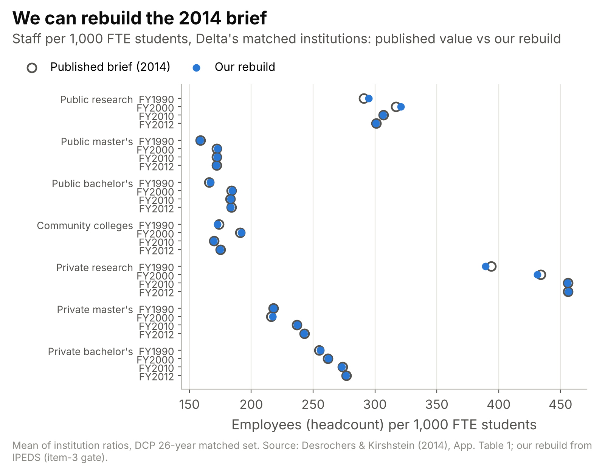{fig-alt="Figure 1" .cs-fig}

**Figure 1. Our rebuild of the brief's Appendix Table 1 against the published values.** Employees per 1,000 FTE students, by sector and year; mean of institution ratios on the DCP 26-year matched set. *Source: Desrochers & Kirshstein (2014); IPEDS; DCP database; repository `bloat/staffing_panel/output/C_gate_appendix_tables_1_3.csv`.* Interactive version: [Sector trends → replication](../sector-trends/?view=table).

## 4. Twelve more years: staffing and spending since 2012 {#sec-4}

After 2012 staff per student rose in every public sector, reversing the decline the brief reported. Full-time faculty per student rose everywhere, professional staff kept growing, and nonprofessional staff kept shrinking. Real pay stalled after 2017, so the rise in compensation per student came from more employees per student, not higher pay.

### 4.1 The public-sector decline reversed

The brief's most-quoted public finding was a decline: public research universities and community colleges had fewer staff per student in 2012 than in 2000. That did not last (Figures 2 and 3, Table 2). From FY2012 to FY2024, employees per 1,000 FTE students rose:

- 8% at public research universities;
- 16% at public master's universities;
- 18% at public bachelor's colleges;
- 27% at community colleges.

Private master's and bachelor's institutions kept rising, as they had before 2012. Private research universities were nearly flat. Weighting by enrollment lowers the levels, because large institutions run leaner per student, but the direction is the same.

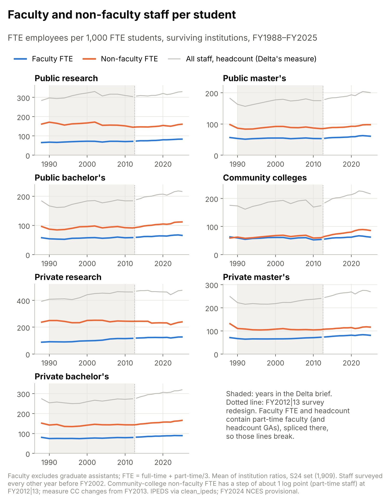{fig-alt="Figure 2" .cs-fig}

**Figure 2. Employees per 1,000 FTE students by sector, FY1990–FY2025.** S24 surviving set (1,909 institutions). Blue: mean of institution ratios; orange dashed: enrollment-weighted. Shading marks the years covered by the Delta brief. *Source: IPEDS; repository `bloat/substack/output/P1_per1000_annual_S24.csv`.* Interactive version: [Sector trends](../sector-trends/).

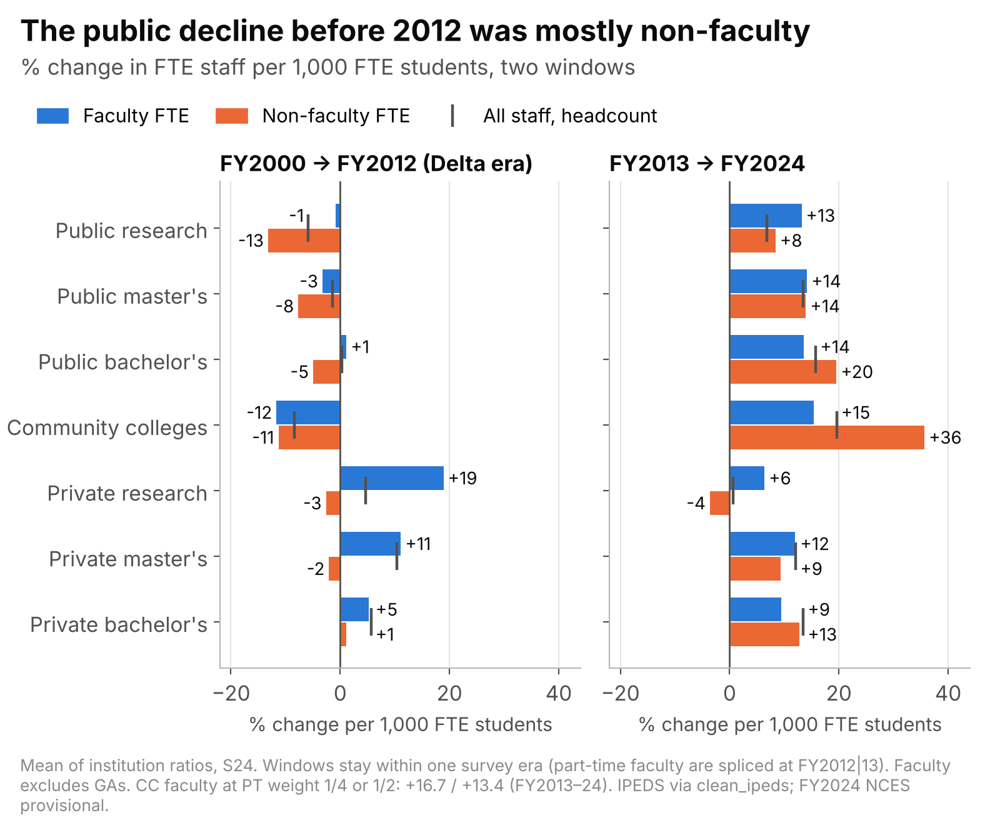{fig-alt="Figure 3" .cs-fig}

**Figure 3. Change in employees per 1,000 FTE students, FY2000–2012 vs FY2012–2024.** Mean of institution ratios, S24. *Source: as Figure 2.* Interactive version: [Sector trends](../sector-trends/?m=total).

**Table 2. Employees (headcount) per 1,000 FTE students**

| Sector | FY2000 | FY2012 | FY2024 | FY2012 weighted | FY2024 weighted |
| --- | --- | --- | --- | --- | --- |
| Public research | 323 | 304 | 328 | 329 | 353 |
| Public master's | 178 | 175 | 203 | 170 | 192 |
| Public bachelor's | 184 | 184 | 218 | 167 | 191 |
| Community colleges | 190 | 174 | 221 | 153 | 180 |
| Private research | 442 | 462 | 471 | 506 | 531 |
| Private master's | 218 | 240 | 274 | 225 | 236 |
| Private bachelor's | 259 | 274 | 314 | 263 | 289 |

*Mean of institution ratios unless labeled weighted (total staff ÷ total FTE). S24 surviving set. FY2024 = fall 2023, NCES provisional. Source: `bloat/substack/output/P1_per1000_annual_S24.csv`. Interactive version: [Sector trends, table view](../sector-trends/?view=table).*

### 4.2 More full-time faculty per student

The brief found full-time faculty hiring that "equaled or lagged" enrollment. Since 2012, full-time faculty per student rose in every sector (Figure 4):

- public research universities, 64 to 74 per 1,000;
- community colleges, 31 to 40;
- private research universities, 100 to 107.

Section 6 shows that at most public institutions this is less a hiring wave than faculty staying as students left.

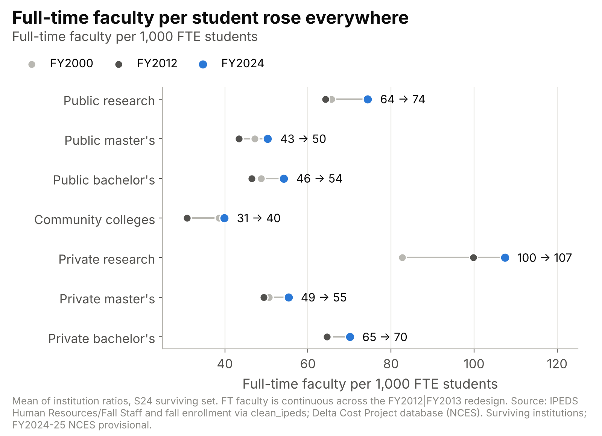{fig-alt="Figure 4" .cs-fig}

**Figure 4. Full-time faculty per 1,000 FTE students, FY2000, FY2012 and FY2024.** Mean of institution ratios, S24. *Source: `bloat/exhibits/output/AppTable3_Fig3_per1000_by_category_S24.csv`.* Interactive version: [Sector trends → FT faculty](../sector-trends/?m=ftfac).

### 4.3 Professional staff kept growing; nonprofessional staff kept shrinking

Within each HR era the brief's composition story continued (Figure 5). From FY2013 to FY2024, professional staff per 1,000 students rose in every sector:

- public research, 76 to 91;
- community colleges, 32 to 48;
- private bachelor's colleges, 58 to 87.

Nonprofessional staff fell almost everywhere, most sharply at private research universities (107 to 80). EAM rose by 1 to 6 per 1,000, from a much smaller base. Other faculty and staff per executive or professional employee, the brief's Figure 5b, kept falling: from 2.0 to 1.6 at public research universities and from 3.1 to 2.2 at community colleges (Figure 6).

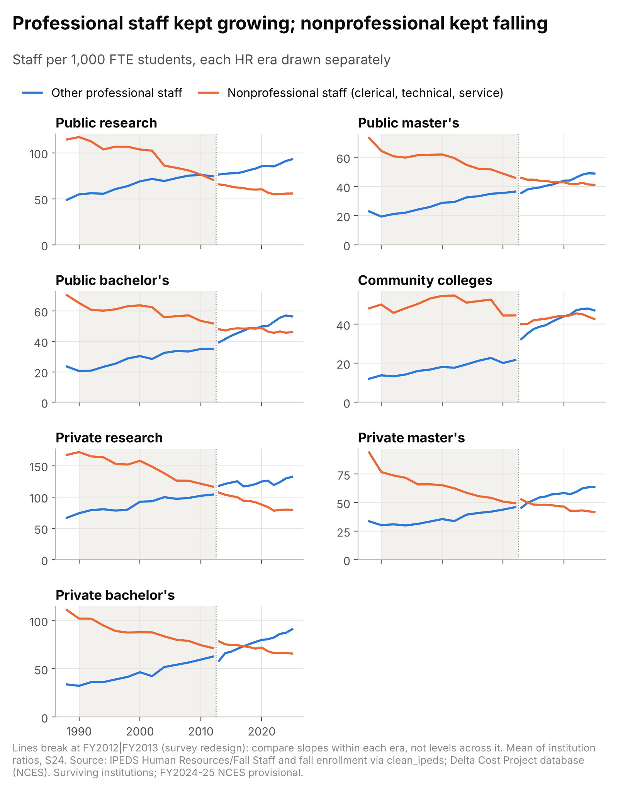{fig-alt="Figure 5" .cs-fig}

**Figure 5. Professional and nonprofessional staff per 1,000 FTE students, FY1990–FY2025, drawn separately in each HR era.** Mean of institution ratios, S24. *Source: `P1_per1000_annual_S24.csv`.* Interactive version: [Sector trends → professional](../sector-trends/?m=prof).

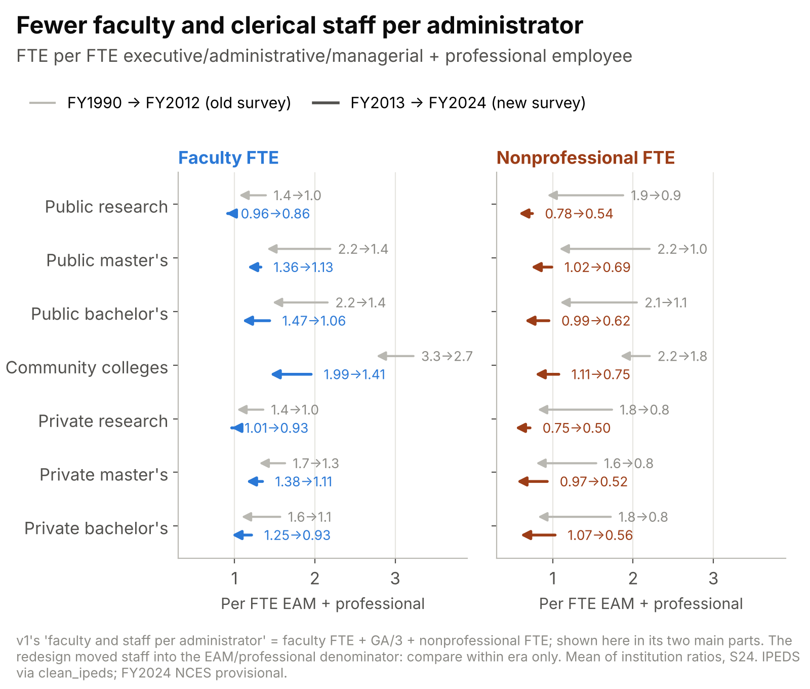{fig-alt="Figure 6" .cs-fig}

**Figure 6. Other FTE faculty and staff per FTE executive + professional employee (the brief's Figure 5b), FY1990–2012 and FY2013–2024.** Levels are not comparable across eras, only slopes. *Source: `bloat/exhibits/output/Fig5ab_faculty_staff_per_admin_S24.csv`.* Interactive version: [Sector trends → EAM + professional](../sector-trends/?m=eamprof).

### 4.4 The money stalled after 2017

The finance side split into two periods (Figure 7).

- **FY2013–17.** Real sticker tuition grew 2.0–2.5% a year. Real full-time faculty salaries grew 0.2–0.9%. Education and related spending (E&R) per student grew 1.5–3.6%.
- **FY2017–24, as inflation surged.** Real tuition fell 0.2–1.3% a year in every sector. Real faculty salaries fell 1.0–1.9% a year. E&R per student was roughly flat (−0.9 to +1.0%).

Student-services salaries per employee still outgrew the average salary in every sector, as the brief found for 2002–10.

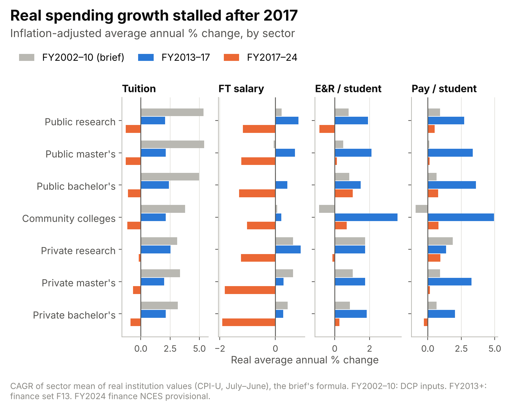{fig-alt="Figure 7" .cs-fig}

**Figure 7. Real average annual growth of sticker tuition, FT faculty salary, E&R per student and compensation per student, by sector and window.** CAGR of the sector mean of real institution values (the brief's formula); CPI-U fiscal year. FY2002–10 uses DCP inputs; FY2013+ uses finance set F13. *Source: `bloat/exhibits/output/Fig6_Fig8_AppTable4_finance_growth.csv`.* Interactive version: [Sector trends → finance](../sector-trends/?fm=ft_faculty_avg_salary).

### 4.5 Where staffing sits in total cost

Compensation is about 60% of education and general (E&G) spending, so staffing ratios and costs move together. They are not the same thing. Real compensation per FTE student splits exactly into pay per FTE employee plus FTE employees per student:

$$
\Delta \ln\frac{\text{Comp}}{\text{FTE students}} = \Delta \ln\frac{\text{Comp}}{\text{FTE employees}} + \Delta \ln\frac{\text{FTE employees}}{\text{FTE students}}
$$

Over FY2013–24, real compensation per student rose 13.2 log points at the typical institution. Pay per employee contributed −0.9 and employees per student +14.1 (Figure 8).

- **Public institutions:** +20.1 = +2.1 pay + 18.0 employees per student.
- **Private institutions:** +3.5 = −5.1 pay + 8.6 employees per student.
- **Community colleges:** the largest rise, +24.6, almost all from employees per student (+21.4).

Compensation rose from 61.2% to 63.0% of E&G spending. Its share rose 4.3 points at publics and fell 1.6 points at privates, and over FY2017–24 it fell in both. Instruction's share of E&G fell about 4 points in every sector. Institutional support (+2.3 points public, +1.4 private) and student services (+1.8 and +3.4) rose.

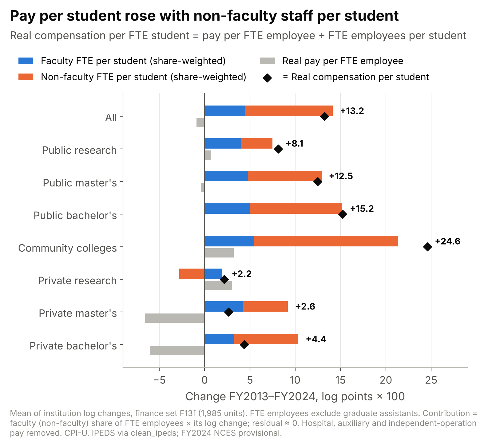{fig-alt="Figure 8" .cs-fig}

**Figure 8. Change in real compensation per FTE student, FY2013–2024, split into pay per FTE employee and FTE employees per student.** Mean of institution log changes, finance set F13f (1,985 units). *Source: `bloat/cost_share/output/T3_decomposition_fy2013_2024.csv`.* Interactive version: [Institution explorer → spending](../institution-explorer/?f=ins).

*Two caveats.* The cost measures remove hospital, auxiliary and independent-operation pay, so medical centers do not swamp research universities. Including them would put the aggregate compensation-share change at +8.2 points rather than +3.0. IPEDS also changed how operations-and-maintenance salaries are reported in FY2016, and no correction is break-free. For publics the compensation-share change is +4.3 points with that line stripped and +1.7 points with it kept; we report the bracket.

## 5. The denominator {#sec-5}

At the typical surviving institution, staff per student rose 12.6 log points over FY2013–24 while headcount staff *fell* 4.8 points; the whole rise is students leaving. Enrollment fell hardest at community colleges and regional publics, grew at research universities, and fell even more on campus than the totals show.

### 5.1 Where the students went

Every sector grew through the 2000s. After 2012 the paths split (Figure 9). From FY2012 to FY2024, fall FTE enrollment:

- grew at public research (+7%) and private research universities (+10%);
- held roughly flat at private master's institutions (+4%);
- fell at public master's (−9%), public bachelor's (−9%) and private bachelor's institutions (−5%);
- fell 26% at community colleges.

State flagships pulled away from everyone else (Figure 10). Flagship enrollment went from 126 to 140 (FY1990 = 100) between FY2012 and FY2024. Regional publics fell from 139 to 126, and small private colleges from 132 to 122.

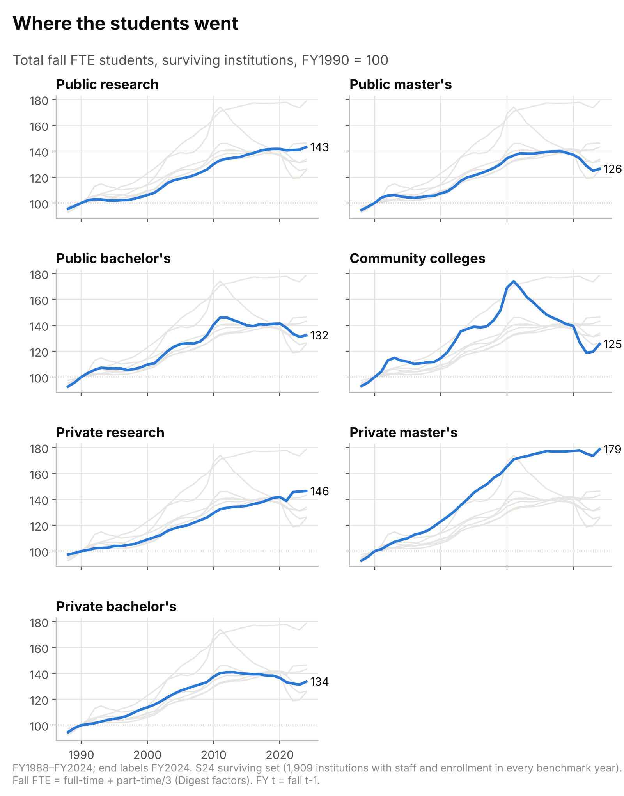{fig-alt="Figure 9" .cs-fig}

**Figure 9. Total fall FTE students by sector, FY1990 = 100.** S24 surviving set. *Source: `bloat/substack/output/E1a_fte_index_annual_S24.csv`.* Interactive version: [Enrollment](../enrollment/?g=sector&base=1990).

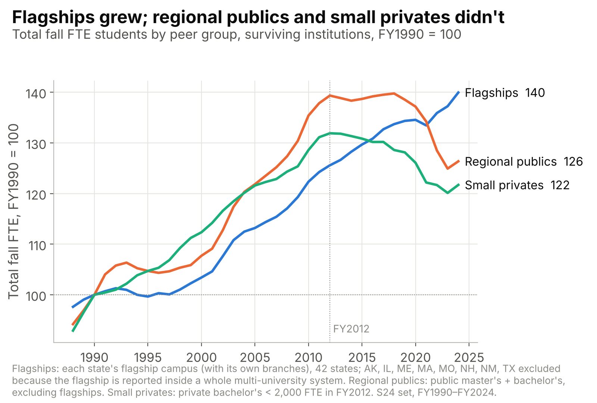{fig-alt="Figure 10" .cs-fig}

**Figure 10. Total fall FTE students for flagships, regional public universities and small private colleges, FY1990 = 100.** Flagships: each state's flagship campus with its branches (42 states; 8 states whose flagship reports inside a multi-university system are excluded). Regional publics: other public master's and bachelor's. Small privates: private bachelor's under 2,000 FTE in FY2012. *Source: `bloat/substack/output/E5_peer_groups_annual_S24.csv`.* Interactive version: [Enrollment → peer groups](../enrollment/?g=peer&base=1990).

The decline was geographically uneven and widespread within sectors (Figures 11 and 12).

- **The map.** Public four-year enrollment rose 15% or more in Utah, Texas, Arizona, Nevada, California and South Carolina. It fell across the Midwest and Northeast. Community colleges shrank almost everywhere.
- **How many shrank.** Among surviving institutions, enrollment fell at:
  - 90% of community colleges;
  - 72% of public master's universities;
  - 76% of public bachelor's colleges;
  - 63% of private bachelor's colleges.

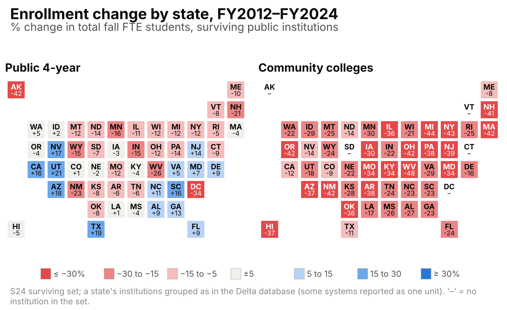{fig-alt="Figure 11" .cs-fig}

**Figure 11. Percent change in total fall FTE, FY2012–FY2024, by state: public four-year institutions and community colleges.** S24 surviving set. *Source: `bloat/substack/output/E2_enrollment_by_state_S24.csv`.* Interactive version: [State explorer](../state-explorer/?map=pct_2012_2024).

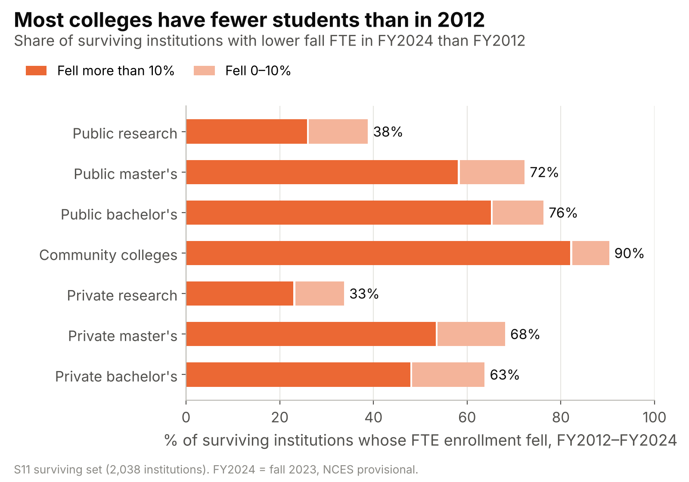{fig-alt="Figure 12" .cs-fig}

**Figure 12. Share of surviving institutions whose fall FTE fell between FY2012 and FY2024, by sector.** S11 surviving set. *Source: `bloat/substack/output/E4_growth_distribution_S11.csv`.* Interactive version: [Enrollment](../enrollment/?by=rosefell).

### 5.2 Splitting the change into staff and students

Because staff per student is a ratio, its change in logs splits exactly into two parts. For staff S and FTE students E between years a and b:

$$
\Delta \ln(S/E) = \Delta \ln S - \Delta \ln E
$$

Log changes × 100 are close to percent changes for small moves and add up exactly. Table 3 applies this to FY2013–24 on the 2,038 S11 institutions. The unweighted columns average institution log changes; the weighted columns use sector totals.

**Table 3. Change in employees per FTE student = staff change − enrollment change, FY2013→FY2024 (log points × 100)**

| Group | Staff | FTE students | Staff per student | Weighted: staff per student | Per on-campus student |
| --- | --- | --- | --- | --- | --- |
| All | −4.8 | −17.4 | +12.6 | +11.8 | +29.9 |
| Public research | +7.1 | +0.9 | +6.2 | +7.0 | +14.5 |
| Public master's | −4.0 | −16.0 | +12.0 | +9.7 | +28.0 |
| Public bachelor's | −0.5 | −14.6 | +14.2 | +10.8 | +31.6 |
| Community colleges | −13.0 | −29.3 | +16.2 | +12.2 | +40.5 |
| Private research | +5.0 | +4.1 | +0.9 | +2.9 | +13.4 |
| Private master's | −2.9 | −13.4 | +10.5 | +4.2 | +27.4 |
| Private bachelor's | +1.3 | −11.2 | +12.5 | +8.5 | +22.1 |
| Enrollment fell | −13.7 | −31.4 | +17.6 | +14.4 | +35.8 |
| Enrollment rose | +18.5 | +19.0 | −0.5 | +0.8 | +14.7 |

*Headcount employees; S11 surviving set (2,038). Unweighted unless labeled. On-campus FTE excludes exclusively-online students. Source: `bloat/online/output/D2_decomposition_headline.csv`. Interactive version: [Enrollment → decomposition](../enrollment/?by=sector&v=b).*

The rows tell two stories.

- **Community colleges and regional publics:** staff per student rose because students left, while staff were flat or falling.
- **Research universities:** enrollment grew and staff grew faster.

Institutions whose enrollment rose saw essentially no change in staff per student. Weighting by enrollment cuts the all-institution rise only slightly (11.8), but the weighted staff count *rose* 5.7 points, because the institutions that grew were large.

The composition shift is real hiring, even where the total is not. By FY2013–24 headcounts, professional staff grew 21.9 log points at the typical institution and nonprofessional staff fell 27.3, even as students left.

### 5.3 Online students change the per-student picture

Exclusively-online students rose from 7.9% of fall headcount in fall 2012 to 21.1% in fall 2023 at the typical institution. Fully online programs went from 8.0% to 20.8% of programs. These students count in FTE but use few campus services. Counting only on-campus FTE, staff per student rose 29.9 log points rather than 12.6 (Figure 13). On-campus FTE fell 34.7 points; online growth replaced about half of the on-campus loss.

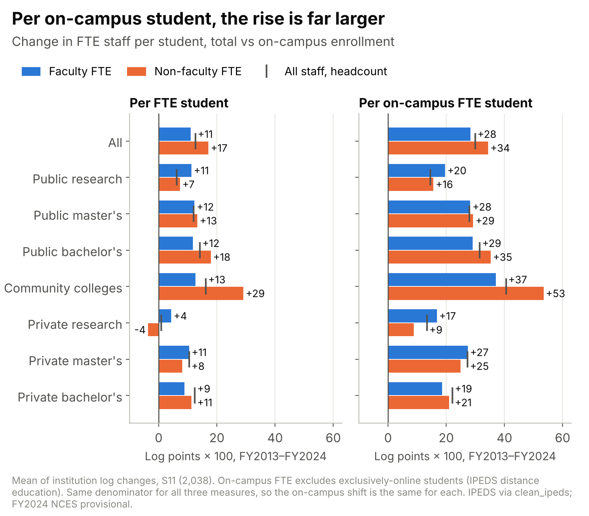{fig-alt="Figure 13" .cs-fig}

**Figure 13. Change in employees per FTE student, FY2013–2024, per total and per on-campus FTE.** Mean of institution log changes, S11. *Source: `bloat/online/output/D2_decomposition_headline.csv`; IPEDS distance education.* Interactive version: [Enrollment → online](../enrollment/?by=online&v=c).

### 5.4 Dual enrollment hides part of the community-college decline

IPEDS has no dual-enrollment item, so we proxy it with undergraduates under 18. Their share of community-college FTE rose from 7.6% in fall 2013 to 18.9% in fall 2023 (Figure 14). That is consistent with [CCRC's estimate](https://ccrc.tc.columbia.edu/easyblog/how-many-students-are-taking-dual-enrollment-courses-in-high-school-new-national-state-and-college-level-data.html) that dual-enrollment students were 21% of community-college enrollment in 2022–23.

- **Community colleges.** Excluding them, FTE fell 40.9 log points over FY2014–24 rather than 26.9, and staff per regular student rose 27.0 rather than 13.0.
- **Regional publics.** The effect is smaller: −17.9 rather than −14.7.
- **Four-year publics.** States where dual enrollment grew fastest show no extra decline at four-year publics.

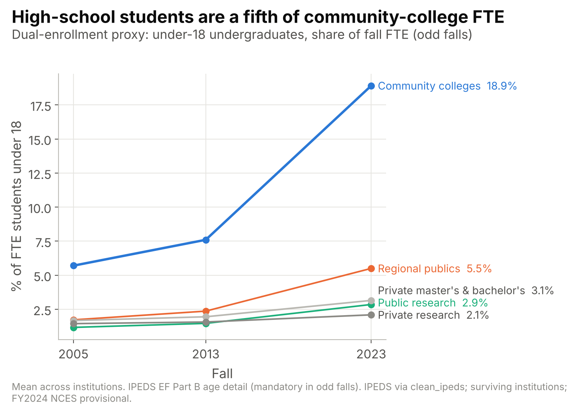{fig-alt="Figure 14" .cs-fig}

**Figure 14. Under-18 undergraduates as a share of fall FTE, by sector.** Mean across institutions; odd falls, when age detail is mandatory. *Source: `bloat/causal/output/e_dual_by_sector.csv`.* Interactive version: [Enrollment → dual enrollment](../enrollment/?by=sector) and [State explorer → dual enrollment](../state-explorer/?map=dual_2023).

## 6. Enrollment shifts institutions don't control {#sec-6}

When enrollment moves for reasons outside an institution's control, staff follow only part of the way. The elasticity is 0.72 overall, 0.88 at public research universities, 0.70 at regional publics and 0.65 at community colleges. The post-2013 enrollment decline was not demographic. Most of it is unexplained by population or the business cycle. With an elasticity below 1, that decline mechanically raised staff per student.

### 6.1 A population instrument

Enrollment and staffing are chosen together, so a raw correlation can't say how staffing responds to students. We need enrollment changes that institutions don't cause. We use changes in the number of college-age people in the places an institution historically draws from.

For each institution, a gravity model of freshman origins gives the share of its base-period (falls 1986–88) entering class expected from each county c, s\_ci. The model accounts for distance, state borders and competition from nearby institutions of the same type. We age each county's 10-year-olds forward eight years, so the shock reflects children already born and living there, not current migration toward growing colleges. The instrument is the predicted proportional change in the institution's catchment population:

$$
Z_{it} = \ln\Big( (1-f_i) \sum_c s_{ci}\, \frac{\tilde P_{ct}}{\tilde P_{cb}} + f_i \Big), \qquad \tilde P_{ct} = \text{age-10 population of county } c \text{ in year } t-8
$$

Here f\_i is the share of freshmen from abroad or unknown origin, held constant. Multi-campus groups combine their campus instruments through predicted enrollment. We then estimate:

$$
\ln E_{it} = \pi Z_{it} + \alpha_i + \delta_{s(i)t} + u_{it}, \qquad \ln S_{it} = \beta \ln E_{it} + \alpha'_i + \delta'_{s(i)t} + \varepsilon_{it}
$$

E is fall FTE, S is staff, α are institution effects and δ are sector × year effects. β, estimated by two-stage least squares, is the elasticity of staff to enrollment. Standard errors are clustered by state. The design follows the shift-share literature ([Goldsmith-Pinkham, Sorkin & Swift 2020](https://doi.org/10.1257/aer.20181047); [Borusyak, Hull & Jaravel 2022](https://doi.org/10.1093/restud/rdab030)). It uses SEER county population by single year of age ([SEER](https://seer.cancer.gov/popdata/)) and Autor–Dorn commuting zones ([Autor & Dorn 2013](https://doi.org/10.1257/aer.103.5.1553)). Appendix A gives the gravity model.

The first stage is strong: F = 137 with state-clustered errors, and about 100 even with state × year effects that absorb state budgets and policy. Simpler instruments built from state-level shares lose all power once state × year effects are added (F < 1). The gravity version does not.

**Table 4. Elasticity of total staff to enrollment, FY1988–2024**

| Specification | First-stage F | Elasticity (SE) |
| --- | --- | --- |
| Fixed effects, no instrument | – | 0.67 (0.02) |
| Gravity instrument, base 1987 (main) | 137 | 0.72 (0.10) |
| … plus state × year effects | 97 | 0.76 (0.07) |
| … base 2002 | 36 | 0.73 (0.10) |
| … births 18 years earlier instead of age 10 | 124 | 0.69 (0.12) |
| … excluding the institution's own commuting zone | 84 | 0.66 (0.12) |
| Earlier blended 60-mile instrument (item 11b) | 58 | 0.72 (0.11) |

*2SLS; institution and sector × year effects; unweighted; SEs clustered by state; about 50,000 institution-years. Source: `bloat/causal/output/c_first_stage.csv`, `c_panel_iv.csv`. Interactive version: [Population shocks](../population-shocks/).*

### 6.2 Staffing responds differently by sector

Pooled, staff rise about 0.72% for each 1% of enrollment. The sector estimates differ in a way that matters for the bloat debate (Figure 15).

- **Public research universities** scale staff almost proportionally: 0.88. Executive and professional staff scale at 0.89.
- **Regional public universities** come in at 0.70. Faculty track enrollment (0.81), but executive and professional staff do not (0.44, CI 0.11–0.77).
- **Community colleges** come in at 0.65. Faculty (0.92) and nonprofessional staff (0.89) track enrollment.

An earlier version of this analysis reported "sticky" executive and professional staff nationwide. That result does not survive the better instrument: the pooled category elasticities change sign across bases. Sticky administrative staff is a regional-public pattern, not a national one. Private-sector first stages are too weak (F of 11–14) to report.

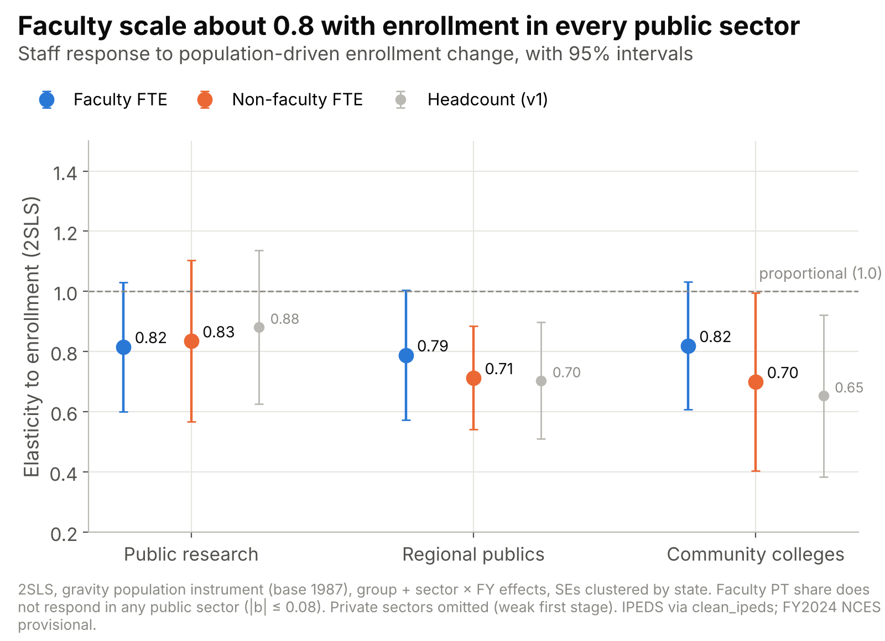{fig-alt="Figure 15" .cs-fig}

**Figure 15. Elasticity of staff to population-driven enrollment change, by sector and staff category, with 95% intervals.** 2SLS, gravity instrument (base 1987). *Source: `bloat/causal/output/d_staff_by_sector.csv`.* Interactive version: [Population shocks → elasticities](../population-shocks/?cat=total).

### 6.3 The post-2013 decline was not demographic

The FY2013–24 change in log enrollment splits into three parts:

- the change predicted by the population instrument;
- a business-cycle term, sector-specific responses to national unemployment;
- a residual.

$$
\Delta \ln E_i = \underbrace{\hat\pi\,\Delta Z_i}_{\text{population}} + \underbrace{\hat\gamma_{s(i)}\,\Delta u}_{\text{cycle}} + \underbrace{\Delta \ln E_i - \hat\pi\Delta Z_i - \hat\gamma_{s(i)}\Delta u}_{\text{everything else}}
$$

For the typical surviving institution, enrollment fell 17.8 log points (Figure 16):

- **Population added 0.5.** The demographic "cliff" is mostly still ahead ([Grawe 2018](https://www.press.jhu.edu/books/authors/nathan-d-grawe)).
- **The cycle subtracted at most 3.6.** Unemployment fell from 8.1% to 3.7%, and college enrollment is countercyclical. This is an upper bound, because Pell and GI Bill changes moved with the cycle.
- **Everything else subtracted 14.7.**

At community colleges the split is −30.1 = +0.5 − 7.0 − 23.7. Public research universities grew. Online growth replaced about half of the fall in on-campus FTE: 16.8 of 34.6 points.

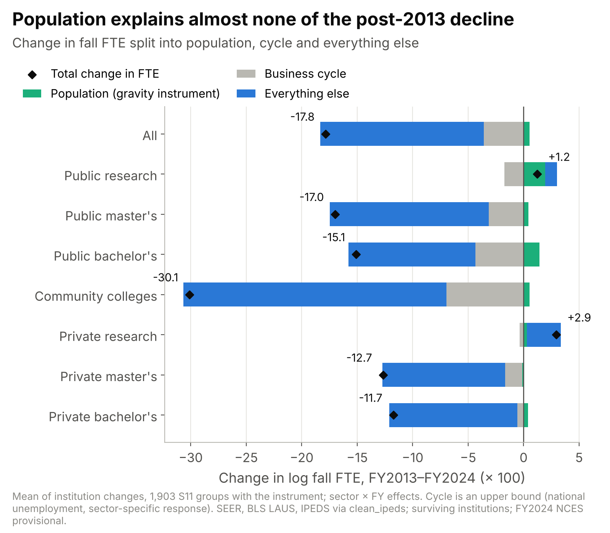{fig-alt="Figure 16" .cs-fig}

**Figure 16. FY2013–2024 change in fall FTE split into population, business cycle and everything else, by sector.** Mean of institution log changes, 1,903 S11 groups with the instrument. *Source: `bloat/causal/output/c_decomposition.csv`.* Interactive version: [Population shocks → decomposition](../population-shocks/?sector=all).

### 6.4 Why staff per student rose

With the elasticities in hand, the rise in staff per student splits into two parts:

- the enrollment decline meeting an elasticity below 1;
- staff growth beyond what enrollment predicts.

$$
\Delta \ln\frac{S}{E} = \underbrace{(\beta_p - 1)\,\Delta \ln E^{\text{pop}} + (\beta_o - 1)\,\Delta \ln E^{\text{other}}}_{\text{enrollment part}} + \underbrace{\eta}_{\text{beyond enrollment}}
$$

β\_p = 0.70 is the response to population-driven change and β\_o = 0.57 the response to other change. Their difference is within about one standard error, and it reverses with state × year effects.

In the instrument sample, staff per student rose 12.8 log points. Of that, 7.7 is the enrollment part and 5.1 is growth beyond enrollment, about 0.45% a year (Figure 17).

- **Community colleges:** the enrollment part is 12.9 of 16.4.
- **Public research universities:** enrollment grew, so the whole 6.6-point rise is growth beyond enrollment.
- **Bachelor's colleges, public and private:** growth beyond enrollment is as large as or larger than the enrollment part (public 6.6 vs 7.3; private 5.0 vs 7.6).

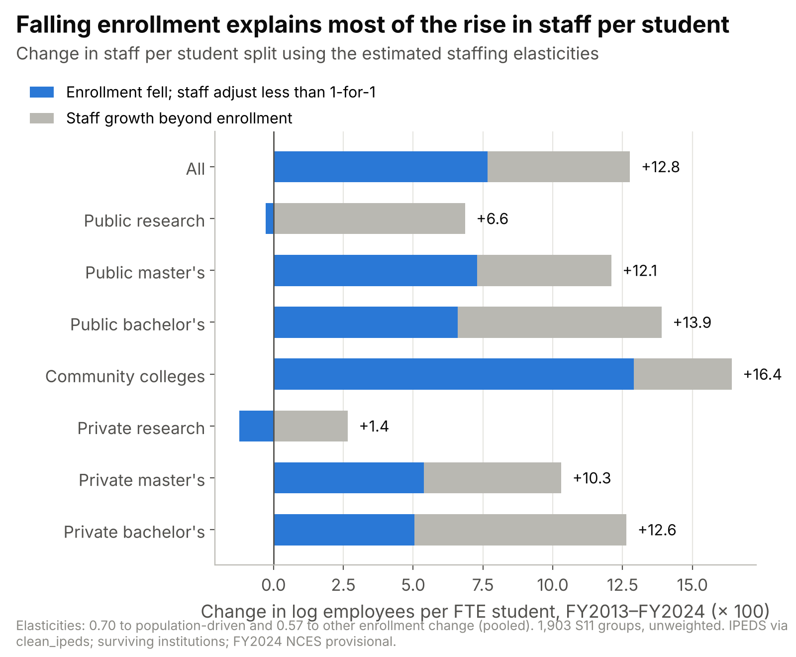{fig-alt="Figure 17" .cs-fig}

**Figure 17. FY2013–2024 change in staff per student split into the enrollment part and growth beyond enrollment, by sector.** Pooled elasticities applied to each sector's enrollment change; 1,903 S11 groups, unweighted. *Source: `bloat/causal/output/c_decomposition.csv`, `c_staff_response.csv`; `bloat/whitepaper/output_staff_split.csv`.* Interactive version: [Population shocks → staff per student](../population-shocks/?cat=total).

**No sign that staffing drives enrollment.** If institutions hired to attract students, and hiring worked, the plain fixed-effects elasticity would exceed the instrumented one, because staffing would raise enrollment as well as respond to it. It does not: fixed effects give 0.67, the instrument 0.72. Staff per student rises even under enrollment changes institutions don't control. Section 8 tests the hiring-to-attract channel directly.

> **Box: The online-provider hypothesis, tested and not supported.** A natural explanation for the unexplained decline is competition from national online providers: 51 institutions that enroll at least 3,000 fully online students, mostly out of state, and whose online headcount was flat from 2012 to 2019 and then rose, ending 35% above its 2012 level by 2024. If they drew students away, local and non-traditional campuses in states where they recruited heavily should have lost more. They did not. Exposure × non-traditional profile and exposure × local draw are near zero or positive at public institutions and private master's and bachelor's colleges, with or without state × year effects (only private research universities show a negative interaction), and a placebo period is flat. Community colleges in high-exposure states did lose more (about 7 log points), but not their local or non-traditional members. Other measured drivers, sticker and net price, competitor mass and own online growth, each explain a few points. About 20 points at regional publics and 27 at community colleges remain unexplained. Interactive version: [Population shocks](../population-shocks/).

## 7. What changes the staff mix {#sec-7}

Research funding, program scope and a national recruiting reach all go with more executive and professional staff per student across institutions. Within an institution over time the associations are a third to two-thirds as large, and none tilts the mix toward administration. These are associations: the one instrument we tried for research funding failed.

### 7.1 Research, programs and competition

We tested three explanations for administrative growth:

- **research funding**, through compliance and grant administration;
- **program scope**, more majors to coordinate;
- **competition for students**, through recruiting and student services.

Each is estimated two ways: comparing institutions in the same sector and year, and following one institution over time with institution × HR-era and year effects. The gap between the two answers is the main lesson (Figure 18, Table 5).

**Table 5. Executive + professional staff per 1,000 FTE students: across vs within institutions**

| Driver (sample) | Across institutions | Within institutions | One within-SD change |
| --- | --- | --- | --- |
| Log real R&D (research universities) | 0.234 | 0.074 | +2.9% |
| Log number of programs (all) | about 0.11 | 0.081 | +1.6% |
| In-state share of freshmen (all) | −0.458 | −0.172 | −0.9% |

*Dependent variable log(1 + EAM + professional per 1,000 FTE). Across: sector × year effects. Within: institution × era + year effects. SEs clustered by institution; all within estimates significant at 1%. FY1988–2024 panel, 52,721 institution-years. Source: `bloat/models/output/B_panel_coefficients.csv`, `F1_standardized_effects.csv`. Interactive version: [Institution explorer](../institution-explorer/?m=ep).*

- **Research.** Research-heavy universities carry far more executive and professional staff per student. Following one university as its real R&D grows, a 10% rise goes with 0.7% more. Long differences agree: 0.14 over FY2000–12 and 0.09 over FY2013–24. The added staff are professional, not executive, and nonprofessional staff rise in the same proportion (0.073), so the mix does not tilt toward administration.
- **Programs.** 10% more programs goes with 0.8% more executive and professional staff and 1.5% more non-faculty staff. The executive + professional *share* falls.
- **Competition.** Institutions that recruit nationally carry more staff, but one that becomes more national adds little. The within-institution association is −0.23 at publics, −0.12 at privates and zero at research universities.

A one-standard-deviation within-institution change in any of these drivers moves executive and professional staff per student by 3% or less. Enrollment moved 17 log points at the typical institution after 2013.

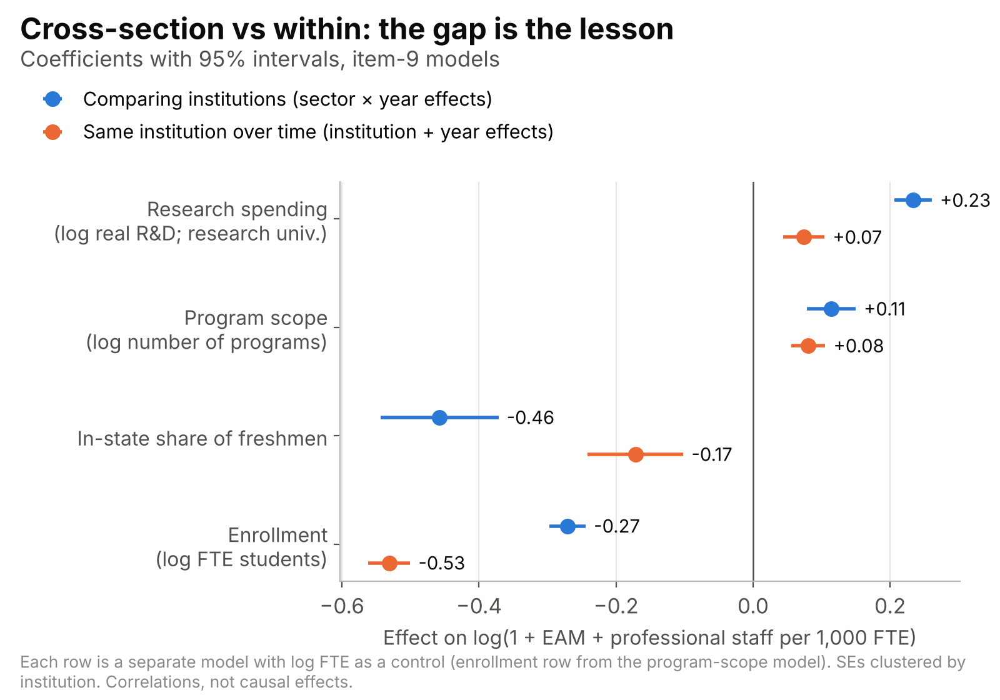{fig-alt="Figure 18" .cs-fig}

**Figure 18. Coefficients on research spending, program scope, in-state share and enrollment for EAM + professional staff per 1,000 FTE students: across institutions vs within institutions, with 95% intervals.** *Source: `bloat/models/output/B_panel_coefficients.csv`.* Interactive version: [Institution explorer](../institution-explorer/?m=ep).

**The research instrument failed.** To move beyond association, we built shift-share instruments for research funding. Each university's base-period mix of federal agencies (or fields) was interacted with national agency (or field) growth, leaving the university out. Neither instrument has power: first-stage F is 1.3 for both, and no variant reaches 3. The reason is structural:

- HHS (mainly NIH) is 53–58% of federal university R&D every year, leaving only about four effective agencies.
- Base-period HHS exposure is mostly medical-school status (R² 0.51).
- Field pre-trends fail.

The within-institution estimate above remains the best available, as an association. Appendix B reports the details.

**Size.** Across institutions within a sector and year, staff per student falls with enrollment up to about 15,000 FTE (95% interval 9,000–24,000) and then flattens. Within an institution there is no such U: as it grows, staff per student keeps falling. Most of the cross-sectional U disappears within sectors (Appendix Figure A2).

### 7.2 Academic medical centers

Universities with medical schools or hospitals (academic medical centers, AMCs) set the *level* of research-university staffing, not its trend. Of 252 research universities, 35 own a hospital and 71 more have a medical school. Together they hold about 70% of research-university staff and 76% of research-university R&D, shares that have barely moved since FY1988 (Figure 19).

- **Staff per 1,000 FTE students in FY2024:**
  - 313 at research universities with no medical school;
  - 436 with a medical school but no hospital;
  - 601 with an owned hospital.
- **Most hospital employees are not in IPEDS staff counts.** At 27 of 35 hospital owners, salary per reported employee is 1.2–2.8 times peers'. Exceptions where hospital staff appear to be included are Vanderbilt to FY2016, Ole Miss/UMMC, Ohio State, Saint Louis University, UIC and, more weakly, Tulane.
- **Some of the most hospital-heavy institutions fall outside the trimmed analysis sample** (Johns Hopkins in most years, Vanderbilt and others). They are listed in the repository.
- **AMCs do not drive the research association.** Splitting the sample, the within-institution R&D association is 0.055 without AMCs and 0.117 within them, but a pooled R&D × AMC interaction is small and insignificant (−0.011, SE 0.032).

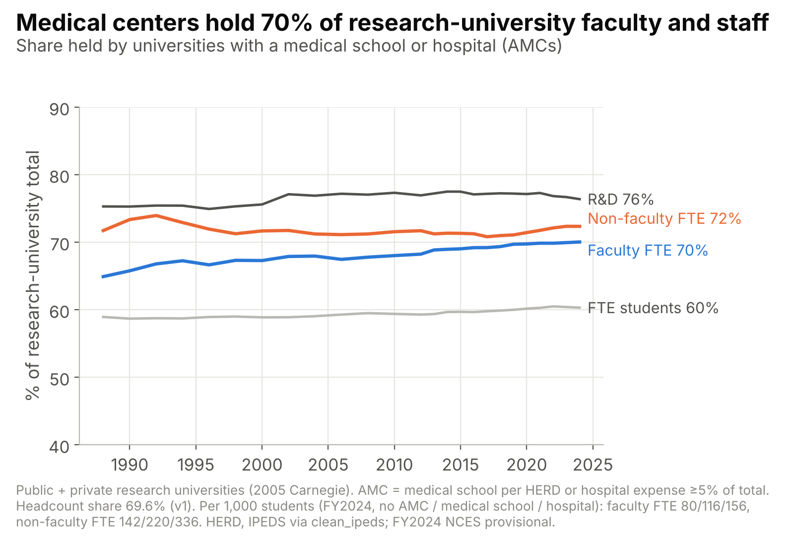{fig-alt="Figure 19" .cs-fig}

**Figure 19. Share of research-university R&D, staff and FTE students held by AMCs, FY1988–2024.** Public and private research universities (2005 Carnegie). *Source: `bloat/amc/output/B1_amc_shares_by_year.csv`.* Interactive version: [Institution explorer](../institution-explorer/) (medical-center flag shown for each institution).

## 8. Hiring to attract students {#sec-8}

The real hiring after 2012 went disproportionately to staff who recruit and serve students. Spending tilted toward amenities and athletics, most at less-selective institutions. Neither the staff nor the athletics spending shows an enrollment payoff, and academic spending predicts later enrollment as well or better.

### 8.1 Enrollment-facing staff

The post-2012 IPEDS occupation codes let us isolate staff whose jobs face students and prospective students. We call them *enrollment-facing*:

- student and academic affairs (code 270): advisers, admissions, financial aid, residence life;
- community service, arts, media and sports occupations (330): counselors, communications and marketing staff, and coaches;
- sales (360).

We measure from FY2015, because code 270 settled only after a 22–24% coding jump in FY2014. These occupation codes do not exist before fall 2012.

From FY2015 to FY2024, enrollment-facing FTE staff rose 17.8 log points while FTE students fell 14.3 (Figure 20). They went from 23.0 to 30.9 per 1,000 students. That is 7.9 of the 17.5-point rise in all staff per 1,000, about 45%. The share varies by sector: 29% at community colleges, 37% at regional publics, 46% at public research universities and 65% at private master's and bachelor's colleges. Instructional staff FTE fell 8 log points but rose per student, from 66.7 to 71.3 per 1,000.

Enrollment-facing staff respond to enrollment with an elasticity of 0.40, against 0.59 for instructional staff. Their growth over FY2015–19 does not predict first-time enrollment over FY2019–24: 0.005 (SE 0.017). Instructional staff growth does (0.15).

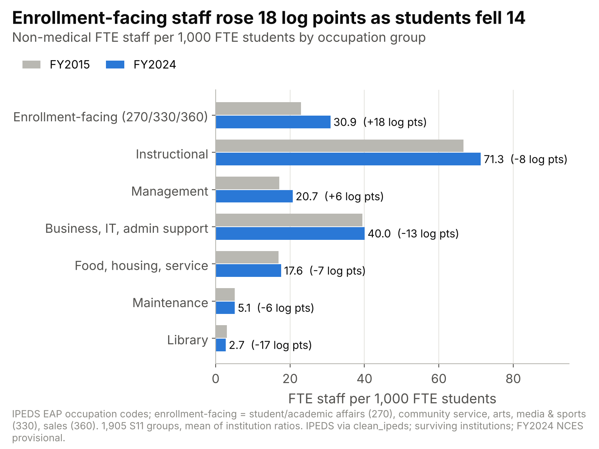{fig-alt="Figure 20" .cs-fig}

**Figure 20. Non-medical FTE staff per 1,000 FTE students by occupation group, FY2015 and FY2024.** 1,905 S11 groups, mean of institution ratios. *Source: `bloat/causal/output/f_composition.csv`.* Interactive version: [Who was hired](../who-was-hired/?view=lvl).

**Is it athletics?** IPEDS has no separate code for coaches; they sit in 330. Subtracting EADA head and assistant coach FTE shows coaches are 18% of the 48,100 enrollment-facing FTE added (Figure 21):

- 5% at public research universities;
- 22% at regional publics;
- 29% at community colleges;
- 57% at private master's and bachelor's colleges.

Outside small privates, the growth is student affairs plus non-coach communications, marketing, counseling and media jobs. Coach counts are a lower bound on athletics staff, because EADA does not count trainers, operations or compliance staff.

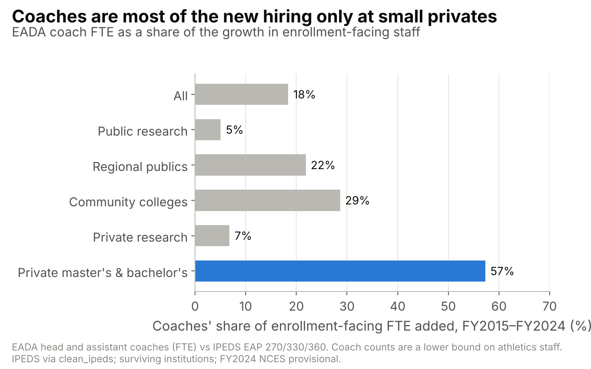{fig-alt="Figure 21" .cs-fig}

**Figure 21. Coaches' share of the growth in enrollment-facing FTE staff, FY2015–2024, by sector.** EADA coach FTE vs IPEDS EAP codes 270/330/360. *Source: `bloat/causal/output/g_coaches_share.csv`.* Interactive version: [Who was hired → coaches](../who-was-hired/?view=chg).

### 8.2 College as country club

Jacob, McCall and Stange argue that competition for students who value consumption pushes colleges toward amenities ([2018](https://doi.org/10.1086/694654)). We compare two kinds of real spending per FTE student from IPEDS finance functions:

- *amenity* spending: student services plus auxiliary enterprises;
- *academic* spending: instruction plus academic support.

From FY2004 to FY2024, the median institution's amenity spending per student rose 33 log points and its academic spending 16 (Figure 22). At private master's and bachelor's colleges the gap is starker: +26 against +1.

The tilt is larger at less-selective institutions: about 8.5 points more per standard deviation lower in the SAT 25th percentile, in every four-year sector. For publics it is also larger in less concentrated markets. Competitor mass has the wrong sign, and within-institution changes in competition don't move the ratio. Population shocks raise it.

{fig-alt="Figure 22" .cs-fig}

**Figure 22. Change in real amenity and academic spending per FTE student, FY2004–2024, by sector.** Median institution log change; CPI-U fiscal year. *Source: `bloat/causal/output/f_spending_growth.csv`.* Interactive version: [Amenities & athletics](../amenities-athletics/?win=long).

### 8.3 Athletics

Athletics is the fastest-growing piece of amenity spending (Figure 23). Real athletic operating spending per student, from EADA, rose 56 log points at the median institution over FY2008–24, against 8 for academic spending. At private master's and bachelor's colleges it rose 62 against 0.5.

- **Levels.** Median athletics spending per student is about $3,200 at small privates, $2,600 at public research universities, $1,700 at regional publics and $390 at community colleges.
- **Share of amenity growth.**
  - Athletics was 31% of all amenity-spending growth over FY2008–24 and 59% over FY2013–24.
  - At private master's and bachelor's colleges it was 40% over FY2008–24, or 61% counting athletic scholarships.
  - EADA and IPEDS are separate reports, so these shares are approximate.
- **Subsidy.** At Division I public universities, the institutional subsidy per student rose from $781 to $1,226 (+36 log points, against +12 for instruction). At regional publics the subsidy is 74% of athletic revenue. Data: USA Today NCAA finances; see also the [Knight-Newhouse database](https://www.knightnewhousedata.org/about).

The athletics tilt, like the amenity tilt, is larger at less-selective schools (−0.19 per SD of SAT) and where an institution's own market share is smaller.

{fig-alt="Figure 23" .cs-fig}

**Figure 23. Change in real athletic and academic spending per FTE student, FY2008–2024, by sector.** Medians across institutions present in both years. *Source: EADA institution files ([U.S. Department of Education](https://ope.ed.gov/athletics/)); `bloat/causal/output/g_athletics_growth.csv`.* Interactive version: [Amenities & athletics → athletics](../amenities-athletics/?win=long&aid=1).

### 8.4 Does any of it bring students?

We regress the change in log first-time students over FY2019–24 on the change in log real spending per student over FY2015–19. Controls are the population instrument's change in both windows and the institution's prior enrollment trend.

**Table 6. Spending growth FY2015–19 and later first-time enrollment FY2019–24 (elasticity, SE)**

| Spending category | All | Public research | Regional publics | Community colleges | Private master's & bachelor's |
| --- | --- | --- | --- | --- | --- |
| Amenity (spec A) | 0.10 (0.04) | 0.09 (0.16) | −0.01 (0.09) | 0.06 (0.05) | 0.28 (0.11) |
| Academic (spec A) | 0.06 (0.04) | 0.29 (0.11) | 0.01 (0.09) | −0.08 (0.08) | 0.14 (0.09) |
| Athletics (spec B) | 0.03 (0.03) | −0.04 (0.09) | −0.01 (0.09) | 0.03 (0.03) | 0.07 (0.07) |
| Non-athletic amenity (spec B) | 0.03 (0.03) | 0.09 (0.08) | −0.05 (0.06) | −0.01 (0.06) | 0.10 (0.05) |
| Academic (spec B) | 0.15 (0.05) | 0.31 (0.12) | 0.07 (0.12) | 0.05 (0.10) | 0.25 (0.09) |

*Spec A: academic + amenity. Spec B: academic + non-athletic amenity + athletics, on the EADA sample. Sector effects pooled; SEs clustered by state. Private research omitted (75 institutions; imprecise). Associations only. Source: `bloat/causal/output/g_spending_payoff.csv`. Interactive version: [Amenities & athletics → payoff](../amenities-athletics/#payoff).*

Amenity spending growth predicts later first-time enrollment only at private master's and bachelor's colleges (0.28). Once athletics is split out, neither athletics nor the remaining amenity spending is significant in any sector. Academic spending predicts later enrollment as well or better: 0.15 pooled, 0.31 at public research universities and 0.25 at small privates. With fall FTE as the outcome, there is no amenity or athletics association at all. Academic spending's is 0.11.

## 9. Conclusions, and what can't be read causally {#sec-9}

Twelve years after the Delta brief, staff per student is up nearly everywhere. The headline "administrative bloat" story fits the data poorly, and the sector detail matters more than the national average.

1. **At community colleges and regional publics the rise is mostly a falling denominator.** Enrollment fell, mostly for reasons that are neither demographic nor cyclical. Staff fell too, but by less, because staffing scales with enrollment at an elasticity of 0.65–0.70. Counting dual-enrollment high-school students and online students as regular students understates how far on-campus enrollment fell.
2. **At public research universities the rise is hiring.** Enrollment grew, and staff per student still rose 6.6 log points, all of it staff growth beyond what enrollment predicts. These institutions scale staff almost proportionally (0.88). Their extra staff go with research volume and medical centers, at a modest within-institution rate.
3. **The hiring that did happen went toward attracting students.** Enrollment-facing staff account for about 45% of the rise in staff per student since FY2015. Amenity and athletic spending grew far faster than academic spending, most at less-selective institutions. None of it predicts later enrollment except amenity spending at small private colleges. Academic spending predicts enrollment as well or better.
4. **Costs followed headcount, not pay.** Real compensation per student rose because there were more employees per student; real pay per employee fell after 2017.

**What is and isn't causal.**

- **Causal, with a credible instrument:** the staffing elasticities in §6. The population instrument is strong, survives state × year effects and gives similar answers across bases and constructions.
- **Accounting identities, not models:** the decompositions in §4–§6. They say how much of a change came from each part, not why.
- **Associations:** everything in §7 and §8. Research funding, program scope, competition, amenity tilts and spending payoffs all move with other things that change at the same time, such as state budgets, new medical schools and leadership. Causation can run both ways.
- **Measurement limits:**
  - The 2012 survey redesign prevents comparing managers and professionals across the break.
  - IPEDS has no coach or dual-enrollment item.
  - EADA and IPEDS are separate reports.
  - FY2024 data are NCES provisional.

The findings suggest three questions worth asking of any institution's staffing:

- How much of the change in its ratio is the denominator?
- How fast does it adjust staff when enrollment falls?
- Does its spending on recruiting and amenities bring students, or only follow competitors?

The [institution explorer](../institution-explorer/) puts each of these numbers on one page for any institution.

## Appendix A. Methods detail {#app-a}

This appendix documents the constructions behind §3–§8. Code and README files for each step are in the private analysis repository (`clauderesearch/bloat/`). Folder names are given so each step can be traced.

### A.1 Universe, groups and surviving sets (`bloat/staffing_panel`, `bloat/exhibits`)

- **Universe.** Public and private nonprofit four-year institutions and public community colleges in seven 2005 Basic Carnegie sectors, held fixed. For-profits are excluded, as in the brief.
- **Year convention.** FY *t* staff and enrollment = fall *t*−1. Finance and completions = FY *t*. Before FY2002 staff data are biennial; the partial even-year staff files of FY2003–11 are excluded.
- **Groups.**
  - DCP's parent/child groups are rebuilt from IPEDS link fields and fitted to DCP group totals. 94–98% of group-years are within 1% of DCP in FY1990, 2010 and 2012.
  - Extension groups (2,231) add post-2012 staff and enrollment links and mergers, combined in all years. Examples: Connecticut State, Dallas College, the Georgia consolidations.
  - Large Delta-era systems (e.g. UMass, the UT system) stay single units.
- **Surviving sets.** Staff and fall FTE present in every year compared:
  - S24: FY1990, 2000, 2010, 2012 and every FY2013–2025; 1,909 groups.
  - S11: FY2000, 2012 and every FY2013–2025; 2,038 groups.
  - F13: finance units reporting every FY2013–2024; 2,003 units, or 1,985 for the cost-share measures.
- **Peer groups.**
  - Flagships: each state's flagship campus with its own branches, 42 states. AK, IL, ME, MA, MO, NH, NM and TX are excluded because their flagship reports inside a multi-university system unit.
  - Regional publics: public master's and bachelor's, excluding flagships.
  - Small privates: private bachelor's under 2,000 FTE in FY2012.

### A.2 Students (`bloat/phase0`, clean\_ipeds `enrollment_detail`)

Fall FTE = full-time + part-time × the NCES Digest part-time factors by level and control. This reproduces DCP's `fte_count` for 97–100% of units within 0.5% in FY1990–2012. The brief's per-1,000 measures are unweighted means of institution ratios; weighted versions are ratios of sums.

### A.3 The HR crosswalk and the 2012 break (`bloat/hr_crosswalk`)

From FY2013 the Delta categories are built from IPEDS EAP occupation codes (non-medical and medical combined, full and part time), as in Table 1. Validation:

1. **The bridge codes behave like an ordinary year.** IPEDS put pre-2012 "bridge" codes on the 2012 file. Full-time faculty change 2011→12 by 1.021 in aggregate, against baseline years of 1.010–1.019.
2. **Excess growth across the break.** Comparing 2011→12 growth to trend:
   - full-time faculty, total and non-faculty: within 1%;
   - EAM: +8.5% to +10.8%, ranging from −14% at private research to +30% at public research universities;
   - professional: +7%;
   - nonprofessional: −7%.

   No alternative mapping removes the EAM excess; the SOC-based form reclassified staff upward.
3. **The 2016 code changes** move every Delta category by under 1%.

EAM, professional and nonprofessional therefore carry a break marker at FY2012|FY2013 and are never differenced across it. Figure A1 shows the break at public research universities.

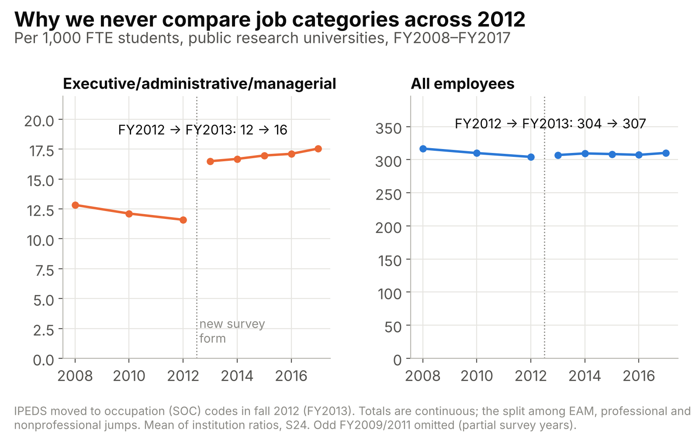{fig-alt="Figure A1" .cs-fig}

**Figure A1. The FY2012|FY2013 IPEDS HR redesign at public research universities.** EAM per 1,000 FTE students jumps at the break while total employees per 1,000 is continuous. *Source: `bloat/substack/output/P1_per1000_annual_S24.csv`; `bloat/hr_crosswalk/output/break_markers.csv`.* Interactive version: [Sector trends → EAM, public research](../sector-trends/?m=eam&sector=pr).

### A.4 Finance (`bloat/finance_layer`, `bloat/cost_share`)

- **The brief's formulas, recovered exactly from DCP.**
  - Average annual % change = CAGR of the sector's unweighted mean of real institution values.
  - Deflator: CPI-U averaged over July–June.
  - Salaries per FTE employee exclude graduate assistants.
  - Tuition is in-state (in-district for community colleges).
- **Breaks.**
  - The IPEDS salary survey average steps +1.5% at FY2013, so extension windows start in FY2013.
  - Operations and maintenance salaries leave the functional detail at FY2016. Total salaries use the O&M-stripped series, which still steps about 1% at FY2016.
  - Functional benefits end at FY2015.
- **Cost share (§4.5).** Compensation = salaries + benefits, excluding hospital, auxiliary and independent operations. E&G = core expenses less those same functions. Units that switch between GASB and FASB forms are dropped.

### A.5 Gravity population instrument (`bloat/causal` c01–c03; `enrollment_cliff/GRAVITY_POPULATION_IV.md`)

1. **Type-specific gravity.** For each institution type (control × Carnegie group, fixed at its earliest classification), state-to-campus freshman flows are fit by PPML. The model has institution × year and origin-state × year effects, a Head–Mayer effective distance and an own-state premium. For mostly in-state public types, within-state distance decay is calibrated from Georgia county-of-origin data, which we flag as a calibration.
2. **Shares with competition.** Each county's college-goers are allocated across every institution in proportion to attractiveness × distance. Attractiveness is calibrated so predicted base enrollment equals observed, for all three base windows. The exposure share s\_ci is the institution's predicted share of its freshmen from county c.
3. **Shifts.** Change in each county's 10-year-old population aged forward eight years (SEER single-year ages, 1969–2024), harmonized to stable county areas. Variants use births 18 years earlier, exclude the institution's own commuting zone, or use the 2000–04 base.
4. **Groups.** Campus instruments combine into group instruments through predicted enrollment: Ê\_Gt = Σ\_i E\_ib exp(Z\_it), and Z\_Gt = ln(Ê\_Gt / Σ\_i E\_ib).
5. **Cycle.** National unemployment (BLS LAUS) enters with sector-specific coefficients estimated from sector time series, 1990–2024. Local unemployment weighted like recruiting barely moves enrollment within sector × year (−0.0008, SE 0.006).

### A.6 Decompositions

- **Staff vs students (§5.2).** Δln(S/E) = ΔlnS − ΔlnE. Unweighted versions average institution log changes, for which the identity holds exactly for the means. Weighted versions use log changes in group totals.
- **Compensation (§4.5).** Δln(C/E) = Δln(C/L) + Δln(L/E), with L = FTE employees.
- **Enrollment (§6.3).** Population = π̂ΔZ with π̂ from the first stage. Cycle = sector coefficient × Δ national unemployment. Residual = the rest.
- **Staff per student (§6.4).** Pooled elasticities β\_p = 0.70 and β\_o = 0.57 applied to each institution's population and other enrollment change. "Beyond enrollment" = actual staff change minus predicted. Sector splits apply pooled elasticities to sector enrollment changes and are approximate.

### A.7 Online and dual enrollment (`bloat/online`, `bloat/causal` e01)

- **Online FTE.** Online FTE = exclusively-online headcount × (FT + f·PT)/(FT + PT), with f the part-time factor. On-campus FTE = fall FTE − online FTE. A lower-bound variant assigns online students to part time first.
- **Dual enrollment.** The proxy is undergraduates under 18 in odd falls, when age detail is mandatory, converted to FTE at the part-time factor.
- **National online providers (§6 box).**
  - Rule: at least 3,000 fully online students, mostly out of state, and at least 90% of students online. COVID falls are not used to classify.
  - State exposure = base share of first-time students attending these providers × their national growth.

### A.8 Enrollment-facing staff, amenities and athletics (`bloat/causal` f01–f02, g01–g04; `data/external/athletics`)

- **Staff.** Enrollment-facing = EAP 270 + 330 + 360, non-medical FTE (FT + PT/3), from FY2015.
- **Spending.**
  - Amenity = student services + auxiliary enterprises.
  - Academic = instruction + academic support.
  - Non-instructional = amenity + academic support + institutional support.
- **Athletics.**
  - EADA total operating expense excluding athletic aid (with aid as a variant), from the EADA institution files 2006–07 to 2023–24, matched to IPEDS groups.
  - Coaches = EADA head + assistant coach FTE.
  - Division I public subsidy from the USA Today NCAA finance data.
- **Payoff regressions (§8.4).**
  - Model: Δln first-time students FY2019–24 on Δln real spending per student FY2015–19.
  - Controls: the population instrument's change in both windows and the prior own enrollment trend, with sector effects.
  - SEs clustered by state.

### A.9 Size and staffing

The quadratic in log FTE is estimated two ways: across institutions (sector × year effects) and within (institution + year effects). The cross-sectional minimum is about 15,000 FTE for all staff (95% interval 9,000–24,000; 8% of observations above it) and about 29,000 for EAM + professional staff (14,000–63,000; 2% above).

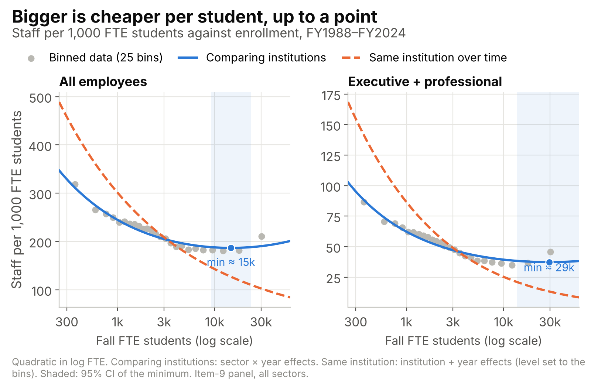{fig-alt="Figure A2" .cs-fig}

**Figure A2. Staff per 1,000 FTE students against enrollment: binned data with quadratic fits across and within institutions.** *Source: `bloat/models/output/D_enrollment_quadratic.csv`, `D_enrollment_binscatter.csv`.* Interactive version: [Institution explorer](../institution-explorer/).

## Appendix B. Robustness {#app-b}

The main conclusions hold across the alternatives we tried. The exceptions are flagged: category-level staffing elasticities, which is why the national "sticky administrators" claim is withdrawn, and the size of the cycle term.

**Table B1. Robustness of the main results**

| Result | Main estimate | Alternative | Alternative estimate |
| --- | --- | --- | --- |
| Total-staff elasticity (§6.1) | 0.72 (0.10) | State × year effects / base 2002 / births / excl. own CZ | 0.76 / 0.73 / 0.69 / 0.66 |
| Total-staff elasticity, weighted by FTE | 0.72 | Gravity instrument, FTE-weighted | 0.70 (0.11) |
| Sector elasticities (§6.2) | 0.88 / 0.70 / 0.65 | Base 2002 | 0.99 / 0.67 / 0.66 |
| Pooled EAM + professional elasticity | not reported | Base 1987 vs base 2002 | 0.24 (0.44) vs 0.86 (0.14): not robust, withdrawn |
| Population vs other response (§6.4) | 0.70 vs 0.57 | State × year effects | 0.48 vs 0.57 (ordering reverses) |
| Elasticity with local unemployment control | 0.72 | Blended instrument + LAUS control | 0.75 |
| Staff per student, FY2013–24 (§5.2) | +12.6 (total FTE) | Pre-COVID FY2013–20 | +9.9 (on-campus +15.8) |
| Staff per on-campus student (§5.3) | +29.9 | Online students counted part time first | +23.4 |
| Compensation per student (§4.5) | +13.2 | Excluding WGU, SNHU, Liberty | +13.3 |
| Public comp-share change (§4.5) | +4.3 pp (O&M stripped) | O&M kept | +1.7 pp |
| R&D within-institution (§7) | 0.074 | Adding public master's / balanced HERD filers / finance controls / without AMCs | 0.031 / 0.087 / 0.072 / 0.055 |
| R&D shift-share first-stage F (§7) | 1.27 (agency), 1.28 (field) | Without AMCs / AMCs only | 0.22 / 1.95 (agency) |
| Amenity payoff, private MA/BA (§8.4) | 0.28 (0.11) | Same on the EADA sample | 0.28 (0.11) |

*Sources: `bloat/causal/output/c_panel_iv.csv`, `d_staff_by_sector.csv`, `c_staff_response.csv`, `b_shock_laus_panel_iv.csv`; `bloat/online/output/D2_decomposition_headline.csv`; `bloat/cost_share/output/T3_decomposition_fy2013_2024.csv`; `bloat/models/output/T_robustness.csv`; `bloat/amc/output/D1_item9_amc_coefficients.csv`, `D2_first_stage_amc.csv`; `bloat/causal/output/g_spending_payoff.csv`.*

**Instruments that failed.** Two designs did not work, and we report them so they are not mistaken for findings.

- **The R&D shift-share (11a).** Agency design: base FY2003–05, panel FY2006–2024. Field design: 12 fields, base FY1988–90.
  - First-stage F is about 1.3 for both, and the 2SLS confidence sets are unbounded.
  - With only about four effective agencies and HHS dominant, common shocks are absorbed by base federal share × year.
  - The field design fails pre-trend and placebo tests.
  - Agricultural-sciences exposure alone is strong (F = 10.9) but exploratory.
- **State-share population instruments.** Built from an institution's observed state-of-origin shares, they lose all power once state × year effects are included (F < 1).

**Earlier claims superseded.**

- An earlier pass (item 10) said the post-2012 rise in staff per student was "all falling enrollment." That holds for the unweighted accounting identity, but §6.4 replaces it as an explanation.
- The item-11b finding of sticky executive and professional staff nationwide is withdrawn (§6.2).
- The item-9 check that dropped Johns Hopkins was moot, because Hopkins is trimmed from that panel in most years.
- Program closures and state policy were explored and dropped as explanations; they are not findings here.

## Appendix C. Verification {#app-c}

Every number in this paper, the companion posts and the interactive site was checked against the analysis outputs by an agent that did not produce them. Every analysis step behind it had been independently re-estimated when it was built.

| Step | What was re-checked independently | Result |
| --- | --- | --- |
| Replication (items 3–5) | Set sizes, App. Table 1, extension growth rates | Matched exactly |
| Item 9 drivers | 42 headline coefficients with an independent estimator | Coefficients and Ns exact; SEs within 0.03% |
| Item 10 decomposition and dashboard | Every draft number, table cell and dashboard value | Matched after rounding fixes |
| 11a–11e (research IV, online, cost share, AMCs) | 33 headline numbers with an independent numpy estimator | 32 exact; the remaining gap explained by a chained base |
| 11b gravity instrument and decomposition | Group instruments, first stage, 2SLS, long difference, every decomposition term | Exact; one trend-interval issue found and fixed |
| 11b-h to 11b-k (sectors, online providers, dual enrollment, enrollment-facing staff, country club, athletics) | Every checked statistic | Matched to six decimals |
| This paper, posts and site (item 12) | All tables, all text numbers, figure values, site KPIs (79 values), every deep link and external citation | 5 errors and about 20 wording, rounding and link issues found; all corrected in this version |

The item-12 check's corrections included:

- the sector range of enrollment-facing staff's share of the per-student rise;
- the timing of national online providers' growth;
- a site statement about hospital staff that contradicted §7.2;
- a site description of the 2014 brief's findings;
- the site's description of fall FTE;
- wording on medical centers, Johns Hopkins's sample status and the finance replication.

## Appendix D. Data sources, code and references {#app-d}

**Data**

| Source | Used for | Years |
| --- | --- | --- |
| [IPEDS](https://nces.ed.gov/ipeds/datacenter/DataFiles.aspx): Fall Staff, Human Resources (EAP, SAL), Fall Enrollment (A, B, C), 12-month enrollment, Finance (F1A/F2), Institutional Characteristics, Completions, Distance Education | Staff, students, spending, tuition, online, age | 1987–2025; FY2024–25 provisional |
| [IPEDS Analytics: Delta Cost Project Database 1987–2012](https://nces.ed.gov/Ipeds/use-the-data/delta-cost-project-finance-data) (NCES 2015-091) | Replication benchmark | 1987–2012 |
| [NSF NCSES HERD survey](https://ncses.nsf.gov/surveys/higher-education-research-development) | R&D by source, agency and field; medical schools | FY1972–2024 |
| [SEER county population by single year of age](https://seer.cancer.gov/popdata/) | Population instrument | 1969–2024 |
| [Autor–Dorn county–commuting zone crosswalk](https://www.ddorn.net/data.htm) | Commuting zones | 1990 |
| [BLS Local Area Unemployment Statistics](https://download.bls.gov/pub/time.series/la/) | Business cycle | 1990–2025 |
| [EADA](https://ope.ed.gov/athletics/) institution files | Athletic expenses, coaches | 2006–07 to 2023–24 |
| USA Today NCAA finances (Division I public) | Athletic subsidy and revenue | Various years |
| CPI-U, July–June fiscal-year average (equal to DCP `cpi_index`) | Deflator | 1987–2025 |

**Code.** All analysis is in the private repository `davidhummels/clauderesearch`, folder `bloat/`:

- `phase0`, `hr_crosswalk`, `staffing_panel`, `finance_layer`, `exhibits`: replication and extension;
- `majors`, `herd`, `freshman_geography`, `models`: §7;
- `substack`, `online`, `cost_share`, `amc`: §4–§5 and §7;
- `causal`: §6 and §8;
- `whitepaper/01_figures.py`: this paper's figures;
- `web_export/export_site_data.py`: every CSV on the companion site.

The companion site's data are public aggregates only.

**References**

- Archibald, R. B., & Feldman, D. H. (2008). Explaining increases in higher education costs. *Journal of Higher Education* 79(3): 268–295. [doi:10.1080/00221546.2008.11772099](https://doi.org/10.1080/00221546.2008.11772099)
- Autor, D. H., & Dorn, D. (2013). The growth of low-skill service jobs and the polarization of the US labor market. *American Economic Review* 103(5): 1553–1597. [doi:10.1257/aer.103.5.1553](https://doi.org/10.1257/aer.103.5.1553)
- Borusyak, K., Hull, P., & Jaravel, X. (2022). Quasi-experimental shift-share research designs. *Review of Economic Studies* 89(1): 181–213. [doi:10.1093/restud/rdab030](https://doi.org/10.1093/restud/rdab030)
- Desrochers, D. M. (2014, Feb. 5). Is "admin bloat" behind the high cost of college? AIR blog. [air.org](https://www.air.org/resource/blog-post/admin-bloat-behind-high-cost-college)
- Desrochers, D. M., & Kirshstein, R. (2014). *Labor Intensive or Labor Expensive? Changing Staffing and Compensation Patterns in Higher Education.* Delta Cost Project at American Institutes for Research. [PDF](https://highered.colorado.gov/sites/highered/files/2020-03/deltacostair_staffing_brief.pdf)
- Desrochers, D. M., & Sun, J. (2015). *IPEDS Analytics: Delta Cost Project Database 1987–2012* (NCES 2015-091). National Center for Education Statistics. [nces.ed.gov](https://nces.ed.gov/Ipeds/use-the-data/delta-cost-project-finance-data)
- Desrochers, D. M., & Wellman, J. V. (2011). *Trends in College Spending 1999–2009.* Delta Cost Project. [ERIC ED539420](https://eric.ed.gov/?id=ED539420)
- Fink, J. (2024, Aug. 26). How many students are taking dual enrollment courses in high school? Community College Research Center. [ccrc.tc.columbia.edu](https://ccrc.tc.columbia.edu/easyblog/how-many-students-are-taking-dual-enrollment-courses-in-high-school-new-national-state-and-college-level-data.html)
- Ginsberg, B. (2011). *The Fall of the Faculty: The Rise of the All-Administrative University and Why It Matters.* Oxford University Press. [Inside Higher Ed interview](https://www.insidehighered.com/news/2011/07/14/fall-faculty)
- Goldsmith-Pinkham, P., Sorkin, I., & Swift, H. (2020). Bartik instruments: What, when, why, and how. *American Economic Review* 110(8): 2586–2624. [doi:10.1257/aer.20181047](https://doi.org/10.1257/aer.20181047)
- Grawe, N. D. (2018). *Demographics and the Demand for Higher Education.* Johns Hopkins University Press. [JHU Press](https://www.press.jhu.edu/books/authors/nathan-d-grawe)
- Greene, J. P., Kisida, B., & Mills, J. (2010). *Administrative Bloat at American Universities: The Real Reason for High Costs in Higher Education.* Goldwater Institute. [goldwaterinstitute.org](https://goldwaterinstitute.org/article/administrative-bloat-at-american-universities-the/)
- Hedrick, D. W., Wassell, C. S., & Henson, S. E. (2009). Administrative costs in higher education: How fast are they really growing? *Education Economics* 17(1): 123–137. [doi:10.1080/09645290701523184](https://doi.org/10.1080/09645290701523184)
- Hill, R. C., & Martin, R. E. (2012). Measuring Baumol and Bowen effects in public research universities. LSU Department of Economics Working Paper 2012-05. [RePEc](https://ideas.repec.org/p/lsu/lsuwpp/2012-05.html)
- Jacob, B., McCall, B., & Stange, K. (2018). College as country club: Do colleges cater to students' preferences for consumption? *Journal of Labor Economics* 36(2): 309–348. [doi:10.1086/694654](https://doi.org/10.1086/694654); [NBER w18745](https://www.nber.org/papers/w18745)
- Lederman, D. (2011, Nov. 28). The Delta Project moves on. *Inside Higher Ed.* [insidehighered.com](https://insidehighered.com/node/80379)
- Martin, R. E. (2009). The revenue-to-cost spiral in higher education. John William Pope Center for Higher Education Policy. [jamesgmartin.center](https://jamesgmartin.center/?p=2196)
- NCES. Archived changes, 2012–13 (IPEDS HR redesign). [nces.ed.gov](https://nces.ed.gov/ipeds/report-your-data/archived-changes/2012-13)
- NCES. Timing of IPEDS data collection, coverage and release cycle. [nces.ed.gov](https://nces.ed.gov/Ipeds/use-the-data/timing-of-ipeds-data-collection)
